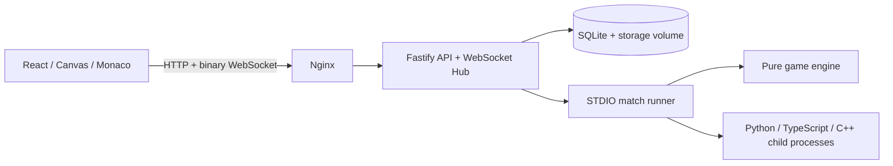

# OanTuTi Arena

Nền tảng thi đấu bot Oẳn Tù Tì: engine TypeScript, runner STDIO NDJSON, Fastify API/WebSocket, replay Protobuf và giao diện React/Canvas với Monaco Editor.

> **Phạm vi vận hành:** dành cho môi trường nội bộ và mã bot đáng tin cậy. Docker Compose dưới đây đóng gói ứng dụng, **không cô lập riêng từng bot**. API hiện chưa có xác thực/phân quyền; bot được chạy bằng tiến trình con cùng container server. Không công khai dịch vụ nhận code lên Internet. Không có Security Pentest trong phạm vi bàn giao này.

## 1. Chạy bằng Docker Compose

Yêu cầu Docker Engine và Docker Compose v2. Chạy từ thư mục gốc repository:

```bash
docker compose up --build -d
```

Mở **http://localhost:3000**. Nginx phục vụ SPA và chuyển tiếp `/api/` cùng `/ws/` tới server. Cổng API 3001 chỉ được expose trong mạng Compose, không publish ra máy host. Web mặc định chỉ bind localhost.

Nếu cổng 3000 đang dùng:

```bash
WEB_PORT=3300 docker compose up --build -d
```

Server dùng Node.js 24, Python 3 và G++ hỗ trợ C++20; chạy dưới tài khoản `node`, không phải root. Web dùng build Vite multi-stage và Nginx. Compose chờ healthcheck server trước khi khởi động web.

### Vận hành

```bash
docker compose ps
docker compose logs -f server web
curl --fail http://localhost:3000/api/health

# Khởi động lại; giữ database, bot sources và replay
docker compose restart

# Cập nhật sau khi sửa mã nguồn
docker compose up --build -d

# Dừng và gỡ container/mạng; giữ volume dữ liệu
docker compose down
```

`docker compose down -v` **xóa volume và dữ liệu**; không dùng khi muốn giữ lịch sử trận đấu.

### Lưu trữ và sao lưu

Named volume `arena-storage` được mount tại `/app/storage`, gồm:

| Đường dẫn trong container | Dữ liệu |
| --- | --- |
| `/app/storage/arena.sqlite` | Bot registry, ELO, trận đấu, giải đấu, metadata và replay BLOB |
| `/app/storage/bots/` | Mã bot nộp qua API/IDE |
| `/app/storage/replays/` | Tệp replay `.oantuti` |

Dữ liệu volume được giữ khi container được tạo lại. Không chỉ sao lưu các tệp replay: cần cả database và bot sources.

Để có bản sao nhất quán, chờ các trận/giải đấu hoàn tất rồi dừng server trước khi copy:

```bash
docker compose stop server
docker compose cp server:/app/storage ./arena-backup
docker compose start server
```

Khôi phục vào cùng đường dẫn storage, giữ quyền ghi của UID/GID 1000 (`node`). Named volume rỗng được Docker khởi tạo từ thư mục storage trong image; bind mount do người dùng tự tạo cần quyền phù hợp.

## 2. Chạy local không Docker

Yêu cầu Node.js 24, npm, Python 3, G++ có C++20. `node:sqlite` được sử dụng ở server. Chạy các lệnh từ thư mục gốc để đường dẫn map, SDK và bot đúng.

```bash
npm ci

# Terminal 1: lưu database trên đĩa
mkdir -p storage
DB_LOCATION=./storage/arena.sqlite npx tsx packages/server/src/index.ts

# Terminal 2: Web dev server + proxy API/WebSocket
npm run dev --workspace=@oantuti/web
```

Web: `http://localhost:3000`; API local: `http://localhost:3001`.

| Biến môi trường server | Mặc định local | Compose |
| --- | --- | --- |
| `PORT` | `3001` | `3001` |
| `HOST` | `0.0.0.0` | `0.0.0.0` |
| `DB_LOCATION` | Database trong RAM nếu không đặt | `/app/storage/arena.sqlite` |

Database trong RAM mất toàn bộ registry/ELO/lịch sử khi server dừng. Thư mục cha của `DB_LOCATION` phải tồn tại và ghi được. Không thay `PORT` riêng trong Compose nếu chưa cập nhật Nginx và healthcheck tương ứng.

## 3. Giao diện sử dụng

- **New Match:** chọn map và hai bot để chạy trận trên server.
- **Bot IDE:** soạn Python hoặc TypeScript, Save để đăng ký bot; Run Test đăng ký phiên bản code hiện tại rồi chạy đối kháng trên server. Đây không phải môi trường thực thi offline trong WebWorker.
- **Match Logs:** xuất hiện theo lượt đang trình chiếu; Reset Logs quay về lượt 0.
- **Timeline:** Play/Pause, bước tới/lùi, tua và tốc độ 1x/2x/5x/10x.
- **Load .oantuti Replay:** tải replay và dựng lại bàn cờ.
- **Leaderboard → Tournaments:** tạo giải và xem bảng điểm, danh sách trận, replay từng trận.

Monaco Editor hiện tải tài nguyên từ CDN; font từ Google Fonts. Dùng IDE cần trình duyệt truy cập được các dịch vụ đó. Nếu server đã chạy trước khi sửa mã backend, cần khởi động lại server; Vite chỉ cập nhật frontend.

## 4. Luật chơi

Mỗi quân đi một ô theo 8 hướng vua trên các ô hợp lệ. Không đi vào đồng minh, quân địch cùng loại hoặc quân khắc chế mình.

| Quân | Ăn | Thua |
| --- | --- | --- |
| Búa — nắm đấm | Kéo | Bao |
| Kéo — hai ngón chữ V | Bao | Búa |
| Bao — bàn tay xòe | Búa | Kéo |

Các điều kiện kết thúc: tuyệt diệt một chủng loại của đối phương, chiếm hoàng tòa đối phương, đối phương hết nước đi, hoặc bot phạm quy/quá giờ/crash. Giới hạn mặc định 300 lượt; khi chạm giới hạn, phân định theo quân số rồi điểm tiếp cận hoàng tòa, cuối cùng hòa.

## 5. Viết bot Python, TypeScript, C++20

Giao thức STDIO NDJSON: nhận một JSON trên mỗi dòng stdin; trả đúng một JSON kết thúc bằng newline trên stdout. `INIT` yêu cầu `{"status":"READY"}` trong 1.000ms. `TURN` yêu cầu `{"action":"MOVE","piece_id":1,"target":[2,3]}` trong ngân sách 100ms (runner có 5ms grace). Log debug viết vào stderr, không stdout.

SDK mẫu:

| Ngôn ngữ | SDK | Điểm vào bot mẫu |
| --- | --- | --- |
| Python | `sdk/python/oantuti.py` | `sdk/python/starter_bot.py` |
| TypeScript | `sdk/typescript/oantuti.ts` | `sdk/typescript/starter_bot.ts` |
| C++20 | `sdk/cpp/oantuti.hpp` | `sdk/cpp/starter_bot.cpp` |

Python: kế thừa `Bot`, override `on_init(ctx)` và `on_turn(ctx)`, dùng `ctx.get_legal_moves()`, rồi gọi `.run()`.
TypeScript: triển khai `BotHandler`, dùng `ctx.getLegalMoves()`, gọi `runBot(handler)`.
C++20: kế thừa `oantuti::Bot`, override `on_init` và `on_turn`, trả `std::optional<MoveAction>`, gọi `.run()`.

```bash
# Đấu bằng SDK; runner tự biên dịch .cpp nếu chưa có binary hoặc source mới hơn
npm run match:play -- \
  --map docs/specs/maps/sample-donut.map.json \
  --white sdk/python/starter_bot.py \
  --black sdk/cpp/starter_bot.cpp \
  --replay /tmp/python-vs-cpp.oantuti

# Sau khi sửa header C++, tự biên dịch lại để tránh binary cũ
# (cơ chế hiện tại chỉ so mtime file .cpp)
g++ -std=c++20 -O3 -I sdk/cpp sdk/cpp/starter_bot.cpp -o sdk/cpp/starter_bot
```

Binary được tạo cạnh source nên thư mục đó cần quyền ghi. SDK/header phải đi kèm khi bot import/include chúng; code inline trong IDE nên tự chứa các thành phần cần thiết.

## 6. Kiến trúc repository



- `packages/engine`: topology, trạng thái, luật, mô phỏng seeded fuzzing.
- `packages/protocol`: Protobuf codec, bitmask map, framing 5 byte, replay `OANTUTI1`.
- `packages/runner`: handshake, timeout, child processes, CLI.
- `packages/server`: API, WebSocket catch-up, SQLite, giải đấu/ELO.
- `packages/web`: visualizer, playback, editor và bảng xếp hạng.
- `sdk/`: SDK và bot mẫu đa ngôn ngữ.
- `docs/specs/`: thiết kế chi tiết; một số hạng mục mô tả mục tiêu dài hạn, không đồng nghĩa đã nghiệm thu.

## 7. API chính

| Endpoint | Chức năng |
| --- | --- |
| `GET /api/health` | Healthcheck |
| `GET /api/maps`, `GET /api/maps/:id` | Map catalog và descriptor |
| `GET /api/bots`, `POST /api/bots` | Registry bot |
| `POST /api/matches` | Chạy trận với `mapId`, `whiteBotId`, `blackBotId`, `maxTurns` |
| `GET /api/matches/:id` | Trạng thái/kết quả |
| `GET /api/matches/:id/replay` | Download replay nhị phân |
| `GET /api/leaderboard` | ELO |
| `GET /api/tournaments`, `POST /api/tournaments` | Danh sách/tạo giải |
| `GET /api/tournaments/:id` | Bảng điểm và các trận |
| `WS /ws/matches/:matchId` | INIT → DELTA → END, có catch-up |

Giải Round-Robin tính 3 điểm/thắng, 1 điểm/hòa; Double Round đổi phe lượt về. **Lựa chọn Swiss hiện vẫn dùng lịch Round-Robin trong implementation**, chưa có ghép cặp theo điểm từng vòng; không dùng nhãn đó để nghiệm thu Swiss.

## 8. Kiểm tra

```bash
npm test
npm run test:engine
npm run test:runner
npm run test:protocol
npm run test:web
npm run test:server
npm run build --workspace=@oantuti/web
npm run test:load
```

Fuzz suite so sánh SHA-256 canonical trace của các lần chạy cùng seed trên cùng runtime; chưa chứng minh tính đồng nhất trên mọi CPU/runtime hay SHA-256 toàn bộ replay `.oantuti`.
Load benchmark hiện là phép đo ngắn trên loopback, client/server cùng tiến trình: không thay thế soak test 60 phút, kiểm tra memory leak dài hạn hoặc đo qua mạng thật. Không lấy một lần chạy làm chứng nhận SLA production.

Đợt kiểm tra đóng gói Docker đã thực thi: build cả hai image; Nginx `nginx -t`; hai service healthy; trận Python/C++, TypeScript và bot Python nộp qua API; nhận INIT/DELTA/END qua WebSocket proxy; tải replay; tạo lại container và đối chiếu SHA-256 replay cùng registry/kết quả. Kiểm tra trên trình duyệt xác nhận New Match nạp map/bot và trình chiếu lượt 1/13 với một dòng log. `npm test` đạt 74/74 tests trong lần kiểm tra này.

Nếu máy báo `docker: unknown command: docker compose`, cần cài Docker Compose v2 plugin theo hệ điều hành hoặc dùng standalone Compose v2. Lần smoke test dùng standalone `/tmp/oantuti-docker-compose` vì host chưa có plugin; không thay đổi cài đặt Docker của host.

## 9. Giới hạn trước khi triển khai công khai

Cần xác thực/phân quyền, HTTPS ở reverse proxy ngoài, giới hạn tài nguyên và sandbox riêng cho bot không tin cậy. API cho phép đăng ký mã nguồn/file path và chạy tiến trình; chỉ mở cho người dùng đáng tin cậy. Compose không mount Docker socket, không dùng privileged mode và không tự fallback thành một sandbox an toàn.

`npm ci` trong image hiện báo 8 dependency vulnerabilities (2 low, 3 moderate, 1 high, 2 critical). Chưa thực hiện dependency upgrade hay Security Pentest; không xem build thành công là chứng nhận bảo mật.
