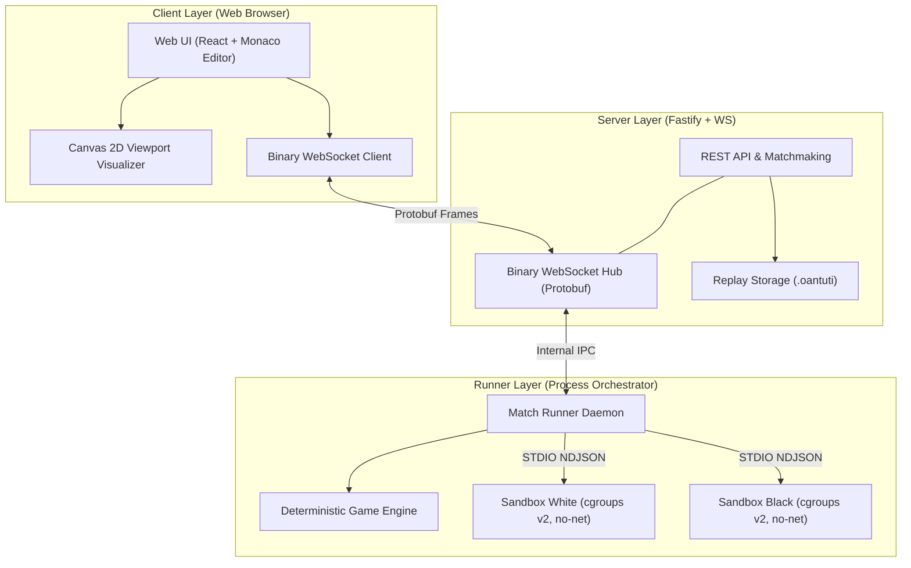

# OanTuTi Arena (Battlecode Platform)

[](./docs/specs)
[](./docs/specs/proto/oantuti.proto)
[](LICENSE)

> **OanTuTi Arena** là nền tảng thi đấu lập trình Bot AI tự động (Competitive Coding Platform) lấy cảm hứng từ MIT Battlecode, kết hợp giữa chiều sâu chiến thuật của Cờ Vua (Chess) và cơ chế ngũ hành khắc chế quen thuộc của Oẳn Tù Tì (Rock - Scissors - Paper).

---

## 1. Tổng Quan Dự Án & Luật Chơi

OanTuTi Arena cho phép người chơi lập trình thuật toán Bot AI bằng nhiều ngôn ngữ (Python, TypeScript, C++, Go, Java,...), sau đó thi đấu trực tiếp trên môi trường máy chủ cô lập an toàn (Docker/cgroups sandbox).

### 1.1. Bản Đồ Tọa Độ Tổng Quát (Generalized Arbitrary Topology Grid)
Bàn cờ được mô hình hóa toán học dưới dạng **đồ thị lưới tọa độ tổng quát** $G = (V, E)$, với tập ô hợp lệ $V \subset \mathbb{Z}^2$ tùy ý (hỗ trợ từ bàn cờ hình chữ nhật, hình xuyến donut có lỗ thủng, đa giác bất đối xứng, đến quần đảo rời rạc). Hai ô kề nhau nếu di chuyển được theo 8 hướng vua ($\max(|x_1 - x_2|, |y_1 - y_2|) = 1$).

### 1.2. Cơ Chế Oẳn Tù Tì Khắc Chế & Cản Đường
- **Búa (Rock - R):** Ăn Kéo ($S$), Thua Bao ($P$).
- **Kéo (Scissors - S):** Ăn Bao ($P$), Thua Búa ($R$).
- **Bao (Paper - P):** Ăn Búa ($R$), Thua Kéo ($S$).
- **Cản đường (Blocking Invariant):** Hai quân cờ cùng loại (ví dụ Búa gặp Búa) không thể ăn nhau và tạo thành vật cản không thể đi xuyên qua.

### 1.3. 4 Điều Kiện Thắng Tuyệt Đối
1. **Tuyệt Diệt Chủng Loại (Species Extinction Win):** Ăn sạch toàn bộ 1 trong 3 chủng loại quân của đối phương (ví dụ đối phương mất sạch quân Kéo $\implies$ Ta thắng).
2. **Chiếm Ô Chốt (Throne Breach Win):** Đưa bất kỳ quân nào của phe mình tiến vào ô chốt hoàng tòa đối phương ($T_W$ hoặc $T_B$).
3. **Bế Tắc Nước Đi (Stalemate Win):** Đối phương không còn bất kỳ nước đi hợp lệ nào vào lượt của họ.
4. **Xử Phạt / Hết Giờ (Disqualification / Timeout):** Bot đối phương vượt quá thời gian (100ms/turn), crash hoặc đưa ra nước đi sai luật.

---

## 2. Kiến Trúc Hệ Thống (High-Level Architecture)



---

## 3. Mục Lục Bộ Tài Liệu Đặc Tả Kỹ Thuật (SDLC Package)

Toàn bộ gói tài liệu thiết kế chi tiết được đặt tại thư mục [`docs/specs/`](./docs/specs/):

| STT | Tài Liệu | Nội Dung Chính | Trạng Thái |
|:---:|:---|:---|:---:|
| **01** | [01-PRD-GDD.md](./docs/specs/01-PRD-GDD.md) | Yêu cầu sản phẩm, Game Design Document, luật toán học $G = (V, E)$, điều kiện thắng | Approved |
| **02** | [02-SYSTEM-ARCHITECTURE.md](./docs/specs/02-SYSTEM-ARCHITECTURE.md) | Kiến trúc Monorepo, Seams, cơ chế bảo mật sandbox cgroups v2, Docker isolation | Approved |
| **03** | [03-NETWORK-PROTOCOL-SPEC.md](./docs/specs/03-NETWORK-PROTOCOL-SPEC.md) | Giao thức WebSocket nhị phân, Protobuf schema, nén delta, định dạng tệp `.oantuti` | Approved |
| **04** | [04-BOT-RUNNER-IPC-SPEC.md](./docs/specs/04-BOT-RUNNER-IPC-SPEC.md) | Giao tiếp STDIO NDJSON, Turn budget 100ms, mã lỗi, SDK mẫu Python/TS/C++ | Approved |
| **05** | [05-DATA-MODELS-DATABASE-SPEC.md](./docs/specs/05-DATA-MODELS-DATABASE-SPEC.md) | Sơ đồ ERD, DDL SQL PostgreSQL/SQLite, cấu trúc dữ liệu RAM của GameState | Approved |
| **06** | [06-UI-UX-VISUALIZER-SPEC.md](./docs/specs/06-UI-UX-VISUALIZER-SPEC.md) | Thuật toán Camera Viewport Transform, Canvas 2D render loop, Monaco Editor | Approved |
| **07** | [07-TEST-PLAN-QA-SPEC.md](./docs/specs/07-TEST-PLAN-QA-SPEC.md) | Kế hoạch kiểm thử tự động, Fuzzing Determinism test, tải WebSocket, Security test | Approved |
| **08** | [08-PROJECT-ROADMAP-WBS.md](./docs/specs/08-PROJECT-ROADMAP-WBS.md) | Kế hoạch triển khai 5 Phase, phân rã công việc WBS, tiêu chí nghiệm thu | Approved |
| **-** | [proto/oantuti.proto](./docs/specs/proto/oantuti.proto) | Mã nguồn định nghĩa Protocol Buffers v3 | Verified |
| **-** | [maps/schema.json](./docs/specs/maps/schema.json) | JSON Schema đặc tả bản đồ tùy biến | Verified |

---

## 4. Hướng Dẫn Kiểm Định Tài Liệu (Automated Validation)

Dự án trang bị bộ kiểm định tự động bằng Vitest để bảo đảm tính toàn vẹn tài liệu, khả năng biên dịch schema Protobuf và tính hợp lệ của JSON Schema:

```bash
# Cài đặt dependencies
npm install

# Kiểm tra tính toàn vẹn bộ tài liệu (8 tài liệu + schemas)
npm run test:specs

# Kiểm tra biên dịch Protobuf và xác thực mẫu bản đồ
npm run test:proto

# Chạy toàn bộ test suites
npm test
```
