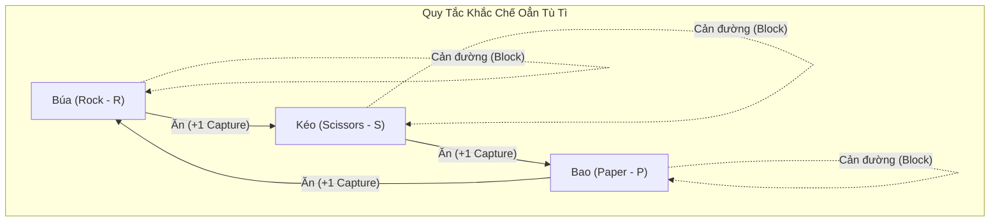
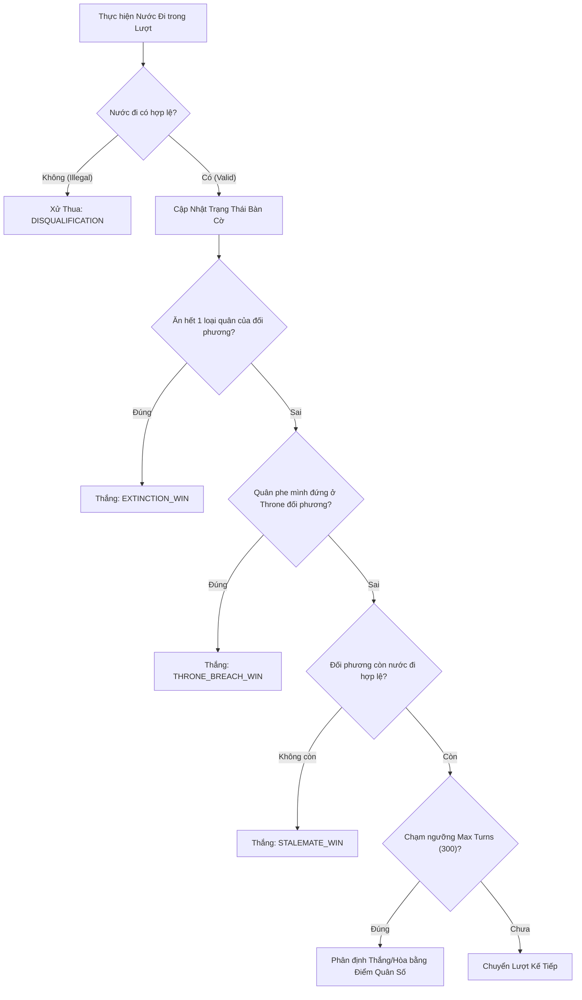

# 01 — Product Requirements Document & Game Design Document (PRD & GDD)

> **Tài liệu Đặc tả Yêu cầu Sản phẩm & Thiết kế Game (Product Requirements Document & Game Design Document)**  
> **Dự án:** OanTuTi Arena (Competitive Battlecode Platform)  
> **Phiên bản:** 1.0.0  
> **Tiêu chuẩn kỹ thuật:** SDLC Standard + Ponytail Senior Engineering  
> **Trạng thái:** Phê duyệt triển khai (Approved for Implementation)

---

## 1. Tổng Quan Sản Phẩm & Tầm Nhìn Chiến Lược (Product Overview & Vision)

### 1.1. Bối Cảnh & Định Vị
**OanTuTi Arena** là nền tảng thi đấu lập trình Bot AI tự động (Competitive Bot Programming Platform) được thiết kế theo tiêu chuẩn của các cuộc thi học thuật danh tiếng như **MIT Battlecode** và **Halite**, nhưng sở hữu luật chơi độc đáo dựa trên sự kết hợp giữa:
1. **Chiều sâu chiến thuật vị trí (Spatial & Positional Tactics)** của Cờ Vua (Chess): kiểm soát không gian, phong tỏa đường đi, bảo vệ cứ điểm trọng yếu.
2. **Cơ chế ngũ hành tương sinh tương khắc (Cyclic Superiority)** của trò chơi dân gian Oẳn Tù Tì (Rock - Paper - Scissors): không có quân cờ nào mạnh tuyệt đối, mọi ưu thế đều mang tính chu kỳ và động.

### 1.2. Đối Tượng Người Dùng & Giá Trị Cốt Lõi
- **Thí sinh / Lập trình viên AI:** Nền tảng hỗ trợ đa ngôn ngữ (Python, TypeScript, C++, Go, Java). Thí sinh có thể nhanh chóng hiện thực hóa từ các thuật toán cơ bản (Greedy, Minimax với Alpha-Beta Pruning, Monte Carlo Tree Search - MCTS) cho đến Reinforcement Learning (Q-learning, PPO) mà không bị rào cản về cơ sở hạ tầng.
- **Khán giả / Cộng đồng:** Trải nghiệm theo dõi trực tiếp các trận đấu đỉnh cao theo thời gian thực (Real-time Streaming) trên nền tảng Web thông qua Canvas 2D Visualizer mượt mà, độ trễ cực thấp (<100ms) và dung lượng truyền tải siêu tối ưu.
- **Đơn vị tổ chức giải đấu:** Hệ thống quản lý trận đấu tự động, hỗ trợ phân nhánh Swiss, Round-Robin, Double Elimination và tính toán điểm hệ số ELO chuẩn mực.

---

## 2. Mô Hình Toán Học & Thiết Kế Game (Formal Game Design & Mechanics)

### 2.1. Không Gian Trạng Thái: Đồ Thị Lưới Tọa Độ Tổng Quát (Generalized Arbitrary Topology Grid)
Hệ thống **tuyệt đối không áp đặt bất kỳ giả định nào về hình dạng bàn cờ cố định** (như bàn cờ vuông $8 \times 8$ hay chữ nhật thông thường). Bàn cờ được mô hình hóa toán học là một **Đồ thị lưới tọa độ tổng quát (Generalized Topological Grid Graph)** $G = (V, E)$:

1. **Bounding Box & Tập Ô Hợp Lệ ($V$):**
   - Không gian bao quanh bàn cờ có kích thước giới hạn $W \times H$, với $W, H \in \mathbb{N}^+$.
   - Tập hợp các ô hợp lệ (Valid Cells) là tập con tùy ý:
     $$V \subset \{ (x, y) \in \mathbb{Z}^2 \mid 0 \le x < W, \; 0 \le y < H \}$$
   - Tập $V$ có thể tạo thành:
     - Bàn cờ chữ nhật truyền thống: $V = [0, W-1] \times [0, H-1]$.
     - Bàn cờ hình xuyến (Donut) có khoảng trống rỗng ở tâm.
     - Bàn cờ chữ thập, chữ H, mê cung đa lối đi, hoặc cụm đảo rời rạc (Archipelago) kết nối qua các eo hẹp (Chokepoints).
   - Hàm đặc trưng ô hợp lệ:
     $$\chi_V(x, y) = \begin{cases} 1 & \text{nếu } (x, y) \in V \\ 0 & \text{nếu } (x, y) \notin V \text{ (vực thẳm / chướng ngại vật / ngoài bản đồ)} \end{cases}$$

2. **Tập Cạnh & Quan Hệ Kề Lân Cận ($E$):**
   - Hai ô $u = (x_1, y_1) \in V$ và $v = (x_2, y_2) \in V$ có cạnh nối $(u, v) \in E$ khi và chỉ khi chúng thỏa mãn khoảng cách Chebyshev bằng 1:
     $$d_\infty(u, v) = \max(|x_1 - x_2|, |y_1 - y_2|) = 1$$
   - Điều này tương ứng với 8 hướng di chuyển chuẩn Vua (King-move).
   - Nếu giữa $u$ và $v$ không tồn tại ô hợp lệ thuộc $V$, không có đường di chuyển nào có thể xuyên qua.

3. **Cứ Điểm Chốt (Throne / Base Objectives):**
   - Mỗi bản đồ định nghĩa linh hoạt 2 ô chốt mục tiêu:
     - Ô chốt Hoàng Tòa phe Trắng: $T_W \in V$
     - Ô chốt Hoàng Tòa phe Đen: $T_B \in V$
   - Vị trí của $T_W, T_B$ phụ thuộc vào cấu hình của từng bản đồ (`map descriptor`), không bị cố định ở các hàng biên.

### 2.2. Phân Bổ Phe & Chủng Loại Quân Cờ (Factions & Pieces)
Trận đấu diễn ra giữa 2 phe đối kháng:
- **Phe Trắng (White - $W$)** và **Phe Đen (Black - $B$)**.
- Mặc định White đi trước ở lượt $t = 1$, Black đi ở lượt $t = 2$, xen kẽ tuần tự.

Mỗi quân cờ $p$ trên bàn cờ là một bộ tuple:
$$p = \langle id, \text{owner}, \text{type}, x, y, \text{is\_alive} \rangle$$
Trong đó:
- $id \in \mathbb{N}^+$: Định danh duy nhất toàn trận đấu.
- $\text{owner} \in \{ \text{WHITE}, \text{BLACK} \}$.
- $\text{type} \in \{ \text{ROCK}, \text{SCISSORS}, \text{PAPER} \}$.
- $(x, y) \in V$: Tọa độ hiện tại của quân cờ.
- $\text{is\_alive} \in \{ \text{true}, \text{false} \}$.

### 2.3. Quy Tắc Di Chuyển (Movement Dynamics)
Ở mỗi lượt của mình, người chơi (hoặc Bot) được phép chọn **chính xác 1 quân cờ còn sống của phe mình** để thực hiện hành động di chuyển $\text{MOVE}(p, x', y')$.

1. **8 Hướng Di Chuyển Chuẩn King-Move:**
   Quân cờ di chuyển sang 1 ô lân cận với vector dịch chuyển:
   $$(\Delta x, \Delta y) \in \{ -1, 0, 1 \}^2 \setminus \{ (0, 0) \}$$
   Ô đích đến: $x' = x + \Delta x, \; y' = y + \Delta y$.

2. **Điều Kiện Hợp Lệ Của Nước Đi (Legal Move Invariants):**
   Nước đi $\text{MOVE}(p, x', y')$ hợp lệ khi và chỉ khi thỏa mãn đồng thời cả 4 bất biến:
   - **Bất biến 1 (Topology Bound):** $(x', y') \in V$ (ô đích phải nằm trong tập ô hợp lệ của bàn cờ).
   - **Bất biến 2 (Friendly Fire Invariant):** Không có quân cờ đồng minh $p_{\text{ally}}$ nào đang chiếm giữ $(x', y')$ ($\text{owner}(p_{\text{ally}}) = \text{owner}(p)$).
   - **Bất biến 3 (Blocking Invariant - Cản đường cùng loại):** Nếu ô $(x', y')$ đang có quân đối phương $p_{\text{enemy}}$, thì:
     $$\text{type}(p_{\text{enemy}}) \neq \text{type}(p)$$
     Hai quân cùng loại (Búa gặp Búa, Kéo gặp Kéo, Bao gặp Bao) không thể ăn nhau; quân đối phương đóng vai trò là một vật cản không thể đi vào.
   - **Bất biến 4 (Suicide Prevention Invariant - Cấm tự sát):** Quân ta không được đi vào ô có quân đối phương khắc chế mình:
     - Búa ($R$) cấm đi vào ô có Bao ($P$) của đối phương.
     - Kéo ($S$) cấm đi vào ô có Búa ($R$) của đối phương.
     - Bao ($P$) cấm đi vào ô có Kéo ($S$) của đối phương.

### 2.4. Ma Trận Khắc Chế & Quy Tắc Xử Lý Ăn Quân (Capture Resolution Matrix)

Hàm ưu thế Oẳn Tù Tì $\Omega: \{R, S, P\} \times \{R, S, P\} \to \{+1, 0, -1\}$ được định nghĩa:
$$\Omega(\text{att}, \text{def}) = \begin{cases} 
+1 & \text{nếu } (\text{att}, \text{def}) \in \{ (R, S), (S, P), (P, R) \} \quad (\text{Thắng / Ăn quân}) \\
0 & \text{nếu } \text{att} = \text{def} \quad (\text{Hòa / Cản đường}) \\
-1 & \text{nếu } (\text{att}, \text{def}) \in \{ (S, R), (P, S), (R, P) \} \quad (\text{Thua / Bị cản / Cấm đi})
\end{cases}$$

| Quân Tấn Công ($\downarrow$) \ Quân Bị Tấn Công ($\rightarrow$) | Búa (Rock - $R$) | Kéo (Scissors - $S$) | Bao (Paper - $P$) |
|:---|:---:|:---:|:---:|
| **Búa (Rock - $R$)** | **Cản đường (Block)** | **Ăn quân (Capture $\checkmark$)** | *Cấm đi (Illegal)* |
| **Kéo (Scissors - $S$)** | *Cấm đi (Illegal)* | **Cản đường (Block)** | **Ăn quân (Capture $\checkmark$)** |
| **Bao (Paper - $P$)** | **Ăn quân (Capture $\checkmark$)** | *Cấm đi (Illegal)* | **Cản đường (Block)** |

**Hệ quả khi ăn quân:**
- Nếu $\Omega(\text{type}(p), \text{type}(p_{\text{enemy}})) = +1$:
  - Quân $p_{\text{enemy}}$ lập tức bị tiêu diệt: $\text{is\_alive}(p_{\text{enemy}}) \leftarrow \text{false}$, bị loại khỏi bàn cờ vĩnh viễn.
  - Quân tấn công $p$ chiếm giữ tọa độ $(x', y')$.
  - Phát sinh sự kiện `CaptureEvent`.

---

## 3. Điều Kiện Thắng Tuyệt Đối & Hòa Trận (Victory & Draw Conditions)

Trận đấu kết thúc ngay lập tức tại thời điểm một trong các điều kiện sau được thỏa mãn (xét theo thứ tự ưu tiên):

### 3.1. 4 Điều Kiện Thắng Tuyệt Đối (Primary Victory Conditions)

1. **Tuyệt Diệt Chủng Loại (Species Extinction Win):**
   - Nếu tại bất kỳ thời điểm nào sau một nước đi, đối phương không còn **bất kỳ quân nào thuộc 1 trong 3 loại quân** ($R, S, P$), phe vừa đi lập tức giành chiến thắng tuyệt đối.
   - *Ý nghĩa chiến thuật:* Người chơi có thể lập bẫy tiêu diệt toàn bộ quân Kéo của đối phương. Khi đối phương hết Kéo, toàn bộ quân Bao của ta trở nên bất khả xâm phạm (vì đối phương chỉ còn Búa và Bao). Trò chơi kết thúc ngay mà không cần đợi dọn sạch bàn cờ.
2. **Chiếm Ô Chốt Hoàng Tòa (Throne Breach Win):**
   - Nếu một quân cờ của phe Trắng di chuyển vào ô chốt của phe Đen ($T_B$), phe Trắng thắng lập tức.
   - Nếu một quân cờ của phe Đen di chuyển vào ô chốt của phe Trắng ($T_W$), phe Đen thắng lập tức.
   - *Ý nghĩa chiến thuật:* Tạo áp lực buộc người chơi phải tổ chức phòng ngự chiều sâu thay vì chỉ tập trung săn lùng quân địch.
3. **Bế Tắc Nước Đi (Stalemate / No Legal Moves):**
   - Đến lượt của một phe, nhưng tập nước đi hợp lệ $\text{LegalMoves}(\text{player}) = \emptyset$ (tất cả các quân bị vây hãm, bị chặn bởi quân cùng loại hoặc đối diện quân mạnh hơn không thể di chuyển), phe đó bị xử thua ngay lập tức.
4. **Phạm Quy / Quá Giờ (Disqualification / Timeout):**
   - Bot vi phạm thời gian tính toán cho mỗi lượt ($>100$ms).
   - Bot ném ngoại lệ không xử lý (Unhandled Exception), gặp lỗi tràn bộ nhớ (Out Of Memory) hoặc crash tiến trình.
   - Bot xuất ra nước đi sai cú pháp hoặc vi phạm luật di chuyển.
   - Phe vi phạm bị xử thua do `TIMEOUT` hoặc `DISQUALIFICATION`.

### 3.2. Quy Tắc Giới Hạn Lượt & Chống Hòa (Draw Invariant & Tie-Breaking)
- **Giới hạn số lượt (Max Turns):** Mặc định $N_{\text{max}} = 300$ lượt đi (150 lượt cho mỗi bên).
- Khi chạm ngưỡng $N_{\text{max}}$, nếu chưa có bên nào đạt điều kiện thắng tuyệt đối, hệ thống kích hoạt thuật toán phân định thắng thua theo thứ tự:
  1. **Tổng quân số còn sống:** Bên nào có tổng số quân còn sống nhiều hơn $\implies$ Thắng.
  2. **Chỉ số áp sát cứ điểm (Throne Proximity Score):** Nếu tổng quân số bằng nhau, phân định bằng tổng điểm áp sát ô chốt đối phương:
     $$\text{ProximityScore}(P) = \sum_{p \in \text{pieces}(P), \text{is\_alive}(p)} \frac{10}{d_\infty(p, T_{\text{enemy}}) + 1}$$
     Trong đó $d_\infty(p, T_{\text{enemy}}) = \max(|x_p - x_T|, |y_p - y_T|)$ là khoảng cách Chebyshev đến ô chốt đối phương. Bên nào có tổng điểm tiếp cận cao hơn sẽ thắng.
  3. Nếu cả tổng quân và điểm áp sát vẫn hoàn toàn bằng nhau: Xử **Hòa Trận (Draw)**.

---

## 4. Đặc Tả Yêu Cầu Chức Năng Nền Tảng (Functional Requirements)

### 4.1. Quản Lý Trận Đấu & Xếp Hạng (Matchmaking & Tournament Engine)
- **Quick Match (1vs1 Friendly):** Đấu giao hữu giữa 2 bot bất kỳ trên bản đồ được chỉ định, hoặc đấu giữa người chơi (Human UI Control) và Bot để thử nghiệm.
- **Round-Robin Tournament:** Chấm giải đấu vòng tròn giữa $M$ bots, tính tổng điểm thắng/hòa/thua.
- **Hệ Thống Tính Điểm ELO:**
  $$R'_{\text{new}} = R + K \cdot (S - E)$$
  Với $K = 32$, cập nhật thứ hạng tự động sau mỗi trận đấu chính thức.

### 4.2. Môi Trường Thực Thi Cô Lập (Bot Sandbox Runner)
- Hỗ trợ thực thi đa ngôn ngữ độc lập:
  - Python 3.10+
  - Node.js 20+ (TypeScript compiled to JS)
  - C++ (GCC 13, C++20)
  - Java 21 LTS
  - Go 1.22
- Mỗi bot chạy trong 1 process/container cách ly hoàn toàn:
  - Cgroups v2: RAM $\le 256$MB, CPU quota 1.0 core.
  - Ngắt toàn bộ truy cập mạng (`--network none`).
  - Hệ thống tệp tin chỉ đọc (`--read-only`), ngoại trừ thư mục `/tmp` dạng memory tmpfs $\le 16$MB.
- Giao tiếp hai chiều qua STDIO (Newline-Delimited JSON).

### 4.3. Streaming Thời Gian Thực & Lưu Trữ Replay
- Trận đấu được stream nhị phân thời gian thực qua WebSockets định dạng Protocol Buffers v3.
- Toàn bộ diễn biến trận đấu được nén và đóng gói thành tệp nhị phân `.oantuti` dung lượng $< 25$ KB.
- Cho phép khán giả vào phòng xem trực tiếp bất kỳ lúc nào và nhận ngay frame đồng bộ `MatchInitFrame` + delta hiện tại.

### 4.4. Trình Trực Quan Hóa (Interactive Web Visualizer)
- Render trên Canvas 2D với tốc độ 60 FPS mượt mà.
- Camera tự động co giãn và căn giữa (Auto Viewport Fit) phù hợp với bất kỳ hình học bản đồ tùy biến nào.
- Replay Timeline Controller: Nút Play, Pause, Bước tới (Step Forward), Bước lùi (Step Backward), Nhảy tới lượt chỉ định, điều chỉnh tốc độ từ 1x đến 10x.
- Tích hợp Monaco Code Editor cho phép chỉnh sửa trực tiếp mã nguồn Bot trên trình duyệt và chạy thử nghiệm tức thì.

---

## 5. Yêu Cầu Phi Chức Năng & Chỉ Số Kỹ Thuật (Non-Functional Requirements)

| Chỉ Số | Tiêu Chuẩn Cam Kết | Cơ Chế Kiểm Định |
|:---|:---|:---|
| **Hiệu Năng Game Engine** | $\ge 50,000$ turns/giây (Headless Pure Engine) | Benchmark script đo trên 1 nhân CPU x86_64 |
| **Băng Thông WebSocket** | $\le 200$ bytes / TurnDelta Frame | Protobuf binary size assertion test |
| **Dung Lượng Replay Tệp** | $\le 25$ KB cho 1 trận đấu 150 turns | File size validation test trên sample match |
| **Thời Gian Khởi Tạo Bot** | $\le 1,000$ ms (Setup & load map) | Runner STDIO watchdog timer |
| **Thời Gian Mỗi Lượt Đi** | $\le 100$ ms / turn | High-resolution monotonic timer (`process.hrtime`) |
| **Tính Tất Định (Determinism)** | $100\%$ kết quả trùng khớp với cùng seed và bot | Hash digest kiểm tra khớp trên $10,000$ ticks |
| **Bộ Nhớ Game Engine RAM** | $\le 50$ KB per match instance | Heap profiling test trong Node.js/Fastify |
| **Khả Năng Chịu Tải WebSocket** | Phục vụ $\ge 1,000$ spectators đồng thời không lag | K6 / Artillery WebSocket load test |
