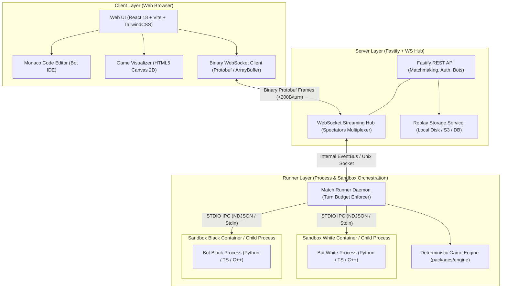
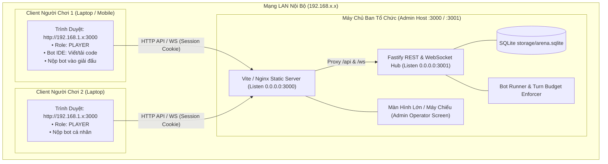
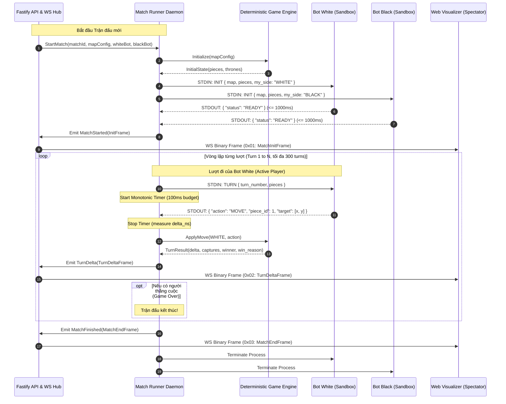
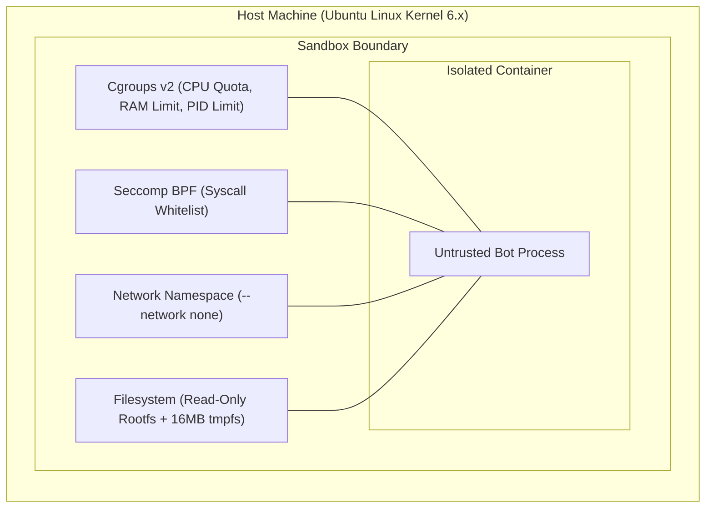

# 02 — System Architecture & Sandbox Security Specification

> **Tài liệu Đặc tả Kiến trúc Hệ thống & An ninh Sandbox (System Architecture & Sandbox Security Specification)**  
> **Dự án:** OanTuTi Arena (Competitive Battlecode Platform)  
> **Phiên bản:** 1.0.0  
> **Tiêu chuẩn kỹ thuật:** SDLC Standard + Ponytail Senior Engineering  
> **Trạng thái:** Phê duyệt triển khai (Approved for Implementation)

---

## 1. Tổng Quan Kiến Trúc Cấp Cao (High-Level Architecture Overview)

Hệ thống **OanTuTi Arena** được xây dựng theo mô hình **Modular Monorepo**, phân tách ranh giới chức năng rõ ràng (Clean Architectural Seams), bảo đảm tính độc lập tuyệt đối giữa **Logic trò chơi (Pure Engine)**, **Môi trường thực thi cô lập (Sandbox Runner)**, **Máy chủ phân phối thời gian thực (Fastify + WebSocket Hub)**, và **Giao diện trực quan hóa (Web Visualizer)**.



### 1.3. Mô Hình Mạng Nội Bộ (LAN Client-Server) & Phân Quyền RBAC (Role-Based Access Control)

Trong môi trường thi đấu nội bộ (LAN Tournament), hệ thống phân tách 2 vai trò bảo mật:



1. **Cấu hình Lắng nghe & Phân giải Tên miền Động:**
   - Fastify và Web Server lắng nghe trên toàn dải địa chỉ `0.0.0.0`.
   - Frontend tự động xây dựng đường dẫn API và WebSocket dựa trên `window.location.host` và `window.location.protocol`, không phụ thuộc vào địa chỉ IP tĩnh.
2. **Cơ chế Phân quyền 2 Tầng (RBAC Matrix):**
   - **`ADMIN` (Ban tổ chức):**
     - Tài khoản `admin` được tạo sẵn mặc định khi khởi tạo cơ sở dữ liệu (`ensureAdminUser`).
     - Quyền hạn: Tạo giải đấu (`POST /api/tournaments`), Chốt danh sách người tham gia (`POST /api/tournaments/:id/lock`), Chuyển trận trình chiếu tiếp theo trên máy chiếu (`POST /api/tournaments/:id/project-next`).
   - **`PLAYER` (Người chơi tham gia):**
     - Người chơi tự đăng ký tài khoản qua Web; hệ thống luôn gán vai trò `PLAYER`.
     - Quyền hạn: Viết/lưu/kiểm thử bot cá nhân trong Bot IDE; Nộp bot của mình vào giải đấu đang mở (`POST /api/tournaments/:id/entries`).
     - Hạn chế bảo mật: Tuyệt đối bị từ chối với mã lỗi `HTTP 403 Forbidden` khi cố gọi API tạo giải hoặc chốt danh sách; không thể xem mã nguồn bot của người khác.
3. **Cơ chế Chống Lộ Kết Quả (Anti-Spoiler Projection Gate):**
   - Khi Admin bấm chốt danh sách, giải đấu tự động chạy các trận ở nền.
   - Để tránh việc thí sinh mở inspect mạng xem trước ai vô địch, API `GET /api/tournaments/:id` đối với `PLAYER` chỉ trả về các trận đấu và bảng điểm được tích lũy đến vị trí `projectedIndex` mà Admin đã bấm chuyển trận trên máy chiếu.

---

## 2. Phân Rã Thành Phần & Trách Nhiệm Gói (Package Decomposition & Responsibilities)

Hệ thống mã nguồn được tổ chức trong thư mục `packages/`:

```
oantuti/
├── packages/
│   ├── engine/       # Pure deterministic game logic (0 dependencies)
│   ├── protocol/     # Protobuf schemas, generated types & binary serializers
│   ├── runner/       # Process orchestrator, sandbox isolation & turn timers
│   ├── server/       # Fastify HTTP REST API + WebSocket spectator hub
│   └── web/          # React SPA, Canvas 2D Visualizer & Monaco Editor
└── docs/specs/       # SDLC documentation & schemas
```

### 2.1. `packages/engine` (Core Game Engine)
- **Bản chất kỹ thuật:** Pure Finite State Machine (FSM), 100% tất định (Deterministic), hoàn toàn không chứa bất kỳ lời gọi hệ thống (Syscall), I/O tệp tin hay thư viện mạng nào.
- **Trách nhiệm cốt lõi:**
  1. **Tải & Thẩm định Bản Đồ:** Nạp định dạng bản đồ đồ thị lưới tọa độ tổng quát $G = (V, E)$ từ JSON Map Descriptor hoặc bitmask nhị phân. Kiểm tra tính liên thông của các ô, tọa độ ô chốt $T_W, T_B$, và vị trí xuất phát quân cờ.
  2. **Quản Lý Trạng Thái (`GameState`):**
     - Lưu trữ danh sách quân cờ: ID, phe (`WHITE` / `BLACK`), chủng loại (`ROCK` / `SCISSORS` / `PAPER`), tọa độ $(x, y)$, trạng thái sống/chết.
     - Đếm số lượt đi ($t = 1 \dots 300$), theo dõi phe đang đến lượt (`active_player`).
  3. **Sinh Nước Đi Hợp Lệ (`get_legal_moves(player)`):**
     - Duyệt 8 hướng lân cận King-step cho tất cả các quân còn sống của phe đang đánh.
     - Lọc nước đi theo Bất biến Bàn cờ ($(x', y') \in V$), Bất biến Đồng đội (không dẫm lên quân cùng phe), Bất biến Cản đường (cùng loại cản đường) và Bất biến Cấm tự sát (lao vào quân khắc chế mình).
  4. **Thực Thi Nước Đi (`apply_move(action)`):**
     - Cập nhật tọa độ quân cờ.
     - Xử lý ăn quân nếu có ($\Omega(\text{att}, \text{def}) = +1$): đánh dấu quân bị ăn `is_alive = false`, sinh `CaptureEvent`.
  5. **Đánh Giá Kết Quả Trận Đấu (`evaluate_winner()`):**
     - Kiểm tra Tuyệt diệt chủng loại (Species Extinction).
     - Kiểm tra Chiếm ô chốt (Throne Breach).
     - Kiểm tra Bế tắc nước đi (Stalemate).
     - Kiểm tra Chạm ngưỡng Max Turns (300 turns).
  6. **Serialization & Delta Diff:** Xuất ra snapshot đầy đủ hoặc bản cập nhật biến thiên (Turn Delta) phục vụ phát sóng.

### 2.2. `packages/protocol` (Binary Serialization & Protocol Schemas)
- **Bản chất kỹ thuật:** Shared Contract Layer, lưu trữ định nghĩa Protocol Buffers v3 (`proto/oantuti.proto`) và JSON Map Schema (`maps/schema.json`).
- **Trách nhiệm cốt lõi:**
  1. Cung cấp mã nguồn Protobuf biên dịch cho các ngôn ngữ (TypeScript via `protobufjs`, Python via `protoc`, C++).
  2. Đóng gói và giải mã Frame mạng WebSocket nhị phân (`WebSocketEnvelope`, `MatchInitFrame`, `TurnDeltaFrame`, `MatchEndFrame`).
  3. Định dạng và phân tích tệp Replay nén nhị phân siêu nhẹ (`.oantuti`).
  4. Cung cấp bộ linter & validator kiểm tra tính hợp lệ của tệp bản đồ `.map.json`.

### 2.3. `packages/runner` (Multi-Language Sandbox Match Runner)
- **Bản chất kỹ thuật:** Process Orchestrator & Execution Controller.
- **Trách nhiệm cốt lõi:**
  1. **Khởi Tạo Môi Trường Thực Thi:**
     - Spawn tiến trình Bot (Python, TypeScript, C++, Java, v.v.).
     - Thiết lập đường ống truyền thông hai chiều Standard Input / Standard Output (STDIO).
  2. **Quản Lý Vòng Lặp Trận Đấu (Turn Lifecycle Enforcer):**
     - Gửi thông điệp `INIT` và đợi `READY` (ngân sách 1000ms).
     - Luân phiên gửi `TURN` đến từng bot.
     - Khởi động đồng hồ đếm thời gian độ phân giải cao (`process.hrtime.bigint()`).
     - Đọc thông điệp phản hồi `MOVE` từ STDOUT.
     - Ép buộc giới hạn thời gian (Turn Budget Enforcer: 100ms).
  3. **Xử Lý Sự Cố & Phạt Quy Tắc (Disqualification Handler):**
     - Xử lý bot quá thời gian (`TIMEOUT`).
     - Xử lý bot crash / exception (`CRASH_FORFEIT`).
     - Xử lý bot trả về nước đi sai luật hoặc sai format (`ILLEGAL_MOVE`).
     - Chấm dứt trận đấu tức thời và báo cáo người thắng cuộc.
  4. **Dọn Dẹp Tiến Trình:** Giết sạch các tiến trình con (`SIGTERM` $\to$ 50ms $\to$ `SIGKILL`), ngăn chặn tiến trình mồ côi (Zombie Processes).

### 2.4. `packages/server` (Web & Real-Time Streaming Server)
- **Bản chất kỹ thuật:** Fastify v4 HTTP Server + WebSocket Subsystem (`@fastify/websocket`).
- **Trách nhiệm cốt lõi:**
  1. **REST API:**
     - Đăng ký/đăng nhập người dùng (JWT Authentication).
     - Quản lý kho bot cá nhân (Upload mã nguồn, kiểm tra cú pháp, cấu hình ngôn ngữ).
     - Ghép trận (Matchmaking Queue, ELO Leaderboard, Tournament Bracket).
  2. **Binary WebSocket Streaming Hub:**
     - Mở endpoint `/ws/matches/:matchId` cho hàng ngàn người xem trực tiếp (Spectators).
     - Khi client kết nối: Gửi ngay `MatchInitFrame` (byte 0: `0x01`).
     - Nhận các event `TurnDelta` từ Runner và phát sóng (Broadcast) frame nhị phân (byte 0: `0x02`) tới tất cả các kết nối đang theo dõi.
  3. **Replay Persistence:**
     - Ghi nhận stream binary thành tệp `.oantuti` trên đĩa cứng hoặc blob storage.
     - Cung cấp API tải replay và metadata tóm tắt trận đấu.

### 2.5. `packages/web` (Interactive Frontend & Visualizer)
- **Bản chất kỹ thuật:** Single Page Application (React 18, Vite, TailwindCSS, HTML5 Canvas 2D).
- **Trách nhiệm cốt lõi:**
  1. **Canvas 2D Visualizer:**
     - Render đồ thị lưới tọa độ tổng quát $G=(V, E)$ với thuật toán Camera Viewport Transform (tự động căn giữa và co giãn tỷ lệ).
     - Vẽ các quân cờ Búa, Kéo, Bao bằng vector path hoặc sprite sắc nét.
     - Hiệu ứng chuyển động mượt mà (Lerp animation giữa các lượt đi), hiển thị tia tấn công và hiệu ứng nổ khi ăn quân.
  2. **Tích Hợp Monaco Code Editor:**
     - Cho phép lập trình viên viết trực tiếp code Bot (Python / JavaScript / TypeScript) trên trình duyệt.
     - Cung cấp tính năng Test Run cục bộ ngay trên trình duyệt trước khi nộp lên đấu trường.
  3. **Replay Player & Match Timeline:**
     - Thanh trượt timeline cho phép kéo thả đến bất kỳ lượt nào trong quá khứ.
     - Các nút điều khiển Play, Pause, Step Next, Step Prev, Speed Selector (1x, 2x, 5x, 10x).

---

## 3. Ranh Giới Giao Tiếp & Luồng Dữ Liệu (Module Seams & Data Flows)



---

## 4. Kiến Trúc Bảo Mật Sandbox (Security & Sandbox Isolation)

Mã nguồn Bot do người dùng tải lên là **mã nguồn không tin cậy (Untrusted Arbitrary Code)**. Để bảo vệ an ninh tuyệt đối cho máy chủ chủ quản và ngăn chặn tấn công gian lận giữa các bot, hệ thống thiết lập cơ chế phòng thủ 5 lớp:



### 4.1. Lớp 1: Cách Ly Mạng Tuyệt Đối (Network Isolation)
- Cấu hình `--network none` trên Docker hoặc Network Namespace riêng biệt không có giao diện mạng loopback hay route ra ngoài.
- **Mục tiêu phòng thủ:**
  - Ngăn chặn bot mở Socket ra ngoài để gửi dữ liệu bàn cờ về máy chủ bên thứ ba xử lý.
  - Ngăn chặn bot thực hiện Port Scanning vào mạng nội bộ của cụm máy chủ.
  - Vô hiệu hóa các cuộc tấn công DDoS từ bên trong container.

### 4.2. Lớp 2: Kiểm Soát Tài Nguyên Bằng Cgroups v2 (Resource Constraints)
Mỗi bot process bị áp đặt hạn ngạch tài nguyên vật lý thông qua Linux Control Groups v2:
1. **Bộ nhớ RAM (`memory.max = 268435456` - 256MB):**
   - Vượt quá 256MB sẽ kích hoạt kernel Out-Of-Memory (OOM) killer tức thì.
   - Runner bắt tín hiệu thoát `SIGKILL` với exit code 137 và xử thua do `CRASH_FORFEIT (OOM)`.
2. **Hạn ngạch CPU (`cpu.max = 100000 100000` - 1.0 CPU Core):**
   - Giới hạn tiến trình bot không được chiếm dụng quá 100% của 1 CPU core vật lý.
   - Ngăn chặn bot làm nghẽn CPU của các tiến trình Runner khác đang chạy cùng máy chủ.
3. **Giới hạn số tiến trình con (`pids.max = 32`):**
   - Ngăn chặn hoàn toàn các cuộc tấn công Fork Bomb (tạo tiến trình đệ quy vô hạn nhằm làm kiệt quệ bảng tiến trình kernel PID).

### 4.3. Lớp 3: Cô Lập Hệ Thống Tệp Tin (Filesystem Isolation)
- Root filesystem của container được gắn cờ chỉ đọc: `--read-only`.
- Thư mục làm việc tạm `/tmp` được mount bằng RAM `tmpfs` dung lượng tối đa 16MB (`--tmpfs /tmp:rw,noexec,nosuid,size=16m`).
- Cấm hoàn toàn quyền ghi đè vào các thư viện hệ thống hoặc lưu file độc hại trên ổ đĩa vật lý của host.

### 4.4. Lớp 4: Lọc Lời Gọi Hệ Thống Bằng Seccomp BPF (Syscall Whitelist)
Sử dụng bộ lọc Seccomp BPF tiêu chuẩn nghiêm ngặt:
- **Syscall bị cấm tuyệt đối:**
  - `clone3` với cờ nguy hiểm, `fork` vượt quá giới hạn.
  - `ptrace`, `process_vm_readv`, `process_vm_writev` (chống sniff bộ nhớ của runner).
  - `bpf` (chống tải mã eBPF vào kernel).
  - `mount`, `umount2`, `chroot`, `pivot_root`.
  - `socket`, `connect`, `bind`, `listen`, `accept` (khóa toàn bộ network syscalls).
- Nếu bot cố tình gọi một syscall nằm ngoài danh mục cho phép, nhân Linux sẽ phát tín hiệu `SIGSYS` tiêu diệt tiến trình ngay tức khắc.

### 4.5. Lớp 5: Đồng Hồ Giám Sát Ngắt Lượt Độ Phân Giải Cao (Turn Budget Enforcer)
- Runner sử dụng đồng hồ đơn điệu `process.hrtime.bigint()` để đo thời gian từ khi đẩy byte cuối cùng của thông điệp `TURN` vào STDIN cho đến khi nhận được ký tự xuống dòng `\n` của `MOVE` từ STDOUT.
- **Ngân sách thời gian:**
  - Khởi tạo (`INIT` $\to$ `READY`): 1000ms.
  - Nước đi (`TURN` $\to$ `MOVE`): 100ms.
- **Xử lý vi phạm:**
  - Nếu bot không phản hồi sau $100$ms $+ 5$ms sai số (Grace period): Runner lập tức gửi tín hiệu `SIGKILL` tới bot và ghi nhận kết quả: phe đối diện thắng do `TIMEOUT`.

---

## 5. Quyết Định Thiết Kế Ponytail (Ponytail Senior Engineering Decisions)

Nhằm tối ưu hóa tốc độ phát triển, dễ dàng kiểm thử tự động, và loại bỏ sự cồng kềnh hạ tầng không cần thiết (No Over-engineering):

1. **Dual-Mode Runner Architecture:**
   - **Local Mode (Lightweight Dev / CI Runner):**
     Sử dụng `child_process.spawn()` trực tiếp của Node.js với timeout bằng timer Javascript. Chạy mượt mà trên macOS, Windows, Linux mà không yêu cầu cài đặt Docker. Cho phép chạy hàng ngàn bài test engine và bot trong vài giây.
   - **Production Mode (Hardened Linux Sandbox):**
     Kích hoạt Docker container với đầy đủ cgroups v2, seccomp, `--network none` trên máy chủ chấm giải.
   - Cả hai chế độ đều chia sẻ chung một interface `IBotProcessRunner`, đảm bảo mã nguồn engine không bị phụ thuộc vào môi trường chạy.

2. **Giao Tiếp STDIO NDJSON Đơn Giản & Hiệu Quả:**
   - Thay vì thiết lập gRPC server phức tạp bên trong mỗi bot (gây nặng nề và khó khăn cho thí sinh mới học), hệ thống sử dụng Newline-Delimited JSON (NDJSON) qua Standard Input / Output.
   - Mọi ngôn ngữ từ C, Python, Go đến JavaScript đều có thể đọc ghi qua STDIO trong 3 dòng lệnh cơ bản.
   - Băng thông STDIO nội bộ trong Linux pipe đạt tốc độ $\ge 1$ GB/s, độ trễ $\le 0.05$ ms, hoàn toàn bỏ xa overhead của HTTP/TCP.
