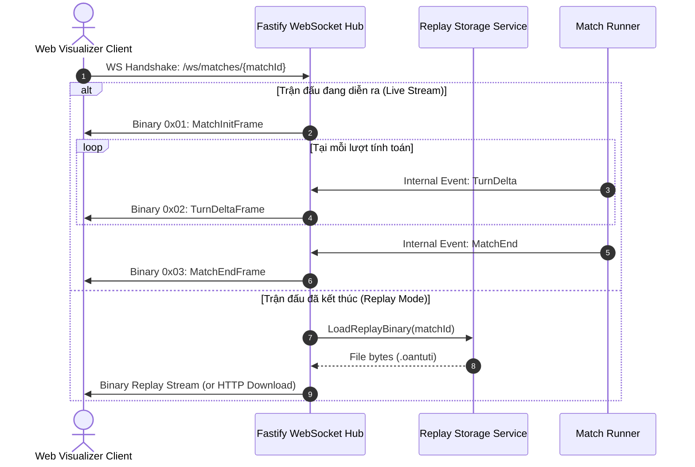

# 03 — Network Protocol & Binary Serialization Specification

> **Tài liệu Đặc tả Giao thức Mạng & Nén Nhị Phân (Network Protocol & Binary Serialization Specification)**  
> **Dự án:** OanTuTi Arena (Competitive Battlecode Platform)  
> **Phiên bản:** 1.0.0  
> **Tiêu chuẩn kỹ thuật:** SDLC Standard + Ponytail Senior Engineering  
> **Trạng thái:** Phê duyệt triển khai (Approved for Implementation)

---

## 1. Tổng Quan Kiến Trúc Giao Thức (Protocol Architecture & Objectives)

Giao thức truyền thông mạng của **OanTuTi Arena** được thiết kế dựa trên triết lý kỹ thuật thực dụng (Ponytail Principle): **Loại bỏ hoàn toàn JSON cồng kềnh trên đường truyền thời gian thực**, chuyển sang mô hình nhị phân phân tầng siêu nhẹ nhằm đáp ứng 3 mục tiêu:

1. **Băng Thông Cực Thấp (Ultra-Low Bandwidth):** Kích thước payload mỗi lượt đi $\le 200$ bytes (thực tế dao động từ $35$ đến $60$ bytes sau khi encode Protobuf). Giúp máy chủ dễ dàng stream đồng thời $1,000+$ trận đấu tới hàng chục ngàn khán giả mà không bị nghẽn I/O.
2. **An Toàn Kiểu Dữ Liệu & Đa Ngôn Ngữ (Strict Type Safety):** Sử dụng chuẩn **Protocol Buffers v3 (`proto3`)** làm nguồn chân lý duy nhất (Single Source of Truth), tự động sinh code (Codegen) cho TypeScript, Python, C++, Go.
3. **Nén Trạng Thái Biến Thiên (Delta State Compression):** Chỉ truyền tải duy nhất nước đi phát sinh và sự kiện ăn quân (`TurnDeltaFrame`) thay vì serialize toàn bộ bàn cờ tại mỗi tick.

---

## 2. Đặc Tả Khung Nhị Phân WebSocket (Binary Framing & Wire Format)

Mọi thông điệp truyền tải qua kết nối WebSocket giữa Server và Client Web Visualizer đều ở dạng **Binary Data (`ArrayBuffer` trong JavaScript)** với cấu trúc Header cố định 5 bytes:

```
 0                   1                   2                   3
 0 1 2 3 4 5 6 7 8 9 0 1 2 3 4 5 6 7 8 9 0 1 2 3 4 5 6 7 8 9 0 1
+-+-+-+-+-+-+-+-+-+-+-+-+-+-+-+-+-+-+-+-+-+-+-+-+-+-+-+-+-+-+-+-+
|  MsgType (1B) |             PayloadLength (4 Bytes, Big-Endian uint32)        |
+-+-+-+-+-+-+-+-+-+-+-+-+-+-+-+-+-+-+-+-+-+-+-+-+-+-+-+-+-+-+-+-+
|                  Protobuf Encoded Payload (N Bytes) ...       |
|                               ...                             |
+-+-+-+-+-+-+-+-+-+-+-+-+-+-+-+-+-+-+-+-+-+-+-+-+-+-+-+-+-+-+-+-+
```

### 2.1. Chi Tiết Các Trường Trong Header
1. **Byte 0 — `MsgType` (1 byte unsigned integer):**
   - `0x01`: `MSG_INIT` — Khởi tạo trận đấu (Payload là `MatchInitFrame`).
   - `0x02`: `MSG_DELTA` — Biến động lượt đi (Payload là `TurnDeltaFrame`).
   - `0x03`: `MSG_END` — Kết thúc trận đấu (Payload là `MatchEndFrame`).
   - `0x04`: `MSG_ERROR` — Thông báo lỗi từ server (Payload là UTF-8 error string hoặc ErrorFrame).
   - `0x09`: `MSG_PING` — Heartbeat Ping kiểm tra độ trễ (Payload rỗng hoặc timestamp 8 bytes).
   - `0x0A`: `MSG_PONG` — Heartbeat Pong phản hồi (Payload phản hồi timestamp).
2. **Byte 1..4 — `PayloadLength` (4 bytes unsigned integer, Big-Endian):**
   - Độ dài chính xác tính bằng byte của phần dữ liệu nhị phân Protobuf đi kèm ngay sau header.
3. **Byte 5..N — `Protobuf Payload` ($N = \text{PayloadLength}$):**
   - Nội dung nhị phân được encode theo schema `proto/oantuti.proto`.

### 2.2. Đo Lường Băng Thông Thực Tế (Bandwidth Calculation)
Xét một lượt đi thông thường:
- Header cố định: $5$ bytes.
- `TurnDeltaFrame`:
  - `turn_number` (int32 varint): $1 - 2$ bytes.
  - `active_player` (enum varint): $1$ byte.
  - `action`:
    - `piece_id` (varint): $1 - 2$ bytes.
    - `target_pos` (`x`, `y` varints): $2 - 4$ bytes.
  - `capture` (nếu có ăn quân): $\approx 6 - 8$ bytes.
  - `time_consumed_ns` (int64 varint): $\approx 4 - 6$ bytes.
  - `is_game_over` (bool): $1$ byte.
- **Tổng kích thước một frame `TurnDeltaFrame`:** dao động từ **$28$ đến $48$ bytes**.
- Hoàn toàn thỏa mãn yêu cầu phi chức năng $\le 200$ bytes/turn (dư dả hơn 400% dung lượng dự phòng).

---

## 3. Lược Đồ Protocol Buffers Chi Tiết (`proto/oantuti.proto`)

Tệp schema đặt tại `docs/specs/proto/oantuti.proto`:

```protobuf
syntax = "proto3";

package oantuti;

enum PieceType {
  PIECE_TYPE_UNSPECIFIED = 0;
  ROCK = 1;     // Búa (thắng Kéo, thua Bao, cản Búa)
  SCISSORS = 2; // Kéo (thắng Bao, thua Búa, cản Kéo)
  PAPER = 3;    // Bao (thắng Búa, thua Kéo, cản Bao)
}

enum PlayerSide {
  PLAYER_UNSPECIFIED = 0;
  WHITE = 1;    // Phe Trắng
  BLACK = 2;    // Phe Đen
}

enum WinReason {
  WIN_REASON_UNSPECIFIED = 0;
  EXTINCTION = 1;        // Ăn sạch 1 loại quân của đối phương
  THRONE_BREACH = 2;     // Chiếm ô chốt của đối phương
  STALEMATE = 3;         // Đối phương không còn nước đi hợp lệ
  TIMEOUT = 4;           // Quá thời gian quy định (>100ms)
  ILLEGAL_MOVE = 5;      // Thực hiện nước đi không hợp lệ
  CRASH_FORFEIT = 6;     // Bot ném exception, crash hoặc OOM
  MAX_TURNS_DRAW = 7;    // Hòa do chạm ngưỡng số lượt tối đa (300)
}

message Coord {
  int32 x = 1;
  int32 y = 2;
}

message MapLayout {
  int32 width = 1;
  int32 height = 2;
  bytes valid_tiles_bitmask = 3;
  Coord white_throne = 4;
  Coord black_throne = 5;
  string map_name = 6;
}

message Piece {
  int32 id = 1;
  PlayerSide owner = 2;
  PieceType type = 3;
  Coord pos = 4;
  bool is_alive = 5;
}

message MoveAction {
  int32 piece_id = 1;
  Coord target_pos = 2;
}

message CaptureEvent {
  int32 attacker_id = 1;
  int32 victim_id = 2;
  PieceType victim_type = 3;
  Coord pos = 4;
}

message MatchInitFrame {
  string match_id = 1;
  MapLayout map = 2;
  repeated Piece pieces = 3;
  int32 max_turns = 4;
  int32 turn_time_limit_ms = 5;
  string white_bot_name = 6;
  string black_bot_name = 7;
}

message TurnDeltaFrame {
  int32 turn_number = 1;
  PlayerSide active_player = 2;
  MoveAction action = 3;
  CaptureEvent capture = 4;
  int64 time_consumed_ns = 5;
  bool is_game_over = 6;
  PlayerSide winner = 7;
  WinReason win_reason = 8;
}

message MatchEndFrame {
  string match_id = 1;
  PlayerSide winner = 2;
  WinReason reason = 3;
  int32 total_turns = 4;
  int32 white_remaining_pieces = 5;
  int32 black_remaining_pieces = 6;
}

message WebSocketEnvelope {
  enum MessageType {
    MSG_INIT = 0;
    MSG_DELTA = 1;
    MSG_END = 2;
    MSG_ERROR = 3;
    MSG_PING = 4;
    MSG_PONG = 5;
  }
  MessageType type = 1;
  bytes payload = 2;
}
```

### 3.1. Thuật Toán Nén Bitmask Ô Hợp Lệ (`valid_tiles_bitmask`)
Để hỗ trợ đồ thị lưới tọa độ tổng quát $G = (V, E)$ tùy ý mà không cần gửi danh sách mảng tọa độ cồng kềnh, trường `valid_tiles_bitmask` nén toàn bộ không gian $W \times H$ thành mảng byte với công thức:

- Số byte cần cấp phát:
  $$N_{\text{bytes}} = \left\lceil \frac{W \cdot H}{8} \right\rceil$$
- Ánh xạ tọa độ $(x, y)$ sang chỉ số bit $k$:
  $$k = y \cdot W + x$$
- Chỉ số byte: $\text{byte\_idx} = \lfloor k / 8 \rfloor$
- Vị trí bit trong byte: $\text{bit\_idx} = k \pmod 8$
- Kiểm tra ô $(x, y) \in V$:
  $$\text{isValidTile}(x, y) = \left( \text{bitmask}[\text{byte\_idx}] \ \& \ (1 \ll \text{bit\_idx}) \right) \neq 0$$
- **Ví dụ hiệu năng:** Với bản đồ kích thước chuẩn $8 \times 8 = 64$ ô, toàn bộ cấu trúc địa hình tùy ý được biểu diễn gói gọn trong **đúng 8 bytes**! Bản đồ cực lớn $32 \times 32 = 1024$ ô chỉ tốn **128 bytes**.

---

## 4. Định Dạng Tệp Lưu Trữ Replay Nhị Phân (`.oantuti`)

Tất cả các trận đấu được hệ thống tự động ghi lại và đóng gói thành một tệp nhị phân duy nhất mang phần mở rộng `.oantuti`. Tệp này cho phép phát lại ngoại tuyến độc lập (Offline Playback) mà không cần kết nối mạng.

```
 0                   1                   2                   3
 0 1 2 3 4 5 6 7 8 9 0 1 2 3 4 5 6 7 8 9 0 1 2 3 4 5 6 7 8 9 0 1
+-+-+-+-+-+-+-+-+-+-+-+-+-+-+-+-+-+-+-+-+-+-+-+-+-+-+-+-+-+-+-+-+
|                   Magic Header "OANTUTI1" (8 Bytes)           |
|                                                               |
+-+-+-+-+-+-+-+-+-+-+-+-+-+-+-+-+-+-+-+-+-+-+-+-+-+-+-+-+-+-+-+-+
|             InitFrameLen (4 Bytes uint32, Big-Endian)         |
+-+-+-+-+-+-+-+-+-+-+-+-+-+-+-+-+-+-+-+-+-+-+-+-+-+-+-+-+-+-+-+-+
|               MatchInitFrame Protobuf Payload                 |
|                              ...                              |
+-+-+-+-+-+-+-+-+-+-+-+-+-+-+-+-+-+-+-+-+-+-+-+-+-+-+-+-+-+-+-+-+
|       DeltaLen1 (2B uint16)   |  TurnDeltaFrame 1 Payload ... |
+-+-+-+-+-+-+-+-+-+-+-+-+-+-+-+-+-+-+-+-+-+-+-+-+-+-+-+-+-+-+-+-+
|       DeltaLen2 (2B uint16)   |  TurnDeltaFrame 2 Payload ... |
+-+-+-+-+-+-+-+-+-+-+-+-+-+-+-+-+-+-+-+-+-+-+-+-+-+-+-+-+-+-+-+-+
|                              ...                              |
+-+-+-+-+-+-+-+-+-+-+-+-+-+-+-+-+-+-+-+-+-+-+-+-+-+-+-+-+-+-+-+-+
|             EndFrameLen (4 Bytes uint32, Big-Endian)          |
+-+-+-+-+-+-+-+-+-+-+-+-+-+-+-+-+-+-+-+-+-+-+-+-+-+-+-+-+-+-+-+-+
|               MatchEndFrame Protobuf Payload                  |
+-+-+-+-+-+-+-+-+-+-+-+-+-+-+-+-+-+-+-+-+-+-+-+-+-+-+-+-+-+-+-+-+
```

### 4.1. Quy Cách Cấu Trúc File
1. **Magic Header (8 bytes):** Chuỗi ASCII `OANTUTI1` (nhận diện định dạng OanTuTi Replay Version 1).
2. **Init Frame Block:**
   - 4 bytes uint32: Chiều dài byte của `MatchInitFrame`.
   - Payload Protobuf của `MatchInitFrame`.
3. **Turn Delta Stream (N blocks):**
   - 2 bytes uint16: Chiều dài byte của `TurnDeltaFrame` hiện tại (vì frame delta luôn $\le 200$ bytes nên uint16 là tối ưu tuyệt đối).
   - Payload Protobuf của `TurnDeltaFrame`.
4. **Footer Block:**
   - 4 bytes uint32: Chiều dài byte của `MatchEndFrame`.
   - Payload Protobuf của `MatchEndFrame`.

### 4.2. Hiệu Quả Dung Lượng
- Một trận đấu điển hình 150 lượt:
  - Header & InitFrame: $\approx 250$ bytes.
  - 150 Delta Frames $\times \approx 40$ bytes: $\approx 6,000$ bytes.
  - EndFrame: $\approx 60$ bytes.
- **Tổng dung lượng tệp `.oantuti`:** $\approx 6.5$ KB (khi nén Gzip còn chưa đầy **3 KB**).
- Cho phép lưu trữ hàng triệu ván đấu trong cơ sở dữ liệu hoặc ổ cứng mà không tốn kém tài nguyên.

---

## 5. Chu Trình Kết Nối & Luồng Tương Tác WebSocket (Connection Lifecycle)



### 5.1. Cơ Chế Bắt Kịp Trạng Thái Cho Người Xem Vào Giữa Trận (Catch-Up Invariant)
Nếu một Spectator kết nối vào phòng đấu khi trận đấu đã diễn ra đến lượt thứ $K$ ($K > 1$):
1. Máy chủ WebSocket gửi ngay `MatchInitFrame` (byte 0: `0x01`).
2. Máy chủ lập tức gửi tiếp tập hợp các delta frame từ lượt $1$ đến $K-1$ (hoặc một snapshot tổng hợp), cho phép Client Visualizer tái hiện lại tức thì trạng thái bàn cờ hiện tại chỉ trong vài mili-giây.
3. Sau đó, Client tiếp tục nhận các live delta frames từ lượt $K$ trở đi.
