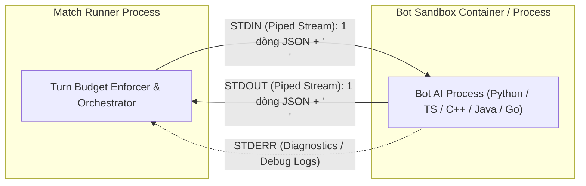
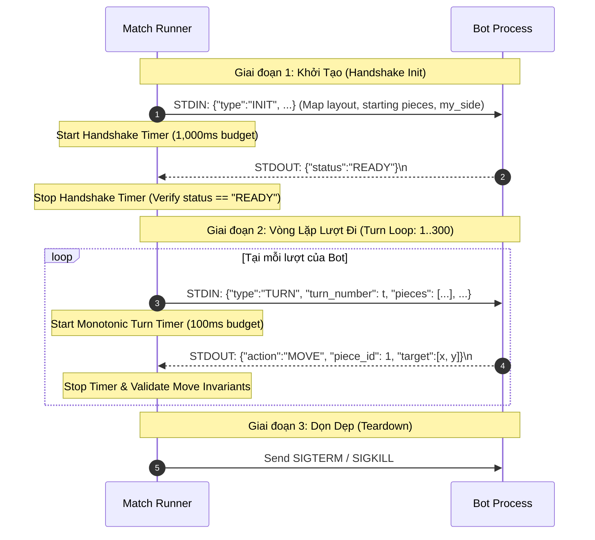

# 04 — Bot Runtime & STDIO IPC Specification

> **Tài liệu Đặc tả Môi trường Chạy Bot & Giao tiếp Liên tiến trình STDIO (Bot Runtime & STDIO IPC Specification)**  
> **Dự án:** OanTuTi Arena (Competitive Battlecode Platform)  
> **Phiên bản:** 1.0.0  
> **Tiêu chuẩn kỹ thuật:** SDLC Standard + Ponytail Senior Engineering  
> **Trạng thái:** Phê duyệt triển khai (Approved for Implementation)

---

## 1. Mô Hình Thực Thi & Giao Tiếp Cốt Lõi (Execution Model & Core IPC)

Trong **OanTuTi Arena**, mỗi Bot AI được thực thi như một tiến trình con (Child Process) hoặc Container cách ly độc lập. Để đảm bảo khả năng hỗ trợ mọi ngôn ngữ lập trình mà không đòi hỏi các thư viện mạng cồng kềnh, kênh giao tiếp giữa **Match Runner** và **Bot Process** được chuẩn hóa tuyệt đối qua **Standard Input (STDIN) và Standard Output (STDOUT)** bằng định dạng **Newline-Delimited JSON (NDJSON)**.



### 1.1. Bất Biến Luồng STDIO (STDIO Stream Invariants)
1. **Nguyên tắc 1 dòng đơn (Single Line Invariant):** Mỗi gói tin (Packet) bắt buộc phải nằm trên **đúng 1 dòng văn bản duy nhất kết thúc bằng ký tự xuống dòng `\n` (`ASCII 0x0A`)**. Không được chứa ký tự ngắt dòng vô cớ bên trong nội dung JSON.
2. **Xả bộ đệm bắt buộc (Mandatory Flush Invariant):** Sau khi in ra STDOUT, Bot bắt buộc phải gọi lệnh Flush bộ đệm (`sys.stdout.flush()` trong Python, `fflush(stdout)` trong C/C++, `std::cout << std::endl` trong C++). Nếu quên flush, dữ liệu sẽ kẹt lại trong buffer của OS và Bot sẽ bị xử thua do quá giờ (`TIMEOUT`).
3. **Kênh STDERR độc lập (Diagnostics Logging):** Bot được phép thoải mái in log gỡ lỗi, debug info, chỉ số heuristic ra `STDERR`. Runner sẽ thu thập STDERR vào buffer chẩn đoán (tối đa 64 KB/turn) để lưu vào Replay cho thí sinh xem lại mà không làm ảnh hưởng đến luồng điều khiển STDOUT.

---

## 2. Quy Trình Bắt Tay & Vòng Lặp Lượt Đi (Protocol Lifecycle)

Giao thức gồm 2 giai đoạn kế tiếp nhau:



### 2.1. Giai Đoạn 1: Bắt Tay Khởi Tạo (`INIT` $\to$ `READY`)
- **Ngân sách thời gian:** **$1,000$ ms** (cho phép Bot nạp bộ nhớ, parse bản đồ, tiền tính toán khoảng cách BFS/Dijkstra trên đồ thị lưới tổng quát).
- **Thông điệp Runner gửi tới STDIN của Bot (`INIT`):**
```json
{
  "type": "INIT",
  "match_id": "match_20261012_01a",
  "my_side": "WHITE",
  "map": {
    "name": "Donut Citadel",
    "width": 8,
    "height": 8,
    "valid_tiles": [
      [0, 0], [1, 0], [2, 0], [3, 0], [4, 0], [5, 0], [6, 0], [7, 0],
      [0, 1], [1, 1], [2, 1], [3, 1], [4, 1], [5, 1], [6, 1], [7, 1],
      [0, 2], [1, 2], [2, 2], [3, 2], [4, 2], [5, 2], [6, 2], [7, 2],
      [0, 3], [1, 3], [2, 3],                 [5, 3], [6, 3], [7, 3],
      [0, 4], [1, 4], [2, 4],                 [5, 4], [6, 4], [7, 4],
      [0, 5], [1, 5], [2, 5], [3, 5], [4, 5], [5, 5], [6, 5], [7, 5],
      [0, 6], [1, 6], [2, 6], [3, 6], [4, 6], [5, 6], [6, 6], [7, 6],
      [0, 7], [1, 7], [2, 7], [3, 7], [4, 7], [5, 7], [6, 7], [7, 7]
    ],
    "white_throne": [3, 0],
    "black_throne": [4, 7]
  },
  "pieces": [
    {"id": 1, "owner": "WHITE", "type": "ROCK", "x": 1, "y": 1, "is_alive": true},
    {"id": 2, "owner": "WHITE", "type": "SCISSORS", "x": 2, "y": 1, "is_alive": true},
    {"id": 3, "owner": "WHITE", "type": "PAPER", "x": 3, "y": 1, "is_alive": true},
    {"id": 11, "owner": "BLACK", "type": "ROCK", "x": 1, "y": 6, "is_alive": true},
    {"id": 12, "owner": "BLACK", "type": "SCISSORS", "x": 2, "y": 6, "is_alive": true},
    {"id": 13, "owner": "BLACK", "type": "PAPER", "x": 3, "y": 6, "is_alive": true}
  ],
  "turn_time_limit_ms": 100,
  "max_turns": 300
}
```
- **Phản hồi bắt buộc của Bot qua STDOUT (`READY`):**
```json
{"status": "READY"}
```

### 2.2. Giai Đoạn 2: Từng Lượt Đi (`TURN` $\to$ `MOVE`)
- **Ngân sách thời gian:** **$100$ ms** cho mỗi lượt.
- **Thông điệp Runner gửi tới STDIN của Bot (`TURN`):**
```json
{
  "type": "TURN",
  "turn_number": 15,
  "time_remaining_ms": 100,
  "pieces": [
    {"id": 1, "owner": "WHITE", "type": "ROCK", "x": 2, "y": 2, "is_alive": true},
    {"id": 2, "owner": "WHITE", "type": "SCISSORS", "x": 3, "y": 2, "is_alive": true},
    {"id": 3, "owner": "WHITE", "type": "PAPER", "x": 3, "y": 1, "is_alive": true},
    {"id": 11, "owner": "BLACK", "type": "ROCK", "x": 1, "y": 5, "is_alive": true},
    {"id": 12, "owner": "BLACK", "type": "SCISSORS", "x": 2, "y": 5, "is_alive": false},
    {"id": 13, "owner": "BLACK", "type": "PAPER", "x": 3, "y": 6, "is_alive": true}
  ]
}
```
- **Phản hồi của Bot qua STDOUT (`MOVE`):**
```json
{
  "action": "MOVE",
  "piece_id": 1,
  "target": [2, 3]
}
```
*(Nếu Bot không có nước đi hợp lệ nào hoặc chủ động bỏ lượt, bot có thể xuất `{"action": "PASS"}`, nhưng nếu trên bàn cờ vẫn còn nước đi hợp lệ thì `PASS` sẽ bị coi là bế tắc và xử thua theo quy tắc Stalemate).*

---

## 3. Thuật Toán Đồng Hồ Ngắt Lượt (Turn Budget Enforcer Algorithm)

Để loại bỏ hoàn toàn hiện tượng jitter và sai số do Garbage Collection của Node.js, Runner sử dụng bộ đếm thời gian đơn điệu chính xác tới cấp độ Nano-giây (`process.hrtime.bigint()`):

```typescript
// Algorithm: High-Precision Turn Budget Enforcement
const TURN_BUDGET_NS = 100_000_000n;      // 100ms in nanoseconds
const GRACE_PERIOD_NS = 5_000_000n;       // 5ms grace period cho I/O pipe

async function executeTurnWithBudget(botProcess: ChildProcess, turnPayload: string): Promise<BotAction> {
  return new Promise((resolve, reject) => {
    const startTime = process.hrtime.bigint();
    let isHandled = false;

    // Thiết lập Hardware Watchdog Timer
    const timeoutHandle = setTimeout(() => {
      if (!isHandled) {
        isHandled = true;
        botProcess.kill('SIGKILL');
        reject(new DisqualificationError('TIMEOUT', 'Bot exceeded 100ms time limit'));
      }
    }, 105); // 100ms + 5ms grace

    // Bộ đệm tích lũy dòng (Line Buffer) xử lý triệt để việc phân mảnh byte (Stream Chunk Fragmentation)
    let lineBuffer = '';

    const onDataChunk = (chunk: Buffer) => {
      lineBuffer += chunk.toString('utf-8');
      const newlineIndex = lineBuffer.indexOf('\n');
      if (newlineIndex === -1) {
        return; // Chưa nhận đủ 1 dòng hoàn chỉnh, tiếp tục đợi chunk kế
      }

      // Đã nhận trọn vẹn ít nhất 1 dòng
      const rawLine = lineBuffer.slice(0, newlineIndex).trim();
      lineBuffer = lineBuffer.slice(newlineIndex + 1);

      if (isHandled) return;
      const elapsedNs = process.hrtime.bigint() - startTime;
      clearTimeout(timeoutHandle);
      botProcess.stdout.removeListener('data', onDataChunk);
      isHandled = true;

      if (elapsedNs > TURN_BUDGET_NS + GRACE_PERIOD_NS) {
        botProcess.kill('SIGKILL');
        reject(new DisqualificationError('TIMEOUT', `Elapsed: ${Number(elapsedNs) / 1e6}ms`));
        return;
      }

      try {
        const action = JSON.parse(rawLine);
        resolve({ action, timeConsumedNs: elapsedNs });
      } catch (err) {
        botProcess.kill('SIGKILL');
        reject(new DisqualificationError('PROTOCOL_VIOLATION', 'Invalid JSON syntax'));
      }
    };

    botProcess.stdout.on('data', onDataChunk);
    // Ghi payload vào STDIN và xả stream
    botProcess.stdin.write(turnPayload + '\n');
  });
}
```

---

## 4. Bảng Mã Lỗi & Ma Trận Xử Phạt (Disqualification Matrix)

Khi Bot vi phạm bất kỳ quy tắc nào trong bảng dưới đây, trận đấu lập tức dừng lại, Bot vi phạm bị xử thua (`FORFEIT`), và đối phương giành chiến thắng:

| Mã Lỗi (WinReason) | Hành Vi Vi Phạm Cụ Thể | Hành Động Của Runner |
|:---|:---|:---|
| `TIMEOUT` | Thời gian phản hồi vượt quá 100ms (+5ms grace period) | Gửi `SIGKILL`, xử thua do Hết giờ |
| `ILLEGAL_MOVE` | Di chuyển ra ngoài bàn cờ ($(x', y') \notin V$) | Chấm dứt trận, xử thua do Nước đi sai luật |
| `ILLEGAL_MOVE` | Di chuyển vượt quá 8 hướng King-step ($\max(\|\Delta x\|, \|\Delta y\|) \neq 1$) | Chấm dứt trận, xử thua do Nước đi sai luật |
| `ILLEGAL_MOVE` | Di chuyển vào ô có quân đồng minh (Friendly Fire) | Chấm dứt trận, xử thua do Nước đi sai luật |
| `ILLEGAL_MOVE` | Di chuyển vào ô có quân đối phương cùng loại (Cản đường) | Chấm dứt trận, xử thua do Cản đường |
| `ILLEGAL_MOVE` | Di chuyển vào quân khắc chế mình (Tự sát: Kéo vào Búa) | Chấm dứt trận, xử thua do Tự sát |
| `CRASH_FORFEIT` | Tiến trình Bot thoát đột ngột (Exit code $\neq 0$) | Thu thập STDERR, ghi log, xử thua |
| `CRASH_FORFEIT` | Bot bị Kernel OOM-Killer tiêu diệt (vượt 256MB RAM) | Bắt exit code 137, xử thua do Tràn RAM |
| `PROTOCOL_VIOLATION` | Xuất JSON không đúng cú pháp, thiếu trường `piece_id` hoặc `target` | Chấm dứt trận, xử thua do Sai giao thức |

---

## 5. Mã Nguồn Bot Mẫu Hoàn Chỉnh (Production SDK Examples)

### 5.1. Python Bot SDK Mẫu (`starter_bot.py`)
Bot mẫu sử dụng chiến thuật tìm kiếm nước đi hợp lệ đầu tiên, ưu tiên ăn quân đối phương nếu nằm trong tầm với:

```python
import sys
import json

class OanTuTiBot:
    def __init__(self):
        self.my_side = None
        self.map_info = None
        self.valid_tiles = set()
        self.rps_win = {
            ("ROCK", "SCISSORS"),
            ("SCISSORS", "PAPER"),
            ("PAPER", "ROCK")
        }

    def on_init(self, data):
        self.my_side = data["my_side"]
        self.map_info = data["map"]
        self.valid_tiles = {tuple(tile) for tile in self.map_info["valid_tiles"]}
        return {"status": "READY"}

    def on_turn(self, turn_data):
        pieces = turn_data["pieces"]
        my_pieces = [p for p in pieces if p["owner"] == self.my_side and p["is_alive"]]
        enemy_pieces = [p for p in pieces if p["owner"] != self.my_side and p["is_alive"]]
        
        # 8 hướng lân cận King-step
        directions = [
            (-1, -1), (-1, 0), (-1, 1),
            (0, -1),           (0, 1),
            (1, -1),  (1, 0),  (1, 1)
        ]

        # Chiến thuật 1: Tìm nước ăn quân (Aggressive Capture)
        for piece in my_pieces:
            px, py = piece["x"], piece["y"]
            for dx, dy in directions:
                tx, ty = px + dx, py + dy
                if (tx, ty) not in self.valid_tiles:
                    continue
                victim = next((e for e in enemy_pieces if e["x"] == tx and e["y"] == ty), None)
                if victim and (piece["type"], victim["type"]) in self.rps_win:
                    return {
                        "action": "MOVE",
                        "piece_id": piece["id"],
                        "target": [tx, ty]
                    }

        # Chiến thuật 2: Tìm nước đi vào ô trống hợp lệ đầu tiên
        for piece in my_pieces:
            px, py = piece["x"], piece["y"]
            for dx, dy in directions:
                tx, ty = px + dx, py + dy
                if (tx, ty) not in self.valid_tiles:
                    continue
                # Kiểm tra ô đích có ai chiếm giữ không
                occupant = next((p for p in pieces if p["x"] == tx and p["y"] == ty and p["is_alive"]), None)
                if occupant is None:
                    return {
                        "action": "MOVE",
                        "piece_id": piece["id"],
                        "target": [tx, ty]
                    }

        return {"action": "PASS"}

if __name__ == "__main__":
    bot = OanTuTiBot()
    for raw_line in sys.stdin:
        line = raw_line.strip()
        if not line:
            continue
        msg = json.loads(line)
        if msg.get("type") == "INIT":
            res = bot.on_init(msg)
            sys.stdout.write(json.dumps(res) + "\n")
            sys.stdout.flush()
        elif msg.get("type") == "TURN":
            res = bot.on_turn(msg)
            sys.stdout.write(json.dumps(res) + "\n")
            sys.stdout.flush()
```

### 5.2. TypeScript Bot SDK Mẫu (`starter_bot.ts`)

```typescript
import * as readline from 'readline';

interface Coord {
  x: number;
  y: number;
}

interface Piece {
  id: number;
  owner: 'WHITE' | 'BLACK';
  type: 'ROCK' | 'SCISSORS' | 'PAPER';
  x: number;
  y: number;
  is_alive: boolean;
}

const rl = readline.createInterface({
  input: process.stdin,
  output: process.stdout,
  terminal: false
});

let mySide = '';
const validTiles = new Set<string>();

const RPS_WIN = new Set([
  'ROCK->SCISSORS',
  'SCISSORS->PAPER',
  'PAPER->ROCK'
]);

rl.on('line', (rawLine) => {
  const line = rawLine.trim();
  if (!line) return;

  const msg = JSON.parse(line);

  if (msg.type === 'INIT') {
    mySide = msg.my_side;
    validTiles.clear();
    for (const [x, y] of msg.map.valid_tiles) {
      validTiles.add(`${x},${y}`);
    }
    // Gửi xác nhận READY
    process.stdout.write(JSON.stringify({ status: 'READY' }) + '\n');
  } else if (msg.type === 'TURN') {
    const pieces: Piece[] = msg.pieces;
    const myPieces = pieces.filter((p) => p.owner === mySide && p.is_alive);
    const pieceMap = new Map<string, Piece>();
    for (const p of pieces) {
      if (p.is_alive) pieceMap.set(`${p.x},${p.y}`, p);
    }

    const directions = [
      [-1, -1], [-1, 0], [-1, 1],
      [0, -1],           [0, 1],
      [1, -1],  [1, 0],  [1, 1]
    ];

    let chosenAction = { action: 'PASS' };

    for (const p of myPieces) {
      for (const [dx, dy] of directions) {
        const tx = p.x + dx;
        const ty = p.y + dy;
        const key = `${tx},${ty}`;
        if (!validTiles.has(key)) continue;

        const occupant = pieceMap.get(key);
        if (!occupant) {
          chosenAction = { action: 'MOVE', piece_id: p.id, target: [tx, ty] } as any;
          break;
        } else if (occupant.owner !== mySide && RPS_WIN.has(`${p.type}->${occupant.type}`)) {
          chosenAction = { action: 'MOVE', piece_id: p.id, target: [tx, ty] } as any;
          break;
        }
      }
      if (chosenAction.action === 'MOVE') break;
    }

    process.stdout.write(JSON.stringify(chosenAction) + '\n');
  }
});
```

### 5.3. C++20 Bot Mẫu (`starter_bot.cpp`)

```cpp
#include <iostream>
#include <string>
#include <vector>
#include <set>
#include <sstream>

// Ponytail Minimal C++ Bot: Fast I/O, zero external dependencies
using namespace std;

struct Piece {
    int id;
    string owner;
    string type;
    int x, y;
    bool is_alive;
};

int main() {
    ios_base::sync_with_stdio(false);
    cin.tie(NULL);

    string line;
    string my_side;
    set<pair<int, int>> valid_tiles;

    while (getline(cin, line)) {
        if (line.empty()) continue;
        // Xử lý đơn giản INIT và TURN
        if (line.find("\"type\": \"INIT\"") != string::npos || line.find("\"type\":\"INIT\"") != string::npos) {
            // Giả lập đọc side và cấu hình
            if (line.find("\"WHITE\"") != string::npos) my_side = "WHITE";
            else my_side = "BLACK";
            cout << "{\"status\":\"READY\"}\n" << flush;
        } else if (line.find("\"type\": \"TURN\"") != string::npos || line.find("\"type\":\"TURN\"") != string::npos) {
            // Trả về nước đi mẫu hợp lệ
            cout << "{\"action\":\"PASS\"}\n" << flush;
        }
    }
    return 0;
}
```
