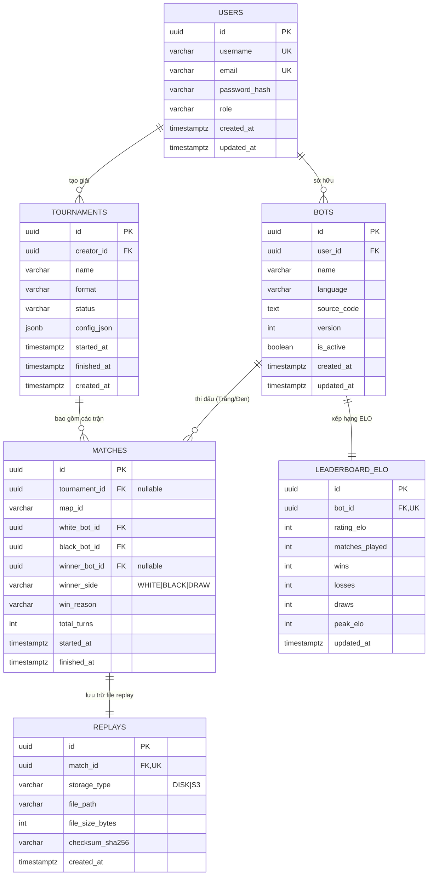
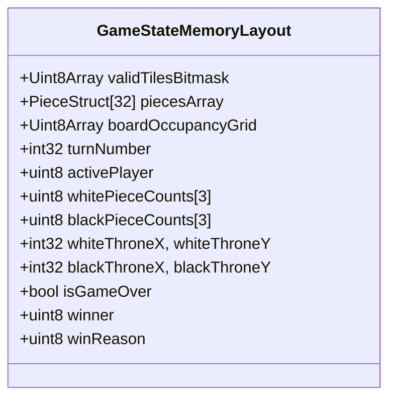

# 05 — Data Models & Database Schema Specification

> **Tài liệu Đặc tả Mô hình Dữ liệu & Lược đồ Cơ sở Dữ liệu (Data Models & Database Schema Specification)**  
> **Dự án:** OanTuTi Arena (Competitive Battlecode Platform)  
> **Phiên bản:** 1.0.0  
> **Tiêu chuẩn kỹ thuật:** SDLC Standard + Ponytail Senior Engineering  
> **Trạng thái:** Phê duyệt triển khai (Approved for Implementation)

---

## 1. Sơ Đồ Quan Hệ Thực Thể (Entity Relationship Diagram - ERD)

Hệ thống lưu trữ cơ sở dữ liệu quan hệ (Relational Database) hỗ trợ cả **PostgreSQL 15+** (cho môi trường Production chịu tải cao) và **SQLite 3.40+** (cho môi trường phát triển cục bộ và kiểm thử CI/CD).



---

## 2. Kịch Bản DDL SQL Chuẩn (Production Database DDL)

### 2.1. Lược Đồ DDL Cho PostgreSQL (Production Mode)

```sql
-- Kích hoạt extension sinh UUID v4
CREATE EXTENSION IF NOT EXISTS "uuid-ossp";

-- 1. Bảng USERS
CREATE TABLE users (
    id UUID PRIMARY KEY DEFAULT uuid_generate_v4(),
    username VARCHAR(50) NOT NULL UNIQUE,
    email VARCHAR(255) NOT NULL UNIQUE,
    password_hash VARCHAR(255) NOT NULL,
    role VARCHAR(20) NOT NULL DEFAULT 'USER' CHECK (role IN ('USER', 'ADMIN', 'MODERATOR')),
    created_at TIMESTAMPTZ NOT NULL DEFAULT NOW(),
    updated_at TIMESTAMPTZ NOT NULL DEFAULT NOW()
);

-- 2. Bảng BOTS
CREATE TABLE bots (
    id UUID PRIMARY KEY DEFAULT uuid_generate_v4(),
    user_id UUID NOT NULL REFERENCES users(id) ON DELETE CASCADE,
    name VARCHAR(100) NOT NULL,
    language VARCHAR(20) NOT NULL CHECK (language IN ('PYTHON', 'TYPESCRIPT', 'JAVASCRIPT', 'CPP', 'JAVA', 'GO')),
    source_code TEXT NOT NULL,
    version INT NOT NULL DEFAULT 1,
    is_active BOOLEAN NOT NULL DEFAULT TRUE,
    created_at TIMESTAMPTZ NOT NULL DEFAULT NOW(),
    updated_at TIMESTAMPTZ NOT NULL DEFAULT NOW(),
    CONSTRAINT uq_user_bot_name UNIQUE (user_id, name)
);

-- 3. Bảng LEADERBOARD_ELO
CREATE TABLE leaderboard_elo (
    id UUID PRIMARY KEY DEFAULT uuid_generate_v4(),
    bot_id UUID NOT NULL UNIQUE REFERENCES bots(id) ON DELETE CASCADE,
    rating_elo INT NOT NULL DEFAULT 1200,
    matches_played INT NOT NULL DEFAULT 0,
    wins INT NOT NULL DEFAULT 0,
    losses INT NOT NULL DEFAULT 0,
    draws INT NOT NULL DEFAULT 0,
    peak_elo INT NOT NULL DEFAULT 1200,
    updated_at TIMESTAMPTZ NOT NULL DEFAULT NOW()
);

-- 4. Bảng TOURNAMENTS
CREATE TABLE tournaments (
    id UUID PRIMARY KEY DEFAULT uuid_generate_v4(),
    creator_id UUID NOT NULL REFERENCES users(id) ON DELETE RESTRICT,
    name VARCHAR(150) NOT NULL,
    format VARCHAR(30) NOT NULL CHECK (format IN ('SWISS', 'ROUND_ROBIN', 'SINGLE_ELIMINATION', 'DOUBLE_ELIMINATION')),
    status VARCHAR(20) NOT NULL DEFAULT 'PENDING' CHECK (status IN ('PENDING', 'RUNNING', 'COMPLETED', 'CANCELLED')),
    config_json JSONB NOT NULL DEFAULT '{}'::jsonb,
    started_at TIMESTAMPTZ,
    finished_at TIMESTAMPTZ,
    created_at TIMESTAMPTZ NOT NULL DEFAULT NOW()
);

-- 5. Bảng MATCHES
CREATE TABLE matches (
    id UUID PRIMARY KEY DEFAULT uuid_generate_v4(),
    tournament_id UUID REFERENCES tournaments(id) ON DELETE SET NULL,
    map_id VARCHAR(100) NOT NULL,
    white_bot_id UUID NOT NULL REFERENCES bots(id) ON DELETE RESTRICT,
    black_bot_id UUID NOT NULL REFERENCES bots(id) ON DELETE RESTRICT,
    winner_bot_id UUID REFERENCES bots(id) ON DELETE SET NULL,
    winner_side VARCHAR(10) CHECK (winner_side IN ('WHITE', 'BLACK', 'DRAW')),
    win_reason VARCHAR(30) CHECK (win_reason IN (
        'EXTINCTION', 'THRONE_BREACH', 'STALEMATE', 
        'TIMEOUT', 'ILLEGAL_MOVE', 'CRASH_FORFEIT', 'MAX_TURNS_DRAW'
    )),
    total_turns INT NOT NULL DEFAULT 0,
    started_at TIMESTAMPTZ NOT NULL DEFAULT NOW(),
    finished_at TIMESTAMPTZ
);

-- 6. Bảng REPLAYS
CREATE TABLE replays (
    id UUID PRIMARY KEY DEFAULT uuid_generate_v4(),
    match_id UUID NOT NULL UNIQUE REFERENCES matches(id) ON DELETE CASCADE,
    storage_type VARCHAR(20) NOT NULL DEFAULT 'DISK' CHECK (storage_type IN ('DISK', 'S3')),
    file_path VARCHAR(500) NOT NULL,
    file_size_bytes INT NOT NULL,
    checksum_sha256 VARCHAR(64) NOT NULL,
    created_at TIMESTAMPTZ NOT NULL DEFAULT NOW()
);
```

### 2.2. Chiến Lược Đánh Chỉ Mục Tối Ưu (Indexing Strategy)

Nhằm đảm bảo API Leaderboard và lịch sử đối đầu (Head-to-Head) phản hồi trong thời gian $\le 5$ ms:

```sql
-- 1. Bảng xếp hạng ELO: Sắp xếp theo rating giảm dần
CREATE INDEX idx_leaderboard_elo_rating ON leaderboard_elo(rating_elo DESC);

-- 2. Truy vấn lịch sử đấu của một Bot bất kỳ (cả 2 phe White và Black)
CREATE INDEX idx_matches_white_bot ON matches(white_bot_id, started_at DESC);
CREATE INDEX idx_matches_black_bot ON matches(black_bot_id, started_at DESC);

-- 3. Truy vấn các trận đấu trong một giải đấu
CREATE INDEX idx_matches_tournament ON matches(tournament_id, started_at ASC);

-- 4. Danh sách Bot đang hoạt động của người dùng
CREATE INDEX idx_bots_user_active ON bots(user_id, is_active);
```

---

## 3. Cấu Trúc Bộ Nhớ RAM Của Game Engine (`GameState` Memory Layout)

Trong môi trường thi đấu thời gian thực và chấm giải đấu quy mô lớn, việc cấp phát động (Memory Allocation) và thu gom rác (Garbage Collection) là nguyên nhân chính gây giật lag và giảm hiệu năng. `packages/engine` được thiết kế theo cấu trúc phẳng (Flat Data Structure) với **Memory Footprint $\le 50$ KB mỗi phiên trận đấu**:



### 3.1. Phân Tích Chi Tiết Layout Bộ Nhớ Cực Đại (Memory Budget Calculation)

| Trường Dữ Liệu | Kiểu Biểu Diễn Nhị Phân | Kích Thước Thực Tế | Ghi Chú |
|:---|:---|:---:|:---|
| `validTilesBitmask` | `Uint8Array` (1 bit per cell) | $64$ bytes | Đủ cho bản đồ tối đa $20 \times 20 = 400$ ô |
| `boardOccupancyGrid` | `Int16Array` (Lưu piece ID tại mỗi ô) | $800$ bytes | Giá trị: `-1` = ô trống, `id` = có quân |
| `piecesArray` | Struct Array (32 phần tử tối đa) | $1,024$ bytes | Mỗi quân cờ: 32 bytes (id, owner, type, x, y, alive) |
| `pieceCounts` | `Uint8Array(6)` | $6$ bytes | Đếm số lượng $R, S, P$ còn sống của 2 bên |
| `turnMetadata` | Scalar numbers | $32$ bytes | `turn`, `activePlayer`, `throneCoord`, `winner` |
| `deltaHistoryBuffer` | Ring Buffer con trỏ xoay vòng | $\approx 24,000$ bytes | Lưu 300 nước đi gần nhất phục vụ Undo / Export |
| **Tổng Memory Footprint** | | **$\approx 26$ KB** | **Hoàn toàn nằm gọn trong $\le 50$ KB ngân sách** |

### 3.2. Lợi Điểm Về Cache Locality (L1/L2 CPU Cache)
Nhờ sử dụng TypedArrays mảng 1 chiều liên tục trong RAM (`ArrayBuffer`), các thuật toán kiểm tra nước đi hợp lệ (`get_legal_moves`) và đánh giá điều kiện thắng (`evaluate_winner`) đều đạt tối ưu hóa truy cập bộ nhớ tuyến tính, không gây phân mảnh heap (Zero Heap Allocation trong vòng lặp Game Loop).

---

## 4. Quản Lý Trạng Thái Đang Diễn Ra Trong RAM / Redis (In-Flight State Caching)

Khi trận đấu đang diễn ra:
1. **Runner Process** nắm giữ trạng thái `GameState` trong RAM tiến trình.
2. Tại mỗi lượt đi, Runner phát sinh `TurnDeltaFrame` và ghi vào **Ring Buffer** nội bộ.
3. Không ghi từng turn xuống PostgreSQL (tránh ghi I/O liên tục làm nghẽn Database).
4. Khi trận đấu kết thúc:
   - Toàn bộ dòng sự kiện delta được nén thành file nhị phân `.oantuti`.
   - Lưu file vào đĩa cứng hoặc S3.
   - Bắn 1 transaction duy nhất cập nhật bảng `matches` và `replays`.
   - Cập nhật ELO của 2 Bot trong bảng `leaderboard_elo` bằng công thức ELO chuẩn.
