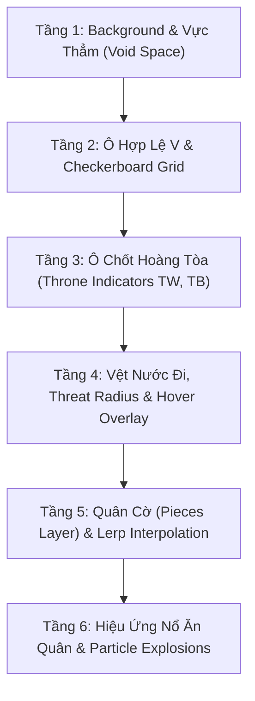

# 06 — UI/UX & Web Canvas 2D Visualizer Specification

> **Tài liệu Đặc tả Giao diện Người dùng & Trình Trực quan hóa Canvas 2D (UI/UX & Web Canvas 2D Visualizer Specification)**  
> **Dự án:** OanTuTi Arena (Competitive Battlecode Platform)  
> **Phiên bản:** 1.0.0  
> **Tiêu chuẩn kỹ thuật:** SDLC Standard + Ponytail Senior Engineering  
> **Trạng thái:** Phê duyệt triển khai (Approved for Implementation)

---

## 1. Tổng Quan Trải Nghiệm Người Dùng (UI/UX Overview & Screen Wireframe)

Giao diện thi đấu của **OanTuTi Arena** được thiết kế hiện đại, tập trung cao độ vào hiệu suất hiển thị 60 FPS, độ trực quan và khả năng gỡ lỗi bot nhanh chóng. Bố cục màn hình chia thành 3 phân vùng chính:

```
+----------------------------------------------------------------------------------------------------+
| [Logo] OanTuTi Arena   | Trận: #m_94821a | Bản đồ: Donut Citadel (8x8) | Turn: 42/300 | [Dark/Light] |
+-------------------------------------------------------+--------------------------------------------+
| BẢNG TRỰC QUAN HÓA (CANVAS 2D VIEWPORT)              | BANEL ĐIỀU KHIỂN & LẬP TRÌNH BOT           |
|                                                       |                                            |
|  +-------------------------------------------------+  | [Tabs: Monaco Editor | Logs | Stats]       |
|  | [Thống kê Quân Số Thời Gian Thực]               |  |                                            |
|  | WHITE (AlphaBot): 3 [R] | 2 [S] | 3 [P]         |  | Language: [ Python 3.10 v ] [Submit Code]  |
|  | BLACK (OmegaBot): 2 [R] | 1 [S] | 2 [P] (Danger)|  | +----------------------------------------+ |
|  +-------------------------------------------------+  | | def on_turn(turn_data):                | |
|                                                       | |     # Tìm nước ăn quân                 | |
|  [=================================================]  | |     for piece in my_pieces:            | |
|  [                                                 ]  | |         moves = get_legal_moves(piece) | |
|  [         CANVAS 2D GRAPH VIEWPORT                ]  | |         if moves: return moves[0]      | |
|  [     (Auto-Fit Bàn cờ đồ thị tổng quát)          ]  | |                                        | |
|  [      - Ô hợp lệ V / Vực thẳm / Throne           ]  | |                                        | |
|  [      - Quân Búa/Kéo/Bao (Lerp Animation)        ]  | +----------------------------------------+ |
|  [      - Tia tấn công / Bán kính kiểm soát        ]  | [Run Local Test] [Export Replay (.oantuti)]|
|  [                                                 ]  |                                            |
|  +-------------------------------------------------+  | [Bot Debug Logs (STDERR Stream)]           |
|                                                       | | [T:42] AlphaBot chose piece #2 -> (3,4)  |
|  [Timeline Controller: |<  <<  [Play/Pause]  >>  >|]  | | [T:42] Execution time: 14.2ms            |
|  [====O====================================] (42/300) | |                                          |
|  Tốc độ: [ 1x | 2x | 5x | 10x ] | Tự động quay lại    |                                            |
+-------------------------------------------------------+--------------------------------------------+
```

### 1.3. Phân Quyền Giao Diện & Màn Hình Trình Chiếu (Role UI & Projector View)

1. **Huy hiệu Phân Quyền (Role Badges):**
   - Thanh điều hướng đầu trang hiển thị tên người dùng và huy hiệu vai trò:
     - `👑 Admin`: Tông màu vàng kim `#facc15`, nền `rgba(234, 179, 8, 0.2)`.
     - `🎮 Player`: Tông màu xanh neon `#38bdf8`, nền `rgba(56, 189, 248, 0.2)`.
2. **Giao Diện Ban Tổ Chức (Admin Operator & Projector Screen):**
   - Hiển thị nút `+ Create` để tạo giải đấu mới (Round-Robin hoặc Swiss).
   - Trong giải đấu đang mở: Hiển thị số lượng thí sinh đăng ký và nút `Chốt danh sách & ghép cặp`.
   - Khi giải đấu đang diễn ra: Hiển thị bảng điều khiển Operator Deck nổi bật với nút `Trận đấu tiếp theo (Next Match) ▶` để điều khiển phát sóng từng trận lên màn hình lớn/máy chiếu và đồng bộ tiến trình tới toàn thể người chơi trong phòng.
3. **Giao Diện Thí Sinh (Player Screen):**
   - Nút tạo giải và các nút chốt danh sách / điều khiển giải đấu bị ẩn hoàn toàn.
   - Trong giải đấu đang mở: Hiển thị hộp nộp bài, cho phép chọn bot cá nhân và bấm `Nộp bot tham gia`.
   - Trong giải đấu đang diễn ra: Bảng xếp hạng và danh sách cặp đấu được mở khóa tuần tự theo từng trận Admin bấm chiếu trên máy chiếu, không bị lộ trước kết quả của các trận chưa chiếu.

---

## 2. Thuật Toán Ánh Xạ Tọa Độ Camera (Camera Viewport Transform)

### 2.1. Bài Toán Hình Học Tổng Quát
Bàn cờ trong OanTuTi Arena là một đồ thị lưới tọa độ tổng quát $G = (V, E)$ nằm trong bounding box kích thước $W_{\text{board}} \times H_{\text{board}}$, trong đó tập ô hợp lệ $V$ có thể là bất kỳ hình dạng nào (hình vuông, chữ nhật lệch tỷ lệ $16 \times 4$, hình chữ L, hình xuyến có lỗ thủng ở giữa, hay cụm đảo rời).

Để bàn cờ **tự động căn giữa khung hình Canvas (Canvas Auto-Fit)** và bảo đảm **tỷ lệ khung hình vuông hoàn hảo cho từng ô cờ mà không bị méo**, thuật toán Camera Viewport tính toán hệ số scale $s$ và độ lệch $(\text{offsetX}, \text{offsetY})$:

### 2.2. Công Thức Toán Học

Cho trước kích thước khung hình Canvas vật lý $(W_{\text{canvas}}, H_{\text{canvas}})$ và khoảng đệm viền $\text{pad} \ge 20\text{px}$:

1. **Hệ Số Tỷ Lệ Cạnh Ô Cờ ($s$ - Tile Size):**
   $$s = \min\left( \frac{W_{\text{canvas}} - 2 \cdot \text{pad}}{W_{\text{board}}}, \; \frac{H_{\text{canvas}} - 2 \cdot \text{pad}}{H_{\text{board}}} \right)$$

2. **Độ Lệch Căn Giữa Khung Hình ($\text{offsetX}, \text{offsetY}$):**
   $$\text{offsetX} = \frac{W_{\text{canvas}} - W_{\text{board}} \cdot s}{2}$$
   $$\text{offsetY} = \frac{H_{\text{canvas}} - H_{\text{board}} \cdot s}{2}$$

3. **Ánh Xạ Tọa Độ Logic $(x, y) \in V$ Sang Tọa Độ Pixel Màn Hình $(X, Y)$:**
   Hệ tọa độ game và Canvas chuẩn hóa đặt gốc $(0, 0)$ tại góc trên-trái (Top-Left Origin): trục $x$ tăng dần từ trái sang phải ($0 \to W_{\text{board}}-1$), trục $y$ tăng dần từ trên xuống dưới ($0 \to H_{\text{board}}-1$). Hàng $y = 0$ là cứ điểm xuất phát của phe Trắng ($T_W$), hàng $y = H_{\text{board}}-1$ là cứ điểm của phe Đen ($T_B$).
   $$X(x) = \text{offsetX} + x \cdot s$$
   $$Y(y) = \text{offsetY} + y \cdot s$$
   Tâm của ô cờ $(x, y)$ tại pixel:
   $$X_{\text{center}}(x) = X(x) + \frac{s}{2}, \quad Y_{\text{center}}(y) = Y(y) + \frac{s}{2}$$

4. **Ánh Xạ Ngược Từ Click Chuột $(X_{\text{mouse}}, Y_{\text{mouse}})$ Về Tọa Độ Bàn Cờ $(x, y)$:**
   $$x = \left\lfloor \frac{X_{\text{mouse}} - \text{offsetX}}{s} \right\rfloor$$
   $$y = \left\lfloor \frac{Y_{\text{mouse}} - \text{offsetY}}{s} \right\rfloor$$
   Nếu $x \in [0, W_{\text{board}}-1]$ và $y \in [0, H_{\text{board}}-1]$ và $(x, y) \in V$, click hợp lệ!

---

## 3. Kiến Trúc Phân Tầng Render Canvas 2D (Layered Rendering Pipeline)

Vòng lặp đồ họa thực thi ở tần số 60 FPS thông qua `requestAnimationFrame()`, phân tách thành 6 tầng vẽ riêng biệt theo thứ tự từ dưới lên trên (Painter's Algorithm):



### 3.1. Chi Tiết Từng Tầng Vẽ
1. **Tầng 1 — Background & Void Layer:**
   - Tô màu nền tối (Dark Canvas Background: `#0f172a`).
   - Các tọa độ $(x, y) \notin V$ được vẽ hiệu ứng vực thẳm / chướng ngại vật mờ với lưới chấm (dot-matrix) hoặc hoa văn gạch chéo tinh tế.
2. **Tầng 2 — Valid Tiles Grid Layer:**
   - Với mỗi ô $(x, y) \in V$, vẽ ô cờ bo góc nhẹ (radius $4\text{px}$) với màu xen kẽ:
     - Ô sáng: `#1e293b` (Slate-800)
     - Ô tối: `#182234`
   - Viền ô cờ tinh tế: stroke `#334155` độ dày $1\text{px}$.
3. **Tầng 3 — Throne Objective Indicators:**
   - Ô chốt $T_W$ của White: Vòng sáng phát quang màu vàng đồng `#eab308` với hiệu ứng sóng lan tỏa (Pulse wave animation).
   - Ô chốt $T_B$ của Black: Vòng sáng phát quang màu đỏ tím `#a855f7`.
4. **Tầng 4 — Overlays & Movement Highlights:**
   - Khi hover vào một quân cờ: Vẽ vòng highlight xanh lá `#22c55e` tại các ô lân cận hợp lệ có thể di chuyển tới.
   - Các ô có quân đối phương bị ta khắc chế: Vẽ tâm ngắm đỏ `#ef4444` (Crosshair attack target).
5. **Tầng 5 — Pieces Layer & Lerp Animation:**
   - Mỗi quân cờ được vẽ bằng biểu tượng Vector 2D sắc nét:
     - **Búa (Rock):** Biểu tượng nắm đấm / khối đá góc cạnh.
     - **Kéo (Scissors):** Biểu tượng lưỡi kéo đan chéo.
     - **Bao (Paper):** Biểu tượng tờ giấy / lòng bàn tay mở.
   - **Màu sắc phe:**
     - Phe Trắng: Viền vàng ánh kim `#f8fafc`, nền `#38bdf8` (Sky blue).
     - Phe Đen: Viền đen khói `#020617`, nền `#f43f5e` (Rose red).
   - **Lerp Animation:** Khi một quân di chuyển từ $(x_0, y_0)$ đến $(x_1, y_1)$ trong khoảng thời gian $\tau \in [0, 1]$:
     $$X_{\text{anim}}(\tau) = (1 - \tau) \cdot X(x_0) + \tau \cdot X(x_1)$$
     $$Y_{\text{anim}}(\tau) = (1 - \tau) \cdot Y(y_0) + \tau \cdot Y(y_1)$$
     Sử dụng hàm gia tốc mượt mà `easeInOutQuad` để chuyển động không bị giật cục.
6. **Tầng 6 — Capture & Particle FX:**
   - Khi có sự kiện `CaptureEvent`: Kích hoạt vụ nổ 16 hạt particles tỏa ra theo hình cầu trong $300\text{ms}$.

---

## 4. Tích Hợp Trình Soạn Thảo Monaco Editor (In-Browser IDE)

Nền tảng tích hợp **Monaco Code Editor** (lõi của VS Code) trực tiếp trên trang Web:
1. **Hỗ Trợ Ngôn Ngữ:**
   - Python (`python`) với Syntax Highlighting, Autocomplete API `on_init`, `on_turn`.
   - TypeScript / JavaScript (`typescript`).
2. **Template Bot Sẵn Có:**
   - Cung cấp sẵn các mẫu Bot mẫu: *Random Walker Bot*, *Aggressive Capture Bot*, *Throne Rusher Bot*.
   - Cho phép thí sinh nhấn "Reset to Template" hoặc "Fork Template" chỉ với 1 click.
3. **Local Test Runner (Không Cần Server):**
   - Tích hợp một bản Game Engine nhẹ chạy trên WebWorker.
   - Cho phép thí sinh bấm "Test Run Match" để cho 2 bot đánh thử nghiệm ngay trong trình duyệt trước khi upload lên máy chủ chấm điểm ELO.

---

## 5. Bộ Điều Khiển Replay Timeline (Playback Controller)

Thanh điều khiển phía dưới màn hình cung cấp đầy đủ chức năng của một trình phát video chuyên nghiệp:

| Phím Tắt | Nút Bấm | Chức Năng |
|:---:|:---:|:---|
| `Space` | **Play / Pause** | Tự động phát tiếp trận đấu hoặc tạm dừng |
| `Left Arrow` | **Step Prev (`<`)** | Lùi lại đúng 1 lượt đi |
| `Right Arrow` | **Step Next (`>`)** | Tiến lên đúng 1 lượt đi |
| `Home` | **Jump to Start (`|<`)** | Nhảy về Lượt 0 (Trạng thái ban đầu) |
| `End` | **Jump to End (`>|`)** | Nhảy tới Lượt kết thúc trận đấu |
| `1` - `4` | **Speed Toggle** | Điều chỉnh tốc độ phát: $1\times, 2\times, 5\times, 10\times$ |
| Kéo thanh trượt | **Seek Slider** | Nhảy tức thời đến bất kỳ lượt nào giữa $0$ và $N_{\text{total}}$ |

---

## 6. Bảng Thống Kê Quân Số & Cảnh Báo Tuyệt Diệt Thời Gian Thực

Bảng HUD thống kê đặt ở góc trên Canvas hiển thị trạng thái sinh tồn của 2 phe:

```
+-------------------------------------------------------------------------------+
| WHITE: [Rock: 3] [Scissors: 2] [Paper: 3]    Total: 8 pieces                  |
| BLACK: [Rock: 2] [Scissors: 1 (ALERT!)] [Paper: 2]   Total: 5 pieces          |
+-------------------------------------------------------------------------------+
```

- Khi bất kỳ chủng loại quân nào của một bên chỉ còn lại **đúng 1 quân duy nhất**, ô thống kê của chủng loại đó sẽ nhấp nháy đỏ cảnh báo **EXTINCTION RISK**!
- Điều này tạo nên sự kịch tính cao độ cho khán giả theo dõi trận đấu, bởi chỉ cần đối phương ăn nốt quân cờ đó, trận đấu sẽ kết thúc ngay lập tức.
