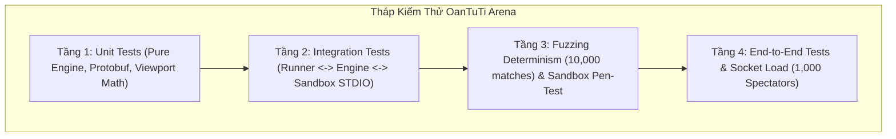
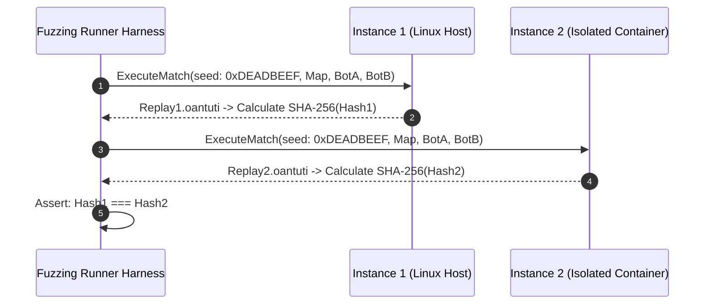
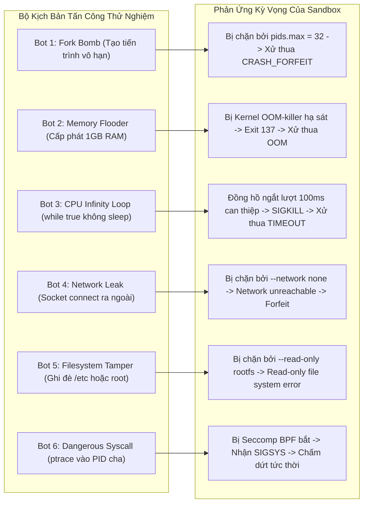
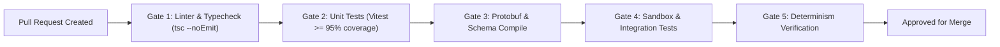

# 07 — Test Plan & Quality Assurance Specification

> **Tài liệu Kế hoạch Kiểm thử & Đảm bảo Chất lượng (Test Plan & QA Specification)**  
> **Dự án:** OanTuTi Arena (Competitive Battlecode Platform)  
> **Phiên bản:** 1.0.0  
> **Tiêu chuẩn kỹ thuật:** SDLC Standard + Ponytail Senior Engineering  
> **Trạng thái:** Phê duyệt triển khai (Approved for Implementation)

---

## 1. Chiến Lược Kiểm Thử Cốt Lõi & Tháp Kiểm Thử (Testing Strategy & Pyramid)

Hệ thống **OanTuTi Arena** chịu trách nhiệm điều phối các giải đấu lập trình tự động với tính chất ăn thua cao, nơi mọi phán quyết về thắng/thua, thời gian tính toán và điểm số ELO đều phải đạt **tính chính xác toán học tuyệt đối (Mathematical Exactness)**. Chiến lược kiểm thử áp dụng tháp kiểm thử 4 tầng:

| Tầng Kiểm Thử | Mục Tiêu Chính | Công Cụ Thực Thi | Độ Bao Phủ Cam Kết |
|:---|:---|:---|:---:|
| **1. Unit Tests** | Kiểm tra logic bàn cờ $G=(V, E)$, ăn quân, encode Protobuf, viewport | Vitest, TypeScript | $\ge 95\%$ Line Coverage |
| **2. Integration** | Kiểm tra giao tiếp STDIO NDJSON, Turn timer 100ms, Local runner | Vitest, Node child_process | $\ge 90\%$ Branch Coverage |
| **3. Fuzzing & Security** | $10,000$ trận đấu ngẫu nhiên kiểm tra tính tất định, Sandbox escape test | Custom Fuzzer, Docker / cgroups | $100\%$ Determinism |
| **4. E2E & Load Test** | Stream trực tiếp $1,000$ client WebSocket, đo độ trễ và rò rỉ RAM | Artillery / K6, WebSocket client | $p99 < 100$ms Latency |

---

## 2. Ma Trận Kiểm Thử Ca Biên Của Game Engine (Engine Edge Cases Matrix)

Mọi ca biên (Edge Cases) trong luật chơi được kiểm thử độc lập trong `packages/engine/tests/`:

| Mã Kịch Bản | Phân Loại Ca Biên | Đầu Vào Kích Hoạt | Kết Quả Kỳ Vọng (Expected Assertion) |
|:---|:---|:---|:---|
| `TC_ENG_001` | **Vực thẳm bàn cờ** | Bot di chuyển quân vào ô $(x, y) \notin V$ (vực thẳm / khoảng trống giữa Donut) | `is_legal_move() == false`, ném lỗi `ILLEGAL_MOVE` |
| `TC_ENG_002` | **Vượt Bounding Box** | Bot di chuyển ra ngoài $W \times H$ (ví dụ: $x = -1$ hoặc $y = 8$) | `is_legal_move() == false` |
| `TC_ENG_003` | **Cản đường cùng loại** | Búa Trắng cố gắng đi vào ô chứa Búa Đen | `is_legal_move() == false` (Blocking Invariant giữ nguyên) |
| `TC_ENG_004` | **Cản đường đồng minh** | Búa Trắng cố gắng đi vào ô chứa Kéo Trắng | `is_legal_move() == false` (Friendly Fire Invariant) |
| `TC_ENG_005` | **Cấm tự sát** | Kéo Trắng cố gắng lao vào ô chứa Búa Đen | `is_legal_move() == false` (Suicide Prevention Invariant) |
| `TC_ENG_006` | **Ăn quân chuẩn** | Búa Trắng di chuyển vào ô Kéo Đen | `is_legal_move() == true`, Kéo Đen bị tiêu diệt (`is_alive == false`), sinh `CaptureEvent` |
| `TC_ENG_007` | **Tuyệt diệt chủng loại** | Kéo cuối cùng của Black bị White ăn thịt | Trận đấu lập tức kết thúc: `winner == WHITE`, `reason == EXTINCTION` |
| `TC_ENG_008` | **Chiếm ô chốt** | Bất kỳ quân nào của White bước vào $T_B$ | Trận đấu lập tức kết thúc: `winner == WHITE`, `reason == THRONE_BREACH` |
| `TC_ENG_009` | **Bế tắc nước đi** | Đến lượt Black nhưng toàn bộ quân bị vây hãm, 0 nước đi hợp lệ | Trận đấu lập tức kết thúc: `winner == WHITE`, `reason == STALEMATE` |
| `TC_ENG_010` | **Ngưỡng 300 Turns** | Trận đấu chạm lượt thứ 300 mà chưa bên nào đạt điều kiện thắng | Kích hoạt bộ đếm quân số: bên nhiều quân hơn thắng, nếu bằng xử `DRAW` |

---

## 3. Kế Hoạch Fuzzing Test Tính Tất Định (Determinism Fuzzing Suite)

Tính tất định là thuộc tính sống còn của một nền tảng thi đấu: Cùng một bản đồ, cùng một hạt giống ngẫu nhiên (Seed) và cùng tập lệnh của 2 bot, kết quả trận đấu trên máy chủ Linux, máy lập trình macOS, hay trình duyệt Web phải **trùng khớp nhau từng byte**:

### 3.1. Quy Trình Chạy $10,000$ Ván Đấu Fuzzing
1. **Khởi tạo Fuzzing Suite:** Tạo $10,000$ seeds ngẫu nhiên cố định (`seed = 1000000..1010000`).
2. **Bot Giả Lập Ngẫu Nhiên (Randomized Fuzz Bots):**
   - Bot sinh nước đi ngẫu nhiên từ tập `get_legal_moves()`.
   - Bot cố tình xuất các nước đi biên (sát mép vực thẳm, tấn công, phong tỏa).
3. **Tiêu Chí Chấp Nhận (Acceptance Criteria):**
   - $10,000 / 10,000$ trận đấu kết thúc hợp lệ mà không có bất kỳ trạng thái treo (Deadlock) hay crash bộ nhớ.
   - Chạy lại lần 2 với cùng $10,000$ seeds: $100\%$ mã băm SHA-256 của tệp `.oantuti` trùng khớp $100\%$.

---

## 4. Kế Hoạch Kiểm Thử Bảo Mật Sandbox (Sandbox Penetration Test Plan)

Bộ test `packages/runner/tests/security-sandbox.test.ts` triển khai các kịch bản bot độc hại (Malicious Bots) để thử nghiệm độ vững chắc của hệ thống Sandbox:

---

## 5. Kế Hoạch Kiểm Thử Tải WebSocket (WebSocket Load Test)

Kịch bản kiểm thử tải mô phỏng phòng thi đấu chung kết với hàng ngàn người xem trực tiếp:

1. **Thông số tải (Load Profile):**
   - Số lượng kết nối đồng thời: **$1,000$ WebSocket clients**.
   - Thời lượng kiểm thử: **$60$ phút liên tục**.
   - Tần số broadcast: **$60$ ticks/giây** (phát sóng các trận đấu diễn ra song song).
2. **Chỉ số SLA / SLI Chấp Nhận:**
   - Tỷ lệ gói tin rơi rớt (Packet Drop Rate): $0.0\%$.
   - Độ trễ phân phối gói tin (Latency Distribution):
     - $p50 \le 15$ ms
     - $p95 \le 45$ ms
     - $p99 \le 80$ ms
   - Bộ nhớ RAM máy chủ Fastify: Đồ thị tiêu thụ phẳng (Flat Memory Graph), không có dấu hiệu Memory Leak sau 1 giờ chạy liên tục.

---

## 6. Chỉ Số Chất Lượng (Quality Gates) & CI/CD Pipeline

Toàn bộ mã nguồn khi tạo Pull Request bắt buộc phải vượt qua 5 cổng kiểm định chất lượng tự động:

- **Quy tắc tuyệt đối:** Không được phép merge bất kỳ PR nào nếu có dù chỉ 1 bài test bị lỗi hoặc độ trễ lượt đi vượt quá ngưỡng 100ms.

---

## 7. Kiểm Thử Phân Quyền RBAC & Kết Nối Mạng LAN (RBAC & LAN Testing Matrix)

| Mã Kịch Bản | Mục Tiêu Kiểm Thử | Điều Kiện Thực Thi | Kết Quả Kỳ Vọng (Expected Assertion) |
|:---|:---|:---|:---|
| `TC_RBAC_001` | **Khởi tạo Admin mặc định** | Server start lần đầu với DB mới | Tài khoản `admin` tồn tại, role là `ADMIN`, đăng nhập thành công với mật khẩu mặc định `admin123`. |
| `TC_RBAC_002` | **Đăng ký Player chuẩn** | Gọi `POST /api/auth/register` kèm payload hợp lệ | Tài khoản được tạo với role `PLAYER`, session cookie hợp lệ. |
| `TC_RBAC_003` | **Ngăn chặn leo thang đặc quyền** | Thí sinh gửi payload `{ username, email, password, role: 'ADMIN' }` | Role lưu trong DB bắt buộc là `PLAYER`. |
| `TC_RBAC_004` | **Chặn Player tạo giải** | Session Player gọi `POST /api/tournaments` | Trả về `403 Forbidden: Admin privilege required`. |
| `TC_RBAC_005` | **Chặn Player chốt giải** | Session Player gọi `POST /api/tournaments/:id/lock` | Trả về `403 Forbidden: Admin privilege required`. |
| `TC_RBAC_006` | **Nộp bot cá nhân vào giải** | Session Player gọi `POST /api/tournaments/:id/entries` với bot của mình | Trả về `200 OK`, bot được ghi nhận vào danh sách. |
| `TC_RBAC_007` | **Cơ chế Chống Lộ Kết Quả (Anti-Spoiler)** | Giải đấu đã chạy xong ở nền, Admin chưa bấm chiếu trận 1 (`projectedIndex == 0`) | Player gọi `GET /api/tournaments/:id` chỉ nhận danh sách trận rỗng/ẩn kết quả, standings chưa tính điểm trận đó. |
| `TC_RBAC_008` | **Đồng bộ tiến trình trình chiếu** | Admin gọi `POST /api/tournaments/:id/project-next` | `projectedIndex` tăng lên 1, Player query lại thấy trận 1 mở kết quả và standings được cộng điểm. |
