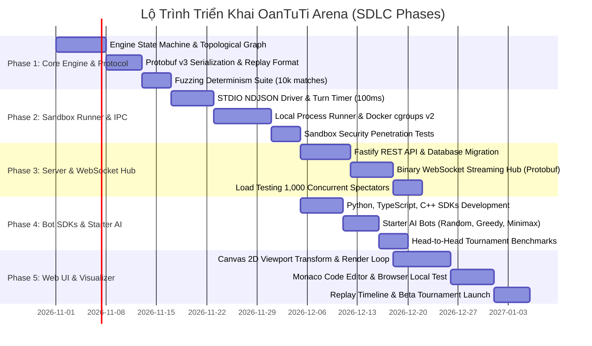

# 08 — Project Roadmap & Work Breakdown Structure (WBS)

> **Tài liệu Lộ trình Dự án & Phân rã Công việc (Project Roadmap & Work Breakdown Structure)**  
> **Dự án:** OanTuTi Arena (Competitive Battlecode Platform)  
> **Phiên bản:** 1.0.0  
> **Tiêu chuẩn kỹ thuật:** SDLC Standard + Ponytail Senior Engineering  
> **Trạng thái:** Phê duyệt triển khai (Approved for Implementation)

---

## 1. Lộ Trình Phân Kỳ Phát Triển Sản Phẩm (Phased Development Roadmap)

Dự án được phân chia thành **5 giai đoạn kỹ thuật kế tiếp nhau (5 SDLC Phases)**, tuân thủ nguyên lý Ponytail: Từng giai đoạn có ranh giới rõ ràng (Seams), có thể kiểm thử độc lập và bàn giao sản phẩm chạy được (Working Increment) mà không bị phụ thuộc vòng:

---

## 2. Chi Tiết Các Giai Đoạn Triển Khai (Phase Scope & Deliverables)

### Phase 1: Core Engine & Protocol Serialization
- **Trọng tâm:** Xây dựng lõi toán học tất định và hệ thống tuần tự hóa nhị phân.
- **Hạng mục bàn giao:**
  1. `packages/engine`: Máy trạng thái `GameState`, đồ thị lưới tọa độ tổng quát $G = (V, E)$, thuật toán sinh nước đi 8 hướng King-step, ma trận khắc chế Oẳn Tù Tì, quy tắc cản đường (Blocking Invariant), 4 điều kiện thắng tuyệt đối.
  2. `packages/protocol`: Compiler Protobuf v3 cho TypeScript và Python, bộ mã hóa/giải mã bitmask `valid_tiles_bitmask`, bộ đóng gói file Replay `.oantuti`.
  3. Bộ kiểm thử Fuzzing $10,000$ ván đấu ngẫu nhiên chứng minh tính tất định tuyệt đối ($100\%$ byte-for-byte SHA-256 match).

### Phase 2: Process Runner & Multi-Language Sandbox
- **Trọng tâm:** Hiện thực hóa môi trường điều phối tiến trình và cô lập bảo mật.
- **Hạng mục bàn giao:**
  1. `packages/runner`: Kênh truyền thông liên tiến trình STDIO NDJSON, quy trình bắt tay `INIT`/`READY` (1000ms), vòng lặp `TURN`/`MOVE` (100ms).
  2. Bộ đếm thời gian độ phân giải cao `process.hrtime.bigint()` với phần cứng watchdog tiêu diệt tiến trình quá giờ.
  3. Chế độ kép: **Local Process Runner** (cho dev/CI không cần Docker) và **Docker Hardened Runner** (cgroups v2, seccomp BPF, `--network none`, `--read-only`).
  4. Bộ kiểm thử xâm nhập bảo mật (Penetration Test) ngăn chặn fork bomb, memory flooding và network leak.

### Phase 3: Fastify HTTP Server & Binary WebSocket Streaming Hub
- **Trọng tâm:** Máy chủ dịch vụ Web, cơ sở dữ liệu quan hệ và phân phối trực tiếp.
- **Hạng mục bàn giao:**
  1. `packages/server`: REST API Fastify quản lý người dùng, nộp mã nguồn bot, ghép trận matchmaking, giải đấu Swiss/Round-Robin.
  2. Lược đồ cơ sở dữ liệu PostgreSQL / SQLite và chỉ mục tối ưu hóa cho bảng xếp hạng ELO.
  3. WebSocket Hub phát sóng nhị phân `TurnDeltaFrame` ($\le 200$ bytes/turn) cho hàng ngàn khán giả đồng thời.
  4. Bộ kiểm thử tải k6 / Artillery: $1,000$ spectators stream liên tục ở 60 ticks/giây với $p99 < 100$ms.

### Phase 4: Bot SDKs & Starter AI Bots
- **Trọng tâm:** Trải nghiệm lập trình viên thí sinh và kiểm thử cân bằng game.
- **Hạng mục bàn giao:**
  1. Thư viện Bot SDK chính thức cho **Python 3**, **TypeScript**, và **C++20**.
  2. 3 mẫu Bot chuẩn:
     - **Random Bot:** Chọn ngẫu nhiên nước đi hợp lệ.
     - **Aggressive Capture Bot:** Ưu tiên tối đa việc ăn quân đối phương nếu trong tầm với.
     - **Greedy Minimax Bot:** Đánh giá thế cờ theo khoảng cách tới ô chốt $T_{\text{enemy}}$ và bảo toàn quân cờ có nguy cơ bị tuyệt diệt.
  3. Giải đấu thử nghiệm nội bộ 100 trận để cân bằng luật chơi và kiểm định ELO.

### Phase 5: Web UI, Canvas 2D Visualizer & Monaco Editor
- **Trọng tâm:** Giao diện người dùng trực quan trên trình duyệt Web.
- **Hạng mục bàn giao:**
  1. `packages/web`: Ứng dụng React 18 + Vite + TailwindCSS.
  2. Canvas 2D Visualizer với thuật toán **Camera Viewport Transform** tự động căn chỉnh và co giãn cho bất kỳ hình học bàn cờ tổng quát nào.
  3. Rendering pipeline 6 tầng, hoạt ảnh Lerp mượt mà giữa các lượt đi, hiệu ứng nổ hạt khi ăn quân.
  4. Tích hợp Monaco Code Editor cho phép code và test trực tiếp trên Web.
  5. Bộ điều khiển Replay Timeline: Play, Pause, Step Next, Seek Slider, Speed Toggle.

---

## 3. Bảng Phân Rã Công Việc Chi Tiết (Work Breakdown Structure - WBS)

| Mã Công Việc (WBS ID) | Tên Gói Công Việc (Task Name) | Gói Phụ Thuộc | Ước Tính (Man-Days) | Vai Trò Phụ Trách | Đầu Ra Bàn Giao | Tiêu Chí Nghiệm Thu (Acceptance Criteria) |
|:---|:---|:---:|:---:|:---|:---|:---|
| **WBS-1.1** | Game State Data Structures & Topology Graph | Không | 3 | Core Engine Dev | `packages/engine/src/graph.ts`, `state.ts` | Load được map tổng quát, kiểm tra liên thông 8 hướng |
| **WBS-1.2** | Move Generation & Combat Rules | WBS-1.1 | 4 | Core Engine Dev | `packages/engine/src/rules.ts` | Vượt qua 10/10 edge case tests trong ma trận engine |
| **WBS-1.3** | Protobuf Schema & Serialization Codegen | Không | 3 | Protocol Engineer | `proto/oantuti.proto`, TypeScript bindings | Encode/decode `TurnDeltaFrame` $\le 200$ bytes |
| **WBS-1.4** | Replay Binary Packer (`.oantuti`) | WBS-1.3 | 2 | Protocol Engineer | `packages/protocol/src/replay.ts` | Tệp 150 turns $\le 25$ KB, đọc ghi không lỗi |
| **WBS-1.5** | Determinism Fuzzing Harness | WBS-1.2, 1.4 | 4 | QA / Core Dev | `packages/engine/tests/fuzz.test.ts` | $10,000$ ván đấu chạy song song, 100% SHA-256 match |
| **WBS-2.1** | STDIO NDJSON IPC Pipe Driver | WBS-1.2 | 3 | Systems Engineer | `packages/runner/src/ipc.ts` | Giao tiếp 2 chiều ổn định với tiến trình con |
| **WBS-2.2** | High-Resolution Turn Budget Enforcer | WBS-2.1 | 3 | Systems Engineer | `packages/runner/src/timer.ts` | Đếm nano-giây chính xác, ngắt `SIGKILL` sau 105ms |
| **WBS-2.3** | Local Process Runner (Lightweight) | WBS-2.2 | 2 | Systems Engineer | `packages/runner/src/local-runner.ts` | Chạy test suite không cần Docker, tốc độ $\ge 500$ turns/s |
| **WBS-2.4** | Docker cgroups v2 Sandbox Runner | WBS-2.2 | 5 | Security Engineer | `packages/runner/src/docker-runner.ts` | Đóng gói container với 256MB RAM, `--network none` |
| **WBS-2.5** | Sandbox Penetration Test Suite | WBS-2.4 | 3 | Security Engineer | `packages/runner/tests/security.test.ts` | Chặn đứng 6 kịch bản bot độc hại (fork bomb, OOM, leak) |
| **WBS-3.1** | Database Migration & DDL Schema | Không | 3 | Backend Engineer | `packages/server/src/db/` | Chạy migration sạch trên PostgreSQL và SQLite |
| **WBS-3.2** | Fastify REST API (Auth, Bots, Matches) | WBS-3.1 | 4 | Backend Engineer | `packages/server/src/routes/` | Đầy đủ CRUD bots, phân quyền JWT, tính điểm ELO |
| **WBS-3.3** | Binary WebSocket Streaming Hub | WBS-1.3, 2.3 | 4 | Backend Engineer | `packages/server/src/ws/` | Phục vụ kết nối spectator, broadcast delta nhị phân |
| **WBS-3.4** | Spectator Load Benchmark (1k clients) | WBS-3.3 | 3 | QA Engineer | `tests/load/websocket.k6.js` | $1,000$ spectators kết nối, $p99 < 100$ms, không drop |
| **WBS-3.5** | LAN Client Architecture & Two-Tier RBAC | WBS-3.2 | 3 | Backend Engineer | `packages/server/src/auth.ts`, `db.ts` | Default seeded Admin, Player self-reg, 403 authorization gate |
| **WBS-4.1** | Python Bot SDK & Starter Bot | WBS-2.1 | 2 | SDK Engineer | `sdk/python/` | Bot Python chạy hoàn hảo trên runner, không lỗi I/O |
| **WBS-4.2** | TypeScript & C++ Bot SDKs | WBS-2.1 | 3 | SDK Engineer | `sdk/typescript/`, `sdk/cpp/` | Compile và pass turn loop đúng luật |
| **WBS-4.3** | Heuristic Starter Bots (Greedy, Minimax) | WBS-4.1, 4.2 | 3 | AI Engineer | `bots/starter/` | Bot thắng Random Bot với tỷ lệ $\ge 90\%$ |
| **WBS-5.1** | Canvas 2D Viewport Transform Engine | WBS-1.1 | 4 | Frontend Engineer | `packages/web/src/canvas/viewport.ts` | Auto-fit mọi hình dạng bàn cờ, không méo tỷ lệ |
| **WBS-5.2** | 6-Layer Rendering Pipeline & Lerp FX | WBS-5.1 | 5 | Frontend Engineer | `packages/web/src/canvas/renderer.ts` | Đạt chuẩn 60 FPS mượt mà trên trình duyệt |
| **WBS-5.3** | Monaco Editor Integration & Local Test | WBS-1.2 | 4 | Frontend Engineer | `packages/web/src/components/Editor.tsx` | Soạn thảo syntax highlight, chạy test bot trên WebWorker |
| **WBS-5.4** | Replay Timeline Controller & Dark Mode | WBS-1.4, 5.2 | 3 | Frontend Engineer | `packages/web/src/components/Timeline.tsx` | Kéo tua từng turn, Play/Pause, chuyển đổi Dark/Light |

| **WBS-5.5** | LAN Operator Projector Deck & Anti-Spoiler Gate | WBS-3.5, 5.4 | 3 | Frontend Engineer | `packages/web/src/components/LeaderboardView.tsx` | Role badges, synchronized Next Match advancement, masked standings |
---

## 4. Ma Trận Quản Trị Rủi Ro Kỹ Thuật (Technical Risk Management & Contingency Plan)

| Mã Rủi Ro | Nguy Cơ Kỹ Thuật | Xác Suất | Mức Độ | Biện Pháp Phòng Ngừa (Mitigation) | Phương Án Khắc Phục Khẩn Cấp (Contingency Plan) |
|:---:|:---|:---:|:---:|:---|:---|
| **RSK-01** | **Sandbox Escape / Bot Độc Hại** Bot khai thác lỗ hổng kernel để chiếm quyền điều khiển server. | Thấp | Nghiêm trọng | Kích hoạt seccomp BPF whitelist nghiêm ngặt, cấm network, mount `--read-only`, hạn chế pids $\le 32$. | Kích hoạt gVisor (runsc) làm runtime virtualization thứ cấp cách ly kernel host. |
| **RSK-02** | **Nghẽn Băng Thông WebSocket** Số lượng khán giả tăng vọt gây quá tải mạng máy chủ. | Trung bình | Cao | Sử dụng frame nhị phân Protobuf siêu nhẹ $\le 200$ bytes, nén delta, gộp frame nếu nghẽn. | Triển khai WebSocket Edge CDN (Cloudflare WebSockets hoặc Redis Pub/Sub cluster phân tán). |
| **RSK-03** | **Bất đồng bộ tính Tất định (Non-determinism)** Sai khác kết quả giữa server Linux và client Web. | Trung bình | Cao | Viết Game Engine hoàn toàn bằng phép toán số nguyên (Integer math), loại bỏ số thực (Float) trong logic cốt lõi. | Bộ test Fuzzing tự động chạy kiểm tra băm SHA-256 trên mỗi bản build CI/CD. |
| **RSK-04** | **Jitter đồng hồ đo thời gian lượt** Node.js GC dừng tiến trình khiến bot bị phạt quá giờ oan. | Trung bình | Trung bình | Sử dụng timer đơn điệu cấp nano-giây, bổ sung khoảng đệm an toàn (Grace period: 5ms). | Chuyển module Timer sang C++ Native Addon hoặc Rust FFI nếu phát hiện jitter $>2$ms. |
| **RSK-05** | **Bản đồ dị biệt làm vỡ giao diện** Bản đồ hình học kỳ lạ gây lỗi tính toán Viewport trên Canvas. | Thấp | Trung bình | Kiểm tra schema map bằng JSON Schema `ajv` nghiêm ngặt trước khi tải, chặn map không liên thông. | Fallback về chế độ vẽ lưới tiêu chuẩn với thanh cuộn (Scrollable Canvas) nếu aspect ratio $>4:1$. |

---

## 5. Tiêu Chuẩn Nghiệm Thu Toàn Diện Bộ Tài Liệu (Definition of Done - DoD)

Toàn bộ gói tài liệu đặc tả kỹ thuật và kế hoạch triển khai được công nhận hoàn tất khi và chỉ khi:
1. Trọn bộ 8 tài liệu đặc tả kỹ thuật Markdown từ `01` đến `08` hiện diện đầy đủ, cấu trúc mạch lạc, chuẩn ngữ nghĩa.
2. File định nghĩa Protocol Buffers `proto/oantuti.proto` biên dịch thành công $100\%$ không có lỗi cú pháp.
3. File JSON Schema `maps/schema.json` kiểm định thành công mẫu bản đồ `sample-donut.map.json`.
4. Toàn bộ các sơ đồ Mermaid tuân thủ cú pháp chuẩn và có thể render trực quan trên GitHub.
5. Bộ kiểm thử tự động `tests/specs-validation.test.ts` và `tests/proto-compile.test.ts` đều đạt trạng thái **ALL GREEN (100% PASS)**.
