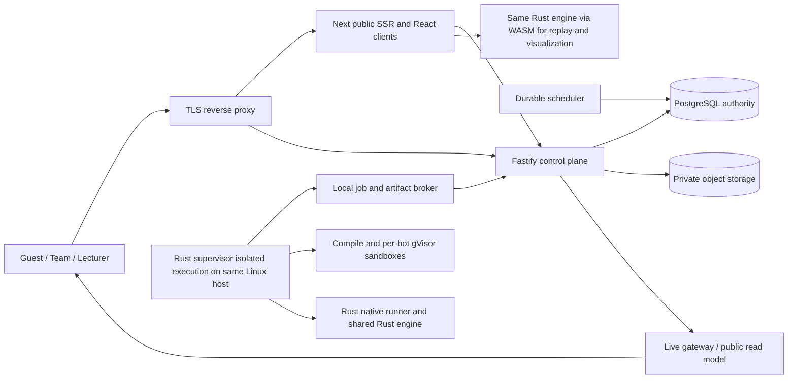

# 03 — Kiến trúc production, dữ liệu và Interface

> Baseline thiết kế đã chốt để triển khai, chưa triển khai/chứng nhận release. Authority sản phẩm: [01](01-PRODUCT-REQUIREMENTS.md), [02](02-GAMEPLAY-TOURNAMENT-RULES.md); technical defaults do người thiết kế chọn, không gán thành xác nhận riêng của người dùng. Resource/security/deployment gate: [05](05-SECURITY-OPERATIONS-QUALITY.md).

## 1. Quyết định kiến trúc

**Rewrite có mục tiêu; delta Rust được duyệt 2026-10-17.** Control plane TypeScript/Fastify modular monolith; web **Next.js/React** public SSR và client Canvas/Monaco/WASM. Một implementation gameplay v2 tại `crates/arena-engine`, dùng native authoritative và WASM browser cùng semantics/revision; `crates/arena-runner` là trusted native state machine không đặc quyền; `crates/arena-supervisor` sở hữu isolation/accounting. Thay Node/TS game-host/v2 engine, không chuyển tournament policies/control plane sang Rust. PostgreSQL **16** thay SQLite cho transactional jobs/ledger/migrations/PITR; không suy SQLite không thể phục vụ500đội. Exact patches/toolchains/WASM targets/image digests được khóa bằng BOM05§7.4. [Research stack](../../research/2026-10-13-v2-tech-stack-evaluation.md) giữ rationale lịch sử, phần Node/TS engine đã superseded.

**Canonical deployment: một máy Linux cho cả LAN và ONLINE/VPS.** PostgreSQL/private local durableobjects, Next/Fastify/scheduler/Rustsupervisor là các process/module cùngmáy, không cluster/remote worker/standby/Redis/executionVM default. Bot/compiler per-jobgVisor, credentials/capabilities/filesystem tách controlplane, admission/cgroupreserve bảo vệ API/DB. Không usercode trongAPI. Checksum/fsync/atomicpromotion+DBtransaction là acceptanceauthority; backupngoàimáy là recovery không synchronousreplica. LANofflinebundle/localCAHTTPS, ONLINEpublicTLS/mail; sharedcore.



Broker là module control plane, không deployment service riêng: socket Unix `/run/oantuti/broker.sock`, filesystem ACL + `SO_PEERCRED` kiểm đúng UID supervisor/reconciler và protocol version. Không mở worker HTTP port, mTLS hay remote-worker certificates. Local operation grant bind job/attempt/fence/deploymentGeneration, TTL15phút và chỉ artifact/evidence key được cấp; sandbox không nhận FD/grant/DB password/session key hoặc quyền enumerate object store. Engine trusted chạy ngoài sandbox Bot, xác minh mọi action; API không spawn compiler/Bot dù supervisor vắng mặt.

## 2. Modules và ownership

| Module | Trách nhiệm và invariant | Vị trí đích |
|---|---|---|
| Identity | ONLINE email/password/verify/recovery; LAN username/password ADMIN-issued/local recovery; sessions/scoped authorization; không SSO/MFA | `packages/server/src/identity/` |
| Teams | Organization/course membership, roster/invitation/entry authorization | `packages/server/src/teams/` |
| Submissions | Source bất biến, compilation workflow, selected/frozen artifact | `packages/server/src/submissions/` |
| Tournaments | Lifecycle/ruleset/stage/round/pairing; không spawn Bot | `packages/server/src/tournaments/` |
| Results | Accepted result ledger, correction, standings/rating commit | `packages/server/src/results/` |
| Jobs | Durable dispatch, lease/fencing/retry/quota; không tính luật game | `packages/server/src/jobs/` |
| Live | Public/private projections, bounded transport, replay retrieval | `packages/server/src/live/` |
| Supervisor | Sandbox lifecycle, native watchdog/accounting, bounded Bot IPC, build/spool/delivery; không luật game | `crates/arena-supervisor/` |
| Engine | Pure deterministic gameplay v2, validated state; không IO/DB/identity/process privileges; native/WASM cùng semantics | `crates/arena-engine/` |
| Runner | Trusted native INIT/TURN/action/evidence state machine và trace/map inspection, không Bot FD/launcher privilege | `crates/arena-runner/` |
| Protocol | Versioned source proto, generated Rust/TS và OpenAPI/contracts; không serialize engine memory layout | `packages/protocol/` |
| Web | Next public SSR + client workspace/viewer/organizer; không mutation authority thứ hai | `packages/web/src/app/`, `packages/web/src/features/` |

Không tạo repository Interface cho mỗi query vô nghĩa. Seam có adapter thật: production gVisor; local immutable filesystem và test temporary storage. Native runner **không phải** unsafe native Bot executor: Bot/compiler luôn sandbox, không local-dev/native/runc fallback khi gVisor hỏng. Không tạo S3 adapter/remote service chỉ để có abstraction.

### Process seams canonical

Rust supervisor sở hữu Bot FD/cgroup/runsc/workload credential; Rust native runner không các quyền này, chỉ engine/state/actions/evidence. Dedicated OS watchdog thread không await parser/upload/engine. Supervisor↔runner dùng private Unix socketpair FD, u32BE length+Protobuf, ≤1MiB/frame trước allocate; envelope version/game/attempt/seq/requestId/digests. `execution.proto` generate Rust+TS. Messages StartGame/RunBotTurn/TurnObservation/TurnCommitted/GameFinished/ExecutionFault/StopGame; budget chỉ manifest, runner không đổi quota. Bot NDJSON≤256KiBrequests/16KiBresponses là transport khác. Host reaper ngoài supervisor killcgroups nếu SIGKILL, không tin destructor.

Runner production chỉ `arena-runner run --socket-fd <inherited-fd>`; không nhận arbitrary Bot executable paths/quota qua CLI. `arena-runner inspect` dùng generated `InspectionRequest/Response` trong `replay-v2.proto`, u32BE stdin/stdout, cap8MiB trước allocate, một request/process, timeout5s, không launch Bot. `VERIFY_TRACE` nhận pinned manifest/full init/actions/claimed end/trusted supervisor observation references, trả validity/canonical state digests/computed outcome/applied ply/failure code; `ANALYZE_MAP` nhận map/pieces/maxPly/engineRevision, trả typed validation errors/warnings/initial outcome/revision/request size. Server kiểm exit/framing/schema/revision/correlation và fail closed; không empty-warning/success fallback. Public stream và execution là hai transport riêng.

Engine kiểm validated initial state theo02 trước launch/INIT/TURN; initial terminal là engine evidence, không Bot fault. `RunBotTurn.ply=0` chỉ INIT, TURN từ1; phase/side/request/game/attempt/sequence/profile phải khớp. Supervisor trả đúng một correlated READY (INIT), RESPONSE (TURN), BOT_FAULT hoặc INFRA_FAILURE kèm monotonic timestamps/cumulative CPU/freeze hoặc cleanup confirmation/health attestation. Confirmed startup Bot fault vẫn kiểm INIT phía còn lại; double fault→NO_CONTEST double-forfeit; infra/missing/forged observation không được suy thành Bot loss. Native/WASM dùng cùng transitions; browser không chạy Bot hoặc accept kết quả.

Rust cutover interfaces là đích chưa khẳng định đã tồn tại: `GameState::try_new(map: MapDescriptor, pieces: Vec<Piece>, max_ply: u32) -> Result<GameState, ValidationError>`, `outcome(&self) -> Outcome`, `apply(&mut self, action: MoveAction) -> Result<TurnDelta, MoveError>`, `visit_legal_moves(&self, side: PlayerSide, visit: impl FnMut(MoveAction))`. Generated replay DTO MapDescriptor/InitialState/Action/TurnDelta/Outcome pin enum numbers version2, unknown reject, không engine memory layout. GP-01–05 là authority; invalid/terminal action không mutate state; transitions/evaluation sau init tránh Vec/HashSet allocations, phải chứng minh instrumentation native/WASM, không suy từ code description.

Adapter đích `packages/server/src/results/engine-adapter.ts` cung cấp `verifyTrace(request): Promise<VerifyTraceResponse>` và `analyzeMap(request): Promise<AnalyzeMapResponse>` qua trusted inspect process, không DB credentials/sandbox launch; S08 dùng cùng adapter, không TS validation semantics thứhai. Invalid map typed validation failure; parser/crash/timeout→ENGINE_ANALYSIS_UNAVAILABLE503/integrity blocker, không Bot fault. Wrapper `crates/arena-engine-wasm` dùng wasm-bindgen với generated proto bytes: `analyzeMap(initialBytes: Uint8Array): Uint8Array`, `createGame(initialBytes: Uint8Array): Game`, `Game.apply(actionBytes): Uint8Array`, `Game.snapshot(): Uint8Array`, `Game.free()`. Browser owns/free handle mỗi route; không giữ một engine authority khác.

Broker nhận/pin observations trực tiếp từ authenticated UID-bound worker session + operation grant/attempt/fence/generation, tính digests/trusted DB refs; completion chỉ reference, không tự khai attestation. Native inspect kiểm gameplay/protocol/side consistency; broker kiểm provenance/health/accounting/freezer trước Bot forfeit acceptance. Missing/contradictory/untrusted observations chặn accept; uncertain counters là infra. Build branch duy nhất `packages/server/src/submissions/acceptance.ts::acceptBuildCompletion(pinned, tx)` do reconciler gọi sau durable pin + verified artifact promotion; không callback-after-commit completion authority.

Next một webapp, không Viteportal song song. Public overview/rules/standings/matchtext renderHTML từ publicreadDTO, metadata/canonical/OG/HTTP404 thật. Canvas/Monaco/live clientcomponents; privateworkspace no-store, khôngPII trongSSRcache/metadata. Không ServerActions cho tournamentmutation; Fastifyauthority, web khôngDBcredential. MutablepublicSSR request-time, API/edge revisioncache ngắn, khôngISR/Redis bắtbuộc. Reverseproxy /api/v2,/ws/v2→Fastify; exactsupportedReact/Next và dependencydigests review+pin theo05§7.4, không giữReact18 chỉ vìv1.

## 3. Lifecycle canonical

Tournament: `DRAFT → PUBLISHED → REGISTRATION_OPEN → VALIDATING_SUBMISSIONS → LOCKED → READY_TO_START → RUNNING ↔ PAUSED → PROVISIONAL → FINALIZED → ARCHIVED`; CANCELLED terminal trước FINALIZED. Intake đóng theo serverclock/receiptdeadline, drain bài đúng hạn rồi auto-lock; infrastructure pending hoãn. **Chỉ ADMIN bấm Bắt đầu** mới RUNNING; không timer/lock/reveal/readiness/restart tự start. READY_TO_START cần frozenentries/maps/ruleset và capacityplan hợp lệ. Start transaction kiểm ADMIN normal session theo deployment profile (ONLINE verified-email; LAN LOCAL_BOOTSTRAP), recent re-auth/expectedVersion/idempotency/preconditions, persist startedBy/startedAt/startReceipt và enable official dispatch atomically. Không precompute officialgames trướcstart. Retry trả receipt cũ. Sau start scheduler tự tiến vòng/epoch; restart khôi phục RUNNING không bấm lại. TEST mọi thời điểm theo quyền/quota/readiness, độc lập start.

Submission: `VALIDATING → QUEUED → COMPILING → SMOKE_TESTING → READY` hoặc `REJECTED`; infrastructure failures đổi attempt nhưng submission vẫn queued/blocked, không dùng REJECTED cho lỗi nền tảng.

Round/epoch: `PLANNED → RUNNING → PROVISIONAL → SEALED`, BLOCKED khi unresolved infra, INVALIDATED khi correction. Job: `QUEUED → LEASED → RUNNING → COMPLETION_PENDING → SUCCEEDED`; infra computation RETRY_WAIT/QUEUED hoặc BLOCKED, delivery pending không computation retry. BOT_FORFEIT vẫn execution terminal thành công. Encounter terminal khi đủ games/tie hoặc WALKOVER, DOUBLE_FORFEIT, DOUBLE_WITHDRAWAL, EMPTY theo02; không ép double-forfeit chạy đủ4games. Stream END không đồng nghĩa result được publication barrier hay tournament FINALIZED.

Tất cả transitions kiểm expected state/version và deadline tại server; optimistic version stale trả 409 kèm latest state. Không kiểm quyền chỉ bằng nút bị ẩn.

Persist sealEligibleAt cho round/epoch và **finalAppealWindowMinutes** trong immutable rule revision, configured trước registration theo02; scheduler chỉ thông báo eligible, không autoFINALIZED. ADMIN finalize cần normal session đúng deployment profile và recent password re-auth; transaction lock tournament row cùng dispute-create path, kiểm clock≥appealClosesAt/no open dispute/infra/integrity blocker/accepted-ledger projection consistency, ghi finalsnapshot+actor/time/audit/outbox. Window0 không discard dispute đã commit. Sau finalized, yêu cầu mới là support/late-review, chỉ explicit reopen có audit mới đổi trạng thái. FinalizedAt chờ ADMIN, không hứa exact ETA.

## 4. Schema logic và constraints

UUID PK; UTC timestamptz; mọi schedule có timezone IANA cho hiển thị. Số điểm giải/game lưu integer half-points khi cần; rating NUMERIC(12,6); JSONB chỉ cho immutable manifest hoặc diagnostics, không nhét entries/standings authoritative vào config JSON.

| Entity | Trường chính và constraint |
|---|---|
| organizations, courses | organization_id, code; một ADMIN toàn deployment, không lecturer-assignment role |
| users,sessions,email_verification_tokens,password_reset_tokens | UUIDuser, LANuniqueusername và optionalemailunique; authOrigin/activationMethod khôngfakeverified; LAN `password_change_required=true` khi cấp/reset, limitedpassword-change session chỉ đổi password/logout, atomicconsume+revoke temporarycredential rồi cấp normal session; ADMINsingleton mọi status; accountCapacity transaction+audit |
| teams, team_memberships, invitations | captain_user_id; membership unique(team,user); invitation hash/expiry; course enrollment |
| tournaments, rule_revisions | course_id, format, state, version, open/close/start times, manifest_digest; public version immutable after lock |
| entries | unique(tournament,team); frozen_submission_id/artifact_digest, seed_ordinal, status; membership tournament uniqueness via enrollment constraint transaction |
| deployment_settings,tournament_admission_limits | ADMIN quản lý accountCapacity/maxTeams, usage counts authoritative và transactional enforcement; không giảm dưới usage hoặc âm thầm loại roster; capacity proof riêng không lấy configuredcap làm N lịch đấu |
| tournament_invite_codes,admissions |Một code revision active/giải, shared multi-use; verifier private,expiry/revocation/rotation; admission unique(tournament,team),codeRevision/actor/time; không per-team codes/publicrawcode; đổi mã không xóa admission|
| submissions, build_attempts, artifacts | team_id, source_digest, sdk/runtime digest, status; artifact key/hash/size; builds refer immutable input |
| stages, rounds | unique(tournament,stage ordinal); unique(stage,round ordinal); sealed_at, input_snapshot_digest, revision |
| encounters, byes | unique(round,slot,revision); entry A/B; ordinal, map permutation; bye explicit no game |
| games | unique(encounter,game ordinal,revision); WHITE/BLACK entry/artifact IDs, map/seed/ruleset digest; dependent tiebreak only created when needed |
| jobs, attempts | unique(job type,target,revision); attempt ordinal; lease_owner, expiry, fencing_token, retry count, available_at, heartbeat |
| result_versions, accepted_results | immutable result version; unique(game,revision) accepted pointer; supersedes FK; attempt/fence/provenance |
| replay_objects, live_chunks | game/attempt, key/hash/size, ready flag, sequence interval; no public raw log |
| standings_snapshots, rating_epochs, rating_events | unique(stage,round/revision,entry); rating event unique(epoch,encounter,entry,revision); digest/input snapshot |
| disputes, audit_events, outbox_events | requester/scope/decision; append-only actor/reason/requestId; outbox unique event ID |

FK và unique constraints phải chặn duplicate acceptance và cross-course reference. Index jobs(state,available_at,priority), attempts(job_id,ordinal), encounters(round_id,ordinal), games(encounter_id,ordinal), entries(tournament_id,status), submissions(team_id,created_at DESC), results(game_id,revision), outbox(delivered_at,created_at), standings(stage_id,revision,rank). Public read pagination cursor theo `(rank,entryId)` hoặc `(roundOrdinal,encounterOrdinal,id)`, snapshot version giữ ổn định trong khi duyệt nhiều trang.

## 5. Durable jobs và chính thức hóa kết quả

### AR-01 — Claim, lease và fencing

Durable jobs priority: recovery official → scheduled official → build/validation bài đúng hạn (kể cả drain sau deadline) → TEST_BUILD/TEST_GAME. Resource pools/reserve riêng, test không starve official. Snapshot/workspace/project file manifest/hash bất biến, archive extraction bounded; test namespace/result/event/replay/private ACL khác official. Test snapshot không submission ordinal/entry candidate; lock chỉ official submissions. Không dedicated practice tournament/rating.

Lease 30 giây, heartbeat 5 giây; mỗi lần cấp lại tăng fencing token. Worker mất heartbeat không làm game tự xử thua; reconciler 10 giây đánh dấu stale, reclaim sau lease expiry. Max3 infrastructure attempts, exponential backoff 5/15 giây trước attempts2/3, sau đó BLOCKED. Không hết retry rồi ghi CANCELLED toàn giải. Watchdog wall có giới hạn toàn game 330 giây (300×1s +startup/IPC allowance), nên lease phải được gia hạn xuyên game.

Scheduler có lease riêng và unique round/job keys; hai scheduler đồng thời không tạo hai lịch. Tạo round và jobs trong cùng transaction; replay từ accepted ledger để reconstruct standings. Claim worker chỉ công việc phù hợp runtime/profile đã chứng nhận; worker bất thường bị quarantine và giảm admission.

### AR-02 — Kết quả và object storage không cùng transaction

1. Worker ghi immutable completion evidence vào object key chứa job/attempt/fence; upload qua broker với quyền hạn mục tiêu cụ thể. BUILD/TEST_BUILD dùng BuildCompletion, GAME/TEST_GAME dùng GameCompletion; không dựng replay/winner cho build.
2. Broker exhaustive-switch job kind, reject mismatch; kiểm checksum, size, pinned provenance và objects. Game branch dùng Rust native `inspect VERIFY_TRACE` với trusted observation provenance; không tin ETag là SHA-256 hoặc browser/WASM là result authority.
3. prepareCompletion chỉ khi lease/fence hợp lệ và broker đã giữ **durable staging copy của toàn bộ evidence để hoàn tất acceptance**: fsync mỗi file và parentdirectory, kiểm digest/length/provenance/trace, persist stagingkeys/digests trong cùng DBtransaction pin COMPLETION_PENDING. Staging do broker quản lý, không chỉ volatile worker spool; referenced pending objects có hold/noGC. DBpin chỉ sau evidence durability. Reconciler có thể finish immutablepromotion/acceptance không cần supervisor gốc; pending không computationreclaim. Trước pin, heartbeat/spool và expiredlease vẫn có thể retrycompute. Missing/corrupt pinned evidence sau durabilityproof là integrityincident, không silentlyrecompute/award.
4. Promote toàn evidence/artifacts/replay immutable local object trước accepted transaction: fsync bytes, atomicrename và fsync parentdirectory hoặc storageadapter guarantee tương đương. Transaction durable PostgreSQL (`fsync=on`, `synchronous_commit=on`) kiểm pinned completion/fence/generation rồi atomically commit đúng branch: build artifact/submission READY hoặc SOURCE_REJECTED; game official result+acceptedpointer+replaymetadata hoặc private test result; cùng terminaljob/receipt/outbox. Không standby/remote_apply/PENDING_REPLICATION/LSNbarrier; không direct recordResult authority thứ hai.
5. Sau local durablecommit, public/outbox/reducer/rating/seal chỉ đọc acceptedrows, duplicate/lostack trảreceipt canonical khôngdouble-score. Crash giữa objectpromotion/commit có orphan reconcile; committedresult phải đủdigest/evidence, storagefailure khôngaccept. Restorefence deploymentgeneration và staleleases trướcresume; khôngexactly-once delivery claim.

Disk intact/process restart giữ acceptedledger/evidence theo local durability, COMPLETION_PENDING delivery không330scompute watchdog hoặcretrybudget. Disk/máy mất restore đến backup consistent cuối, khôngzero-loss/HAclaim. OrphanGC24h chỉ unreferenced/nohold. Backupfailure cảnhbáo dữ liệu atrisk, không lặnglẽ chạy lại acceptedgame để giả restorefull.

### AR-03 — Freeze entry thật

Đóng intake tách khóa execution snapshot. Receipt gắn source object checksum/durability và receivedAt server `< submissionClosesAt`; immutable eligible set persist và chặn receipt mới sau hạn. Lock transaction chỉ sau toàn eligible set READY/REJECTED, chọn max receiptOrdinal READY, bất kể readyAt sau hạn. Infra pending/BLOCKED không tự fallback/exclude. Frozen artifact ID dùng mọi jobs; edit/delete draft không phá snapshot. Idempotent close/drain/lock khôi phục sau restart.

## 6. Interfaces đích cho implementation

Các contract sau là baseline cho implementation/plan, chưa là code v1. DTO không expose DB entities. Shared types ở `packages/protocol/src/contracts/`; engine không import identity/db types.

```ts
type UUID = string;
type Digest = string; // lowercase SHA-256 hex, 64 characters
type Instant = string; // UTC RFC3339
type IdempotencyKey = string; // 16–128 ASCII characters
type Actor = Readonly<{ userId: UUID; role: 'ADMIN' | 'STUDENT'; sessionId: UUID;
  deploymentProfile: 'LAN_OFFLINE' | 'ONLINE'; authorizedTeamIds: readonly UUID[];
  reauthenticatedAt: Instant | null }>;
type CommandContext = Readonly<{ actor: Actor; expectedVersion: number;
  idempotencyKey: IdempotencyKey; requestId: UUID }>;
type Receipt<T> = Readonly<{ receiptId: UUID; requestId: UUID; resourceId: UUID;
  version: number; committedAt: Instant; data: T }>;
interface TournamentCommands {
  lock(tournamentId: UUID, ctx: CommandContext): Promise<LockReceipt>;
  start(tournamentId: UUID, ctx: CommandContext): Promise<StartReceipt>;
  finalize(tournamentId: UUID, ctx: CommandContext): Promise<FinalReceipt>;
}
interface SubmissionCommands {
  create(tournamentId: UUID, teamId: UUID, source: SourceUpload,
    ctx: CommandContext): Promise<SubmissionReceipt>;
}
interface PairingPolicy { plan(input: PairingInput): PairingPlan }
interface JobBroker {
  claim(worker: WorkerIdentity, capacity: SlotOffer): Promise<JobLease | null>;
  heartbeat(lease: LeaseIdentity): Promise<LeaseStatus>;
  prepareCompletion(lease: LeaseIdentity, evidence: CompletionEvidence): Promise<CompletionReceipt>;
  complete(completion: PinnedCompletion, actor: ReconcilerIdentity): Promise<BuildReceipt | ResultReceipt | TestReceipt>;
}
interface ResultCommands {
  previewCorrection(gameId: UUID, command: CorrectionCommand, ctx: CommandContext): Promise<CorrectionImpact>;
  applyCorrection(gameId: UUID, command: CorrectionCommand, previewDigest: Digest,
    ctx: CommandContext): Promise<CorrectionReceipt>;
}
```

Actor xây từ authenticated session/DB scopes, không client-supplied; limited password-change session không tạo Actor thường. expectedVersion là aggregate version (submission create dùng entry intake aggregate, không tournament version thay đổi bởi đội khác). Mutation cùng scope+idempotencyKey+payload digest trả receipt canonical trước stale-version check; reuse key với payload khác409. Receipt IDs/audit/outbox cùng durable transaction; retention key tối thiểu bằng resource lifetime, không retry tạo bản sao. Preview không consume idempotency key; apply recompute impact dưới lock và reject409 nếu preview/input revision đổi.

- `LockReceipt = Receipt<{frozenEntryCount:number; excludedReasons: readonly EntryExclusion[]; manifestDigest:Digest}>`; `StartReceipt = Receipt<{startedAt:Instant; startedBy:UUID; manifestDigest:Digest}>`; `FinalReceipt = Receipt<{finalizedAt:Instant; snapshotDigest:Digest}>`.
- `SourceUpload` là bounded stream + canonical project manifest (language, entrypoint, SDK version, file path/size/digest), không arbitrary executable path. `SubmissionReceipt = Receipt<{submissionId:UUID; receivedAt:Instant; receiptOrdinal:number; sourceDigest:Digest; intakeEligibility:'ELIGIBLE'}>`. receivedAt sau durable full-source receipt, phải trước cutoff; ordinal monotonic theo team/giải. Không thành công trước durability. `EntryQueries.candidate(tournamentId,teamId,actor)` chỉ own team hoặc ADMIN; max ordinal READY tạm, freeze sau drain toàn eligible set; không selectEntry API.
- `PairingInput` immutable gồm format/policy revision, round ordinal, canonical entries/draw indices, seed, sealed result/rating snapshot digests; `PairingPlan` encounters/byes/explanations/inputDigest/planDigest. Pure deterministic, chạy bounded job không khóa API; timeout10s trên benchmark host là gate, quá hạn BLOCKED không random fallback.
- `WorkerIdentity`/`ReconcilerIdentity` là local UID-bound identities, không Actor trình duyệt. `SlotOffer` gồm certified profile/runtime digests và số build/game slots còn trống. `LeaseIdentity` gồm jobId/attemptId/fence/deploymentGeneration/grantId; `JobLease` thêm pinned manifest/expiresAt. `LeaseStatus` ACTIVE+expiresAt hoặc STOP+reason. Mọi integer fence/ordinal lớn qua wire là decimal string, không JSON BigInt.
- `CompletionEvidence` là generated discriminated union trong `completion-v2.proto` và `contracts/jobs.ts`: BuildCompletion (BUILD/TEST_BUILD) chứa source/SDK/compiler/runtime/profile/manifest digests, outcome READY hoặc SOURCE_REJECTED, stage COMPILE hoặc INIT_SMOKE, private diagnostic refs; READY bắt buộc artifact key/digest/size/entrypoint, không replay/winner/resultVersion. InfrastructureFailure có typed reason/observations, retry/BLOCKED theo lease, không SOURCE_REJECTED. GameCompletion (GAME/TEST_GAME) chứa pinned manifest/trace/replay/terminal/resource observation refs; game evidence giữ verdict/winner/reason/actionTraceDigest/replay metadata/private diagnostics. `CompletionReceipt = Receipt<{completionId:UUID; state:'COMPLETION_PENDING'; evidenceDigest:Digest}>`; `PinnedCompletion` chỉ completionId/evidenceDigest/deploymentGeneration, broker đọc lại trusted DB. `ResultReceipt = Receipt<{resultVersionId:UUID; state:'ACCEPTED'}>` chỉ official game sau local durable acceptance; BuildReceipt/private TestReceipt không tạo resultVersion. Pending không public/scoring, complete chỉ reconciler, duplicate/lost ack trả canonical receipt không double-score.
- `BuildReceipt` là typed branch receipt cho BUILD/TEST_BUILD, chốt generated contract khi implementation: READY pin durable artifact và submission/test-build state; SOURCE_REJECTED giữ private diagnostics, không xóa candidate READY cũ. TEST_BUILD READY enqueue đúng một TEST_GAME trong durable transaction, không official ordinal/result. Receipt không thay quyền source/log hoặc expose private diagnostic refs cho public.
- `CorrectionCommand` gồm expectedResultRevision, action VOID hoặc REJUDGE, reason; không cho nhập arbitrary winner. `CorrectionImpact` gồm affected revisions/descendants, required re-pair/rebuild và previewDigest; `CorrectionReceipt = Receipt<{impactDigest:Digest; newRevision:number}>`. Apply theoTR-08, không dùng obsolete `correct` alias.
- `TestCommands.create(tournamentId,teamId,snapshot:ProjectSnapshot,opponent:OwnArtifactOrBaseline,options:TestOptions,ctx:CommandContext):Promise<TestReceipt>` và `TestQueries.result(testId,actor):Promise<PrivateTestDto>`. Snapshot immutable, không submissionOrdinal/candidate. Team/admission/quota/readiness enforced nhưng **không phase/deadline gate**, cả archived. Historical profile unavailable trả503/unsupported, không silent fallback; hidden maps trước reveal không dùng cho test.
- Supervisor generated `execution.proto`: `Build(BuildManifest) → BuildOutcome`, `RunGame(GameManifest) → GameEvidence`, `Terminate(attemptId) → CleanupReceipt`. GameManifest gồm protocol version, game/attempt/fence/generation, entry/artifact/ruleset/engine/runtime/map digests, seed/sides/resource profile. Bounded observer lỗi không bỏ cleanup; host reaper xử lý supervisor chết.
- PublicQueries chỉ public DTO. `SubmissionQueries.source(submissionId,actor):Promise<PrivateSourceDto>` và `logs(submissionId,actor):Promise<PrivateLogsDto>` ADMIN hoặc đội sở hữu, audit/no-store, không draft/test chưa nộp. UUID/UTC/decimal/error serialization đóng trong versioned OpenAPI và generated protocol.

## 7. HTTP và lỗi

Versioned control API `/api/v2`, same-origin HTTPS trong cả hai profiles (LAN dùng local CA trust trong offline bundle). Mutations require authenticated actor+scope+CSRF/Origin, trừ public login/registration/token redemption dùng exact Origin+rate-limit và purpose-bound token khi có; chúng không được require session chưa tồn tại. Internal jobs chỉ UDS, không HTTP/mTLS/browser session. Idempotency-Key cho create/lock/start/finalize/correction; error `{code,message,requestId,details,retryAfter}` không stack/path/source. 400invalid,401unauthenticated,403scope,404inaccessible,409state/version,413size,422source,429quota,503admission.

| Route family | Quyền | Nội dung |
|---|---|---|
| GET tournaments/:id + standings/bracket/rounds/encounters | Public nếu published | Metadata, paginated snapshots, rules, announcements |
| GET encounters/:id, games/:id/replay | Theo visibility giải | Public result/provenance, replay bytes có checksum; không stderr |
| POST teams/invitations/memberships | ONLINE team permissions; LAN chỉ ADMIN quản lý roster | Profile permission enforce server, không chỉ ẩn UI |
| POST tournaments/:id/join; POST organizer/tournaments/:id/enrollments | ONLINE captain+sharedcode; LAN ADMIN direct enrollment | Transaction kiểm roster/capacity/unique membership, cấp admission; LAN không code/Join sinh viên; không tạo thêm role |
| POST teams/:id/submissions, GET builds/logs | Team | Nhận source, private logs, READY status |
| GET tournaments/:id/entries/me | Team scope | Bot dự kiến tự chọn từ bản hợp lệ mới nhất, trạng thái kiểm tra và frozen receipt; không PUT chọn bài |
| POST organizer/tournaments/:id/{publish,lock,start,pause,resume,seal,finalize} | ADMIN normal session đúng profile; recent password re-auth cho thao tác nhạy cảm | Receipt/impact confirmation/audit; LAN không email gate, không MFA |
| POST organizer/games/:id/corrections/{preview,apply} | ADMIN | Preview digest/apply, reason/revision/audit |
| Local UDS jobs claim/heartbeat/prepareCompletion/complete | UID-bound supervisor/reconciler | Không public internal HTTP routes |

Pagination default50/max100; stable cursor snapshot; search≤128characters. Public leaderboard không serialize config_json. Source API bounded stream vào staging cùng filesystem trước immutable promotion. Object store là private local directory, không S3 service/bucket/CDN requirement; replay download qua authorized API stream, private no-store. Nếu dùng opaque expiring download token,≤5phút, bind resource/scope/session và recheck revocation, không public filesystem path.

## 8. Live và replay

**Một wire frame v2:** fixed header type:uint8 +payloadLength:uint32 big-endian và protobuf payload có protocolVersion/gameId/attemptId/sequence. Không song song WebSocketEnvelope numeric enum với fixed frame enum. Chọn schema proto là source of truth, generate TS types/codecs; xóa embedded hand-maintained schema khi cutover.

HTTP snapshot + WebSocket stream `/ws/v2/games/:id?afterSeq=N`. INIT seq0, DELTA monotonic, TERMINAL final seq; stream includes attempt identity. Client phát hiện duplicate/gap, reconnect jitter backoff1–30s, lấy canonical snapshot nếu cursor không còn. Ping20s, stale60s. Không tin kết thúc animation là server terminal. Replay import giới hạn8MiB, reject lengths/trailing bytes/checksum sai; migrate historical offline files bằng reader version riêng.

Single-gateway bounded ring≤300deltas/game, TTL10min sau terminal; persist chunks≤20ply/2s cho restartcatchup, archivedreplay localstorage khôngunboundedRAM. Slowclientbuffer>1MiBdisconnect/resume; append-only sequence/gapverification. Khôngmulti-replica/pubsub/Rediscluster; clientreconnect/snapshotfallback vẫn bắtbuộc.

Replay v2 OANTUTI2 magic/version riêng, immutable manifest+full init+canonical actions+end+checksum; timing/log diagnostics separate. Decoder cap8MiB/exact length/no trailing/UTF8/types/digests/version; reject corrupt hoặc unknown enum. Browser seek/replay qua cùng Rust engine WASM; server native trace verifier dùng pinned ruleset/engine revision và trusted observations. Không dummy map/snapshot/sample/guessed reason. Archive reader v1 read-only giữ historical semantics, không shim cho API/engine v2. Source proto versioned generate Rust/TS, không sửa lịch sử v1.

## 9. Migration sạch, không viết lại lịch sử

1. Inventory v1 SQLite/bot files/replay BLOB+disk; checksum, reference counts và mismatch report.
2. Chuyển maintenance read-only; chờ trận hoàn tất hoặc dừng giải chưa xong theo quy trình thông báo. Không tự gọi v1 RUNNING có thể resume được.
3. Export snapshot consistent; import PostgreSQL bằng migration versioned, source/artifact/replay vào object store, chạy validator count/digest/FK.
4. Owner v1 thành đội một người, giữ lịch sử; legacy course do operator chọn. Chọn đúng một ADMIN theo mapping deploy; account cũ khác STUDENT với mapping/audit, không xóa dữ liệu. ONLINE verify email trước login; LAN ADMIN-issued/first-change credential theo05, không SMTP/fakeverified/promote/MFA.
5. Match v1 thiếu actual revision/runtime/ruleset/seed giữ `provenance=LEGACY_UNVERIFIED`; không gắn latest source như executed source. Elo cũ vào bảng legacy read-only, không seed mùa Elo v2 mặc định.
6. Tournaments v1 completed thành archive với rules/public-policy legacy metadata; v1 RUNNING/PENDING không migrate như giải đang chạy: archive incomplete +create v2 tournament mới khi chủ giải chọn. Giữ mọi kết quả đã biết.
7. Canary deployment validate public/private DTO và rehearsed restore. Cutover route/UI đồng thời `/api/v2`; gỡ `/project-next` publication gate, obsolete scheduler loops và global mutable Elo sau khi archive adapter xong. Không có runtime dual-write và alias API cũ.
8. Trước production writes có thể rollback snapshot v1. Sau có v2 writes: rollback application compatible PostgreSQL schema hoặc forward fix; không restore SQLite cũ làm mất bài mới. Expand/contract migrations, chưa drop cột trong release rollback window7 ngày.

## 10. Baseline deployment và chứng nhận tương lai

Một máy vật lý Linux, không cluster/standby/remote execution/synchronous second-store. **Supported baseline được chọn: Ubuntu Server 24.04 LTS amd64, GA Linux6.8 kernel line, systemd+cgroupv2, PostgreSQL16, rootful dedicated runsc launcher với non-root isolated workloads.** Không WSL/Docker Desktop/macOS/Windows/ARM distribution. Exact patch của OS/kernel/runsc/toolchains được resolve, review security/support và lock vào release BOM theo05; tên baseline không chứng minh support/security hiện tại. Nếu proof isolation/accounting không đạt trên baseline này, release blocked; không tự fallback/native hoặc đổi distro im lặng.

LAN_OFFLINE: ADMIN cấp account/đội/direct-enroll, local bootstrap/reset, không SMTP/self-registration/invite code; local CA HTTPS, exact origin, toàn assets/help/fonts/toolchains đã bundle và WAN-deny. ONLINE: domain+TLS, self-register/emailverify/sharedcode/mail recovery; build/run vẫn deny network. Mode immutable deployment metadata, không client header/tournament toggle. Transfer/import maintenance chỉ một scheduler active, kiểm hash/mapping; LAN identity không tự thành ONLINE verified.

Các process dùng systemd service UID/ACL/cgroup riêng trên cùng host; default không thêm execution VM, hypervisor, Redis, object service hay orchestrator. Nếu sau này chọn VM phải sửa deployment contract và chứng nhận lại UDS/trust seams trước dùng, không gọi là tương đương baseline đã thử. Preflight đo CPU/RAM/IO/disk/network và certified build/game slots, API/DB reserve, ETA trên hardware operator cung cấp; không bịa sốcore/RAM tối thiểu đủ500đội. Backup off-host chỉ recovery media, không serving node. RPO5min/RTO30min là mục tiêu acceptance cần drill, không HA/no-loss guarantee.
