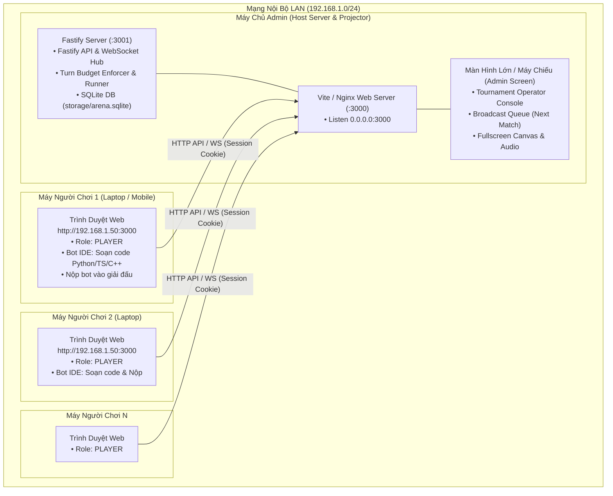

# Thiết Kế Kỹ Thuật: Kiến Trúc LAN Client-Server, Phân Quyền Admin/Player & Vận Hành Giải Đấu Nội Bộ

> **Tài liệu Thiết kế Kỹ thuật (Technical Design Document)**  
> **Dự án:** OanTuTi Arena (LAN Multiplayer & Role-Based Access Control)  
> **Ngày lập:** 2026-10-13  
> **Trạng thái:** Chờ kiểm duyệt & phê duyệt (Pending Review & Approval)

---

## 1. Mục Đích & Bối Cảnh (Intent & Why)

Hiện tại, hệ thống OanTuTi Arena đã có đầy đủ Engine đối kháng, Runner thực thi code đa ngôn ngữ (Python, TypeScript, C++20), WebSocket streaming, bảng xếp hạng ELO, thể thức giải đấu Thụy Sĩ (Swiss System) và Vòng tròn (Round-Robin).

Tuy nhiên, hệ thống ban đầu chủ yếu vận hành cục bộ trên cùng một máy (local single-seat), chưa phân tách rõ ràng vai trò giữa **Ban tổ chức (Admin)** và **Người chơi (Player)** trong một buổi thi đấu qua mạng nội bộ (LAN):
- Trong mạng LAN, người tổ chức (Admin) chạy máy chủ trung tâm và kết nối máy chiếu/TV cho cả phòng xem.
- Nhiều người chơi (Player) từ máy tính xách tay cá nhân trong cùng mạng LAN kết nối vào hệ thống qua địa chỉ IP hoặc domain nội bộ (`http://<LAN_IP>:3000`).
- Người chơi tự đăng ký tài khoản cá nhân, lập trình/nộp mã nguồn bot vào giải đấu mà **không cần cài đặt môi trường biên dịch (Node/Python/G++) trên máy mình**.
- Ban tổ chức sở hữu tài khoản Admin tạo sẵn mặc định để duyệt thí sinh, chốt danh sách, bấm kích hoạt giải và trình chiếu từng trận đấu cho toàn thể khán giả.

Tài liệu này thiết kế kiến trúc toàn diện cho mô hình LAN Client-Server, cơ chế phân quyền RBAC (Role-Based Access Control) gồm 2 vai trò `ADMIN` và `PLAYER`, cùng kế hoạch cập nhật đồng bộ toàn bộ bộ tài liệu đặc tả (`docs/specs/`).

---

## 2. Mục Tiêu, Phi Mục Tiêu & Chống Mục Tiêu (Goals, Non-Goals & Anti-Goals)

### 2.1. Mục Tiêu (Goals)
1. **Kết nối mạng LAN thông suốt (Zero-Config LAN Client):**
   - Server Fastify và Web Frontend bind trên `0.0.0.0` thay vì chỉ `127.0.0.1`.
   - Kết nối WebSocket và HTTP API trên Frontend tự động nhận diện theo `window.location.host`, hoạt động ngay lập tức với bất kỳ IP mạng LAN (`192.168.x.x`, `10.x.x.x`) hoặc hostname/domain nội bộ mà không cần cấu hình lại code.
2. **Hệ thống phân quyền 2 vai trò (Two-Tier RBAC):**
   - Vai trò được phân định nghiêm ngặt: `ADMIN` và `PLAYER`.
   - **Tài khoản Admin tạo sẵn mặc định (Seeded Default Admin):** Khi máy chủ khởi động lần đầu, hệ thống tự động tạo sẵn tài khoản quản trị viên (ví dụ `username: admin`, mật khẩu mặc định `admin123` hoặc cấu hình qua biến môi trường `ADMIN_PASSWORD`). Admin không cần và không cho phép đăng ký lại.
   - **Người chơi tự đăng ký (Player Self-Registration):** Tất cả tài khoản tạo mới qua API `/api/auth/register` hoặc form đăng ký Web đều bắt buộc có vai trò `PLAYER`. Người dùng không thể tự phong quyền Admin cho mình.
3. **Ma trận phân quyền API & Giao diện (Authorization Matrix):**
   - **Quyền của ADMIN:**
     - Tạo giải đấu mới (`POST /api/tournaments`).
     - Khóa danh sách đăng ký và kích hoạt ghép cặp / khởi chạy giải (`POST /api/tournaments/:id/lock`).
     - Điều khiển hàng đợi trình chiếu trận đấu trên máy chiếu (`Next Match`).
     - Xem và quản lý toàn bộ trận đấu, giải đấu, danh sách người tham gia.
   - **Quyền của PLAYER:**
     - Đăng ký tài khoản, đăng nhập, quản lý phiên.
     - Sử dụng Bot IDE để viết, kiểm thử (Run Test) và lưu phiên bản bot cá nhân.
     - Nộp bot cá nhân vào các giải đấu đang mở đăng ký (`POST /api/tournaments/:id/entries`).
     - Xem bảng xếp hạng ELO, danh sách giải đấu, lịch thi đấu và xem lại các trận đã công khai.
     - **Bị cấm (403 Forbidden):** Không được tạo giải đấu, không được chốt danh sách/ghép cặp giải đấu, không được can thiệp vào tiến trình điều khiển trình chiếu của Admin.
4. **Bảo mật mã nguồn thí sinh (Source Code Privacy):**
   - Mỗi người chơi chỉ được xem và chỉnh sửa mã nguồn bot thuộc sở hữu của mình (`user_id === session.user.id`).
   - Các thí sinh đối thủ không thể xem trộm code bot của nhau qua API.
5. **Cập nhật đồng bộ các tài liệu đặc tả chuẩn (`docs/specs/`):**
   - Cập nhật 6 tài liệu đặc tả cốt lõi (`01-PRD-GDD`, `02-SYSTEM-ARCHITECTURE`, `05-DATA-MODELS-DATABASE-SPEC`, `06-UI-UX-VISUALIZER-SPEC`, `07-TEST-PLAN-QA-SPEC`, `08-PROJECT-ROADMAP-WBS`) để chuẩn hóa kiến trúc LAN Client và RBAC.

### 2.2. Phi Mục Tiêu (Non-Goals)
- Không triển khai chứng chỉ SSL/TLS công khai (HTTPS/WSS công cộng); mạng LAN chấp nhận HTTP/WS thông thường hoặc reverse proxy nội bộ.
- Không xây dựng hệ thống phân quyền phức tạp nhiều tầng (như Moderator, Judge, VIP); chỉ tập trung 2 vai trò `ADMIN` và `PLAYER`.
- Không hỗ trợ soạn thảo code đồng thời dạng Google Docs (mỗi người chơi làm việc trên workspace riêng của mình).

### 2.3. Chống Mục Tiêu (Anti-Goals)
- Tránh việc thí sinh phải cài đặt trình biên dịch hoặc runtime (Python, Node, G++, Docker) trên máy client cá nhân. Toàn bộ việc biên dịch, thực thi và chấm điểm trận đấu diễn ra tập trung tại máy chủ Admin.
- Tránh tình trạng người chơi gọi API ngoài luồng để tự khởi chạy hoặc hủy giải đấu của Admin.

---

## 3. Kiến Trúc Kỹ Thuật Chi Tiết (Detailed Technical Architecture)

### 3.1. Sơ Đồ Kiến Trúc Mạng LAN (LAN Network Topology)

### 3.2. Mô Hình Dữ Liệu & Khởi Tạo Admin Mặc Định (Database & Seed)

1. **Bảng `users`:**
   - Trường `role`: Chuẩn hóa giá trị thành `TEXT NOT NULL DEFAULT 'PLAYER' CHECK (role IN ('ADMIN', 'PLAYER'))`.
2. **Khởi tạo Admin mặc định (`ensureAdminUser`):**
   - Khi khởi động `Database` (`packages/server/src/db.ts`), hệ thống kiểm tra nếu chưa có tài khoản username `admin`:
     - Tự động tạo tài khoản:
       - `id`: `usr_admin_default`
       - `username`: `admin` (hoặc cấu hình qua biến môi trường `ADMIN_USERNAME`)
       - `email`: `admin@oantuti.arena`
       - `password_hash`: Băm scrypt bảo mật của mật khẩu `admin123` (hoặc biến môi trường `ADMIN_PASSWORD`)
       - `role`: `ADMIN`
   - Tài khoản `system` (`usr_system`) tiếp tục được bảo vệ làm tài khoản định danh cho các bot hệ thống và không cho phép đăng nhập qua web.

### 3.3. Cơ Chế Xác Thực & Phân Quyền Backend (`AuthService`)

1. **Phương thức kiểm tra quyền trong `auth.ts`:**
   - `requireUser(request)`: Xác thực phiên đăng nhập hợp lệ của người dùng (trả về `UserRow`).
   - `requireAdmin(request)`: Xác thực người dùng phải đăng nhập **VÀ** có `role === 'ADMIN'`. Nếu vi phạm, ném lỗi `HttpError(403, 'Forbidden: Admin privilege required')`.
2. **Phân quyền tại các Endpoint API:**
   - `POST /api/auth/register`: Mọi tài khoản mới luôn nhận `role = 'PLAYER'`. Tham số `role` nếu gửi lên trong body sẽ bị loại bỏ hoặc cấm.
   - `POST /api/tournaments`: Yêu cầu `requireAdmin(request)`.
   - `POST /api/tournaments/:id/lock`: Yêu cầu `requireAdmin(request)`.
   - `POST /api/tournaments/:id/project-next`: Yêu cầu `requireAdmin(request)`. Mỗi lần Admin bấm chuyển trận trên máy chiếu, endpoint này tăng chỉ số `projectedIndex` của giải đấu trên server.
   - `POST /api/tournaments/:id/entries`: Yêu cầu `requireUser(request)` (cả Admin và Player đều có thể nộp bot của mình).
   - `GET /api/tournaments/:id`:
     - **Đối với ADMIN:** Trả về đầy đủ toàn bộ các trận đấu và bảng tổng sắp hoàn chỉnh.
     - **Đối với PLAYER (Cơ chế Chống Lộ Kết Quả - Anti-Spoiler):** Hệ thống chỉ tiết lộ các trận đấu và điểm số đến vị trí `projectedIndex` mà Admin đã bấm chiếu. Các trận chưa được chiếu sẽ bị ẩn kết quả, và bảng xếp hạng trên màn hình Player được tính toán đồng bộ theo nhịp máy chiếu của Admin.
   - `GET /api/bots`: Chỉ trả về danh sách bot thuộc sở hữu của người dùng đang đăng nhập (`where user_id = ?`). Thí sinh không thể xem source code bot của đối thủ.
   - `POST /api/bots`, `PUT /api/bots/:id`: Yêu cầu `requireUser(request)` và kiểm tra quyền sở hữu bot.
### 3.4. Trải Nghiệm Giao Diện Người Dùng (Frontend UI/UX)

1. **Huy hiệu phân quyền (Role Badges):**
   - Góc trên bên phải hiển thị tên người dùng kèm huy hiệu:
     - `👑 Admin` (Màu vàng ánh kim `#facc15` trên nền đen/vàng)
     - `🎮 Player` (Màu xanh neon `#38bdf8` trên nền tối)
2. **Phân nhánh giao diện Giải đấu (`LeaderboardView.tsx`):**
   - **Đối với Player:**
     - Nút **"+ Create"** tạo giải đấu bị ẩn hoàn toàn.
     - Trong chi tiết giải đấu đang mở (`PENDING`): Hiển thị phần "Đăng ký tham gia giải", cho phép chọn bot cá nhân và bấm "Nộp bot tham gia".
     - Nút "Chốt danh sách & ghép cặp" và Bảng điều khiển "Trận đấu tiếp theo (Next Match)" bị ẩn hoàn toàn.
     - Sau khi giải chạy: Người chơi theo dõi bảng xếp hạng (Standings) và danh sách trận đấu trên máy cá nhân được mở khóa dần theo nhịp Admin bấm chiếu trên máy chiếu.
   - **Đối với Admin:**
     - Hiển thị đầy đủ nút **"+ Create"** tạo giải đấu.
     - Hiển thị số lượng thí sinh đã nộp bot, nút **"Chốt danh sách & ghép cặp"**.
     - Hiển thị bảng điều khiển trình chiếu **Tournament Operator Deck** với nút bấm **"Trận đấu tiếp theo (Next Match)"** (gọi `POST /api/tournaments/:id/project-next`) và chế độ phóng to toàn màn hình (Theater/Fullscreen) để nối ra máy chiếu/TV.

---

## 4. Kế Hoạch Cập Nhật Tài Liệu Đặc Tả (`docs/specs/`)

Trước khi viết mã triển khai, các tài liệu đặc tả sau sẽ được cập nhật đồng bộ:

1. **`docs/specs/01-PRD-GDD.md`:**
   - Bổ sung Mục 1.4: "Mô hình Sử dụng Thi đấu Mạng LAN & Phân Quyền Người Dùng".
   - Đặc tả hành trình người dùng: Admin (Host & Trình chiếu) vs Player (Client nộp bot).
2. **`docs/specs/02-SYSTEM-ARCHITECTURE.md`:**
   - Cập nhật Kiến trúc Hệ thống: Bổ sung sơ đồ phân tầng mạng LAN Client-Server.
   - Mô tả ranh giới bảo mật mạng LAN, cấu hình lắng nghe `0.0.0.0` và xử lý kết nối WebSocket động.
   - Định nghĩa tầng xác thực và phân quyền RBAC (`ADMIN` vs `PLAYER`).
3. **`docs/specs/05-DATA-MODELS-DATABASE-SPEC.md`:**
   - Cập nhật bảng `users`: Bổ sung định nghĩa trường `role` (`ADMIN`, `PLAYER`), lược đồ seed tài khoản Admin mặc định (`usr_admin_default`).
   - Cập nhật các bảng quan hệ liên quan đến phân quyền giải đấu.
4. **`docs/specs/06-UI-UX-VISUALIZER-SPEC.md`:**
   - Đặc tả giao diện phân quyền: Giao diện màn hình Admin (Operator & Projector View) vs Giao diện màn hình Player (Participant View).
   - Mô tả huy hiệu nhận diện vai trò và cơ chế ẩn/hiện điều khiển giải đấu.
5. **`docs/specs/07-TEST-PLAN-QA-SPEC.md`:**
   - Bổ sung kịch bản kiểm thử RBAC: Xác thực bảo mật (Player không thể tạo giải hoặc khóa danh sách, API trả về 403 Forbidden).
   - Kiểm thử seed tài khoản Admin và kiểm thử đăng ký tài khoản Player trong mạng LAN.
6. **`docs/specs/08-PROJECT-ROADMAP-WBS.md`:**
   - Bổ sung gói công việc WBS cho hạng mục "LAN Client-Server & RBAC Architecture".

---

## 5. Rủi Ro, Ràng Buộc & Biện Pháp Kiểm Soát (Risks & Mitigations)

| Rủi ro | Mức độ | Biện pháp kiểm soát |
| --- | --- | --- |
| Địa chỉ IP mạng LAN thay đổi khi đổi mạng Wi-Fi | Thấp | Frontend tự động lấy `window.location.host` và `window.location.protocol`, không phụ thuộc vào IP cứng. Chỉ cần máy Admin truy cập vào IP mạng của mình là các client khác cùng dải mạng truy cập được ngay. |
| Người chơi gọi curl/API trực tiếp để tạo giải hoặc can thiệp giải | Trung bình | Backend kiểm tra chặt chẽ `requireAdmin` ở middleware route; mọi request không có cookie của Admin đều bị từ chối với HTTP 403. |
| Thí sinh xem lén mã nguồn bot của nhau | Trung bình | Query `GET /api/bots` lọc cứng theo `user_id` của phiên đăng nhập; API trả về danh sách bot tham gia giải đấu chỉ bao gồm metadata (`id`, `name`, `language`, `version`), tuyệt đối không bao gồm `source_code`. |
| Trùng lặp tài khoản Admin | Thấp | `ensureAdminUser` chỉ khởi tạo khi username `admin` chưa tồn tại trong cơ sở dữ liệu. Mật khẩu mặc định có thể ghi đè linh hoạt qua biến môi trường `ADMIN_PASSWORD`. |

---

## 6. Việc Bàn Giao Lại Cho Lập Trình Viên (Left to Builder)

- Lựa chọn bảng màu và animation hiển thị cho huy hiệu `👑 Admin` và `🎮 Player` trên thanh điều hướng đầu trang.
- Câu thông báo tiếng Việt trực quan khi Player cố gắng truy cập tính năng bị hạn chế.
